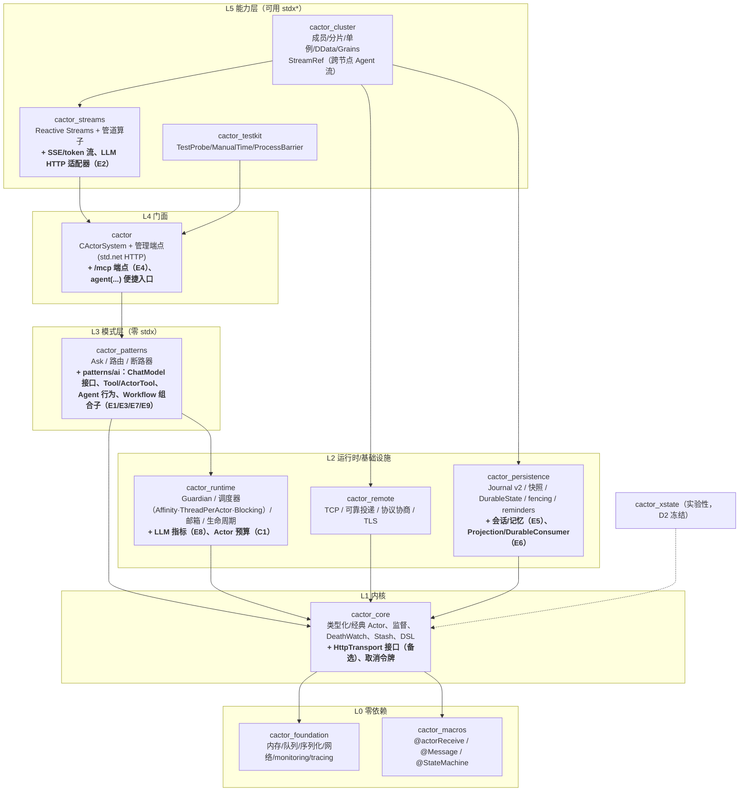
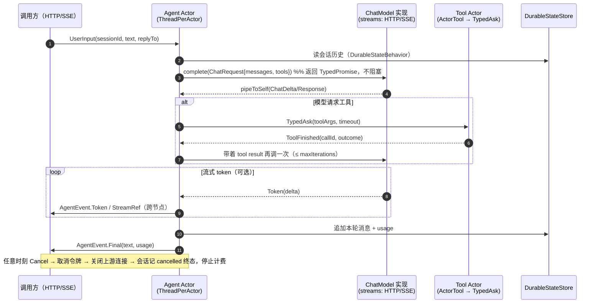
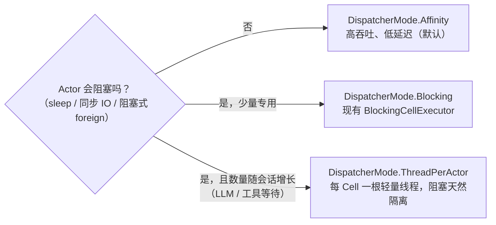

# CActor 面向未来的分布式 Actor 平台：架构 / 性能 / 稳定性 / 并发 / AI 接入 全面分析与完善计划（2026-11-17，v2）

> **v2 修订（同日）**：本版基于三件事重写，v1 的结论有两处需要修正：
>
> 1. **补齐仓颉语言事实**（`references/concurrency-io.md`、`stdx.md`、`macros-ffi.md`）：
>    **仓颉线程是用户态轻量级线程、M:N 模型、支持抢占；线程阻塞时 native 线程会切去执行其他就绪线程**
>    （例外：阻塞式 `foreign` C 调用会占住 native 线程）。v1 写的"无抢占＝硬约束"**只说对了框架层**，
>    漏掉了语言层已有抢占与轻量线程——这改变了对 A 组（并发）的判断，并带出一个新的架构选项
>    （thread-per-actor 调度模式）。
> 2. **AI 不做成独立库**（按要求）：AI 能力**内建在现有 5 层**
>    （`patterns` / `streams` / `persistence` / `cluster` / `cactor` 门面），v1 提的 `cactor_ai` 模块**撤销**。
> 3. **补架构图**：§4.6 给出分层架构、AI 能力落点、一次 Agent 轮次的时序图（Mermaid）。
>
> **本文与既有计划的分工**（互不重复）：
>
> | 文档 | 回答什么 | 口径 |
> |---|---|---|
> | `docs/plan/20261106.md` | 44 项主计划 | 唯一计分表 |
> | `docs/plan/20261116.md` | 删假批次 B1–B7 | 工程纪律 |
> | `docs/plan/20261117.md` | 46 条能力清单对标（✅20 / 🟡9 / ❌17） | 功能有无 |
> | `docs/plan/2026117-lz.md` | 5 个真实示例（E1–E5）、Lou 承载 HTTP、G-1/G-2/G-3 | 应用验证 |
> | **本文** | **纵深版**：架构、并发模型、性能、稳定性、**AI 接入能力** | 平台工程 |
>
> 方法：代码级通读 + 可复制命令取证（§8）+ 仓颉语言事实（§2.6，逐条注明来源文件）+
> 既有实测数据（注明日期与机器）。对标 Akka/Pekko（含 Akka SDK 的 agentic 方向）、protoactor-go、Erlang/OTP。

---

## 1. 结论摘要

### 1.1 五维评分（v2 修订）

| 维度 | v1 | **v2** | 依据 |
|---|---|---|---|
| 架构与设计 | 70% | **72%** | 分层无环、门禁严格；门面未收敛（7 个 `ActorSystem` 类型）、`xstate` 4,878 行（36 处占位词，全库最高）、`patterns` 层薄 |
| 并发模型 | 65% | **78%↑** | **语言层已有 M:N 轻量线程 + 抢占 + 阻塞自动让渡**，比 v1 判断好得多；真正缺口是"框架没利用这个能力"（只提供亲和池）与"无阻塞检测/隔离" |
| 性能 | 80% | **80%** | 单 Actor 14M msg/s、P50 1.0µs（优于 Akka）；扇出 17M vs Akka 32M；序列化类型全名、无压缩 |
| 稳定性 | 72% | **72%** | 13 项机制（2 项半成品）；缺全局 Actor 预算、tell 路径端到端背压、集群 drain |
| AI 接入能力 | 15% | **18%** | 库层仍为 0，但**底座够用**：Actor=Agent、Ask=工具、StreamRef=流式 token、DurableState=会话、reminders=定时；缺的是"接口 + 约定 + 少量算子" |

> 一句话：**语言给的比框架用的多。** 仓颉已经提供抢占式轻量线程与阻塞让渡，
> CActor 只用了"亲和线程池"这一种用法；而 AI 的"长调用 + 多会话"负载，
> 正好是 thread-per-actor 最擅长的场景。

### 1.2 三条主线（v2 修订）

1. **主线 A：把语言能力用起来（并发）** —— 提供三种调度模式并给出选择依据：
   `Affinity`（现状，高吞吐低延迟）、`ThreadPerActor`（轻量线程，阻塞天然隔离，适合 LLM/IO 密集）、
   `Blocking`（已有）。**这是本版最大的新增项**，也是 AI 负载的落地前提。
2. **主线 B：AI 接入能力内建（不新建库）** —— `patterns` 定义模型/工具/Agent 三个接口与行为组合子；
   `streams` 提供 SSE/token 流算子；`persistence` 提供会话/记忆/投影/持久消费者；
   `cluster` 复用 StreamRef 做跨节点；`cactor` 门面暴露 `agent(...)`。**零新模块。**
3. **主线 C：架构收敛与稳定性补口** —— 门面收敛（E49）、`xstate` 去留、全局 Actor 预算、
   tell 路径端到端背压、集群 graceful drain、序列化短 id + 压缩。

### 1.3 与既有计划的关系

| 本文条目 | 关系 |
|---|---|
| A1–A6（并发/调度） | **全新**；A1（调度模式）是 v2 新增，取代 v1 的"无抢占"论述 |
| B1–B4（性能） | 补 `20261117.md` §2.3 的短板分析，给出可验收目标 |
| C1–C5（稳定性） | 与 `20261117.md` 4.4/4.8/4.13 部分重叠，本文只补"全局预算/端到端背压/drain"并交叉引用 |
| D1–D4（架构） | D1 即 `20261116.md` B5（E49），本文补"收敛成什么形态" |
| **E1–E9（AI 接入）** | **v2 重写**：从"新建 `cactor_ai`"改为"内建五层"；与 `2026117-lz.md` 的 G-1/G-2/G-3 对接 |

---

## 2. 现状基线（全部可核对）

### 2.1 规模与构成

| 模块 | 行数 | 文件 | 说明 |
|---|---|---|---|
| foundation | 11,912 | 47 | 零依赖：内存/队列/序列化/网络/monitoring/tracing |
| core | 12,373 | 52 | Actor 内核：类型化 + 经典、监督、上下文、DSL |
| runtime | 9,588 | 30 | 调度器、Guardian、邮箱、生命周期（B4c 后） |
| patterns | 2,326 | 12 | Ask / 路由 / 断路器 / spawn protocol |
| streams | 5,967 | 19 | Reactive Streams 全套 + 管道算子 |
| remote | 3,250 | 5 | TCP 传输、可靠投递、协议协商、TLS |
| persistence | 6,506 | 25 | Journal v2 / 快照 / DurableState / fencing / reminders |
| cluster | 13,769 | 23 | 成员 / 分片 / 单例 / PubSub / DData / StreamRef / Grains |
| testkit | 2,141 | 7 | TestProbe / ManualTime / ProcessBarrier |
| cactor | 1,835 | 15 | 门面：`CActorSystem` / 管理端点（`std.net` 手写 TCP） |
| xstate | 4,878 | 17 | 状态机（**36 处占位词，全库最高**） |
| macros | 1,299 | 6 | `@actorReceive` / `@Message` / `@StateMachine` |
| **库合计** | **75,843** | 243 | 占位词 122、死包 9、`@Deprecated` 50 |
| tests | 31,229 | 140 | 918 个用例 |
| examples | 17,174 | 64 目录 | 门禁运行 47 个 |

### 2.2 并发模型（v2 重写：语言层 vs 框架层）

v1 把两层混为一谈，导致"无抢占"的错误结论。分开说：

**语言层（仓颉 1.2.0，来源 `references/concurrency-io.md` §1.1）**

| 事实 | 对架构的含义 |
|---|---|
| 仓颉线程是**用户态轻量级线程，M:N 模型，支持抢占** | 可以有大量"线程"；单个 actor 死循环不会冻结整个运行时 |
| 线程阻塞（等锁、网络 IO、`sleep`）时，**native 线程会切去执行其他就绪的仓颉线程** | 阻塞只让当前这根仓颉线程停下，不是内核线程被占死 |
| 例外：**阻塞式 `foreign` C 函数会占住 native 线程** | 经 C SDK 接 LLM（部分厂商）时要当心 |
| 取消是**协作式**（`Thread.currentThread.hasPendingCancellation`） | 长调用的取消必须由实现主动检查；CActor 的 ask 取消令牌已符合该模型 |
| 无 `async/await`；并发原语是 `spawn`/`Future`、`Mutex`/`Condition`/`ReadWriteLock`/`Semaphore`/`Barrier`/`Timer`、`std.collection.concurrent` | 设计上不要照搬 Kotlin/Swift 协程写法 |
| 结构化并发 `std.concurrent.threadScope` / `ThreadGroup` | 可用于 Agent 的子任务编排 |

**框架层（CActor 当前实现）**

| 事实 | 代码位置 | 含义 |
|---|---|---|
| 默认调度器是**亲和池**：actor → 固定 worker 线程 | `runtime/src/guardian/actor_cell.cj:3090` `ActorCellDispatcher` | 一个 worker 只承载一根仓颉线程，其上的 actor **串行共享** |
| 每 worker 私有就绪队列；空闲自旋 50µs 再休眠 | 同上（`CACTOR_DISPATCHER_SPIN_US`） | 低唤醒延迟；空转耗 CPU |
| worker 数 = 核数/4（4–64） | `CACTOR_DISPATCHER_THREADS` | 14 核默认 4 线程 |
| 每次调度最多 64 条消息（**actor 级协作让出**） | `CACTOR_DISPATCHER_THROUGHPUT` | 不是时间片；条数到点就让出 |
| 空闲 worker"举手捐赠"、忙 worker 按需扫描窃取 | `hungryCount`/`donateSeq`/`runNextPending`（:3108–3116） | 保守窃取，避免跨核读风暴 |
| 饥饿检测 | `starvationCount`（:3117） | 已有信号，但只计数不处置 |
| 独立阻塞调度器 | `BlockingCellExecutor`（:3392） | 用户显式 `withDispatcher("blocking")` |
| Actor 线程标识 + `askInbox` 阻塞报错 | `actorThreadFlag`（:93） | 已挡住一类错误写法 |

> **v2 结论（修正 v1）**：
> ① **不是"没有抢占"**，而是"**actor 级迁移靠吞吐配额，线程级抢占由语言提供**"；
> ② 阻塞的真实后果是**同一 worker 上的其他 actor 被拖慢**（不是整个系统停摆）；
> ③ 因此**thread-per-actor 在仓颉上可行且廉价**——这是 AI 负载（长 LLM 调用、工具等待）最自然的形态，
>    而 CActor 目前没有提供这个选项。**这是本版最重要的新发现。**

### 2.3 性能实测（`bench/results/baseline-darwin-arm64-14.json`，2026-11-05，macOS arm64 14 核，T4）

| 指标 | 当前 | 历史对标（2026-11-01） |
|---|---|---|
| 单 Actor 吞吐 | **14.0M msg/s** | CActor 9.43M ｜ protoactor 3.67M ｜ Akka 8.58M |
| 扇出 8×100 | **17.0M msg/s** | CActor 10.65M ｜ protoactor 22.26M ｜ **Akka 32.01M** |
| 多对 ping-pong | **55.0M msg/s** | 55.4M ｜ 67.0–71.7M ｜ — |
| 类型化互发 | **25.0M msg/s** | 4.74M（`@Frozen` 热路径优化后大幅提升） |
| ping-pong P50/P99 | **1.0 / 2.0 µs** | 1.0/2.0 ｜ 10.5/28.5 ｜ 2.25/8.75 |
| 100 万 Actor 创建/排空/停止 | **1100 / 400 / 2000 ms** | — |
| 每 Actor 存活堆 | **1,200 B** | — |

### 2.4 稳定性机制清单

| 机制 | 位置 | 覆盖 |
|---|---|---|
| 监督树（OneForOne/OneForAll/Escalate/退避） | `core/src/supervision/` | ✅ 默认策略与 Akka 一致 |
| DeathWatch（`watch`/`unwatch`/`watchWith`） | `core/src/actor/actor_context.cj:109–119` | ✅ |
| 死信 | `DeadLetter`（`message/message.cj:262`）+ `DeadLetterRef`（`actor_ref.cj:219`） | ✅ |
| 邮箱溢出策略 | `DropNew`/`Fail`/`Block(Duration)`（`actor/actor.cj:238–246`） | ✅ 三种 |
| 有界邮箱 | `Props.bounded(...)`（`actor.cj:303`） | ✅ 单 Actor 级 |
| Stash / Timers | `core/src/typed/typed_timers_stash.cj` | ✅ |
| 可注入调度器（虚拟时钟） | `ActorScheduler` + `testkit/ManualTime` | ✅ 优于多数框架 |
| 脑裂（SBR 5 策略，纯函数决策） | `cluster/src/membership/sbr.cj:23/60` | ✅ |
| 隔离 + 实例唯一标识 | `remote/src/remoting.cj` | ✅ |
| 全节点字节/通道/对端预算 | `remoting.cj` + `foundation/src/network/transport.cj` | ✅ 少见 |
| 持久化原子写 + fsync + CRC + fencing | `persistence/src/journal_v2.cj` / `fencing.cj` | ✅ |
| 协调关闭分阶段 | `runtime/src/lifecycle/coordinated_shutdown.cj:43` | 🟡 有阶段，**未与集群 leave 接线** |
| 端到端背压 | StreamRef ✅；普通 tell ❌ | 🟡 半成品 |

### 2.5 AI 能力现状（库层为 0，底座齐备）

| 能力 | 12 个库内 | 示例层 |
|---|---|---|
| Agent 抽象 | **0**（唯一 "Agent" 是 `persistence/src/durable_state.cj:5` 的一句注释） | `dsl_agent`、`best10`、`agent_orchestration_demo`、`real01` |
| LLM 客户端 | **0**（大小写敏感 `LLM` 11 次，全在 `streamref/*` 注释） | `llm_http_demo`、`llm_token_stream`、`real01` |
| Tool / ToolRegistry | **0**（`\bTool\b` 零命中） | 各示例自带 `ToolActor` |
| MCP / Embedding / Prompt / Guardrail / RAG / Projection | **全部 0** | 0 |
| Workflow（可恢复编排） | **0**（`xstate.createWorkflowTemplate` 只是状态机模板） | `real05` 自拼 |
| 持久订阅（Durable Consumer） | **0**（PubSub 不持久） | 0 |
| Token/成本计量 | 0（`Token` 命中均为类型名/流式 token） | 各示例自统计 |

> 结论：**底座够用，接口缺失**。这正是"不新建库、内建接入"能成立的依据。

### 2.6 仓颉语言能力基线（架构决策依据）

| 能力 | 结论 | 来源 | 对本文的影响 |
|---|---|---|---|
| 线程模型 | 用户态轻量线程，M:N，**可抢占** | `references/concurrency-io.md` §1.1 | A1 新增 thread-per-actor 模式 |
| 阻塞行为 | 阻塞时 native 线程切换；`foreign` C 阻塞例外 | 同上 | A1b 需对 FFI 告警 |
| 取消 | 协作式（`hasPendingCancellation`） | 同上 §1.4 | E2/E7 的取消必须主动检查 |
| 结构化并发 | `std.concurrent.threadScope`、`ThreadGroup` | 同上 §1.8 | Agent 子任务编排可用 |
| 同步原语 | `Mutex`（可重入）/`Condition`/`ReadWriteLock`/`Semaphore`/`Barrier`/`Timer` | 同上 §2 | 无需自造 |
| 并发集合 | `ConcurrentHashMap`/`LinkedBlockingQueue`/`ArrayBlockingQueue`/`ConcurrentLinkedQueue` | 同上 §3 | tellBatch/背压可复用 |
| HTTP | `stdx.net.http`：客户端 + 服务端 + WebSocket，HTTP/1.1 与 2 | `references/stdx.md` §1 | LLM/MCP 传输有官方实现 |
| JSON | `stdx.encoding.json` + **流式** `encoding.json.stream` | 同上 §2 | 工具参数/结构化输出 |
| 压缩 / TLS / 日志 | `stdx.compress` / `stdx.net.tls` / `stdx.log` | 同上速查表 | B3 压缩、TLS 已用 |
| FFI | `foreign`、`@C`、`CPointer`、回调；阻塞 C 调用占住 native 线程 | `references/macros-ffi.md` | 接 C 版 LLM SDK 的注意点 |
| `@Frozen` | **承诺实现不再变化**（二进制演进），可修饰全局/成员/构造/属性 | 同上 §7 | CActor 用它做跨包泛型展开（见 `cactor_system_api.cj:228` 注释） |
| 无 async/await | 并发靠线程 + Future | `references/concurrency-io.md` | 不要照搬协程范式 |
| stdx 分层约束 | `STDX_ALLOWED` 仅 remote/cluster/tests/examples | `tools/check_module_deps.py:26` | **决定 AI 接入落点**（§4.5） |

---

## 3. 对标矩阵

### 3.1 并发模型（v2 修正）

| 维度 | CActor | Akka/Pekko | protoactor-go | Erlang/OTP |
|---|---|---|---|---|
| 执行单元 | Actor → 固定 worker（亲和池；可扩展 thread-per-actor） | Actor → dispatcher（可插拔） | **每 actor 一个 goroutine** | 每 actor 一个轻量进程 |
| 语言层调度 | **M:N 轻量线程 + 抢占**（仓颉） | JVM 线程（虚拟线程可选） | Go runtime 抢占 | **reduction 抢占** |
| 框架层调度 | 协作让出（吞吐 64） | 协作让出（throughput） | 无需（goroutine 自由调度） | 无需 |
| 阻塞影响 | 同 worker 的 actor 变慢（选 thread-per-actor 可消除） | 同 dispatcher 线程 | 只阻塞该 goroutine | 完全隔离 |
| 阻塞隔离手段 | 亲和池 / blocking dispatcher / **待加 thread-per-actor** | dedicated dispatcher | 天然 | 天然 |
| GC | 全局 GC（宿主） | JVM 分代 | Go 并发 GC | **per-process GC** |
| 内存/单元 | 1,200 B | 数百 B | ~KB（goroutine 栈） | ~KB |
| 阻塞检测 | `askInbox` 报错 + 饥饿计数 | 无内建 | 无 | `system_monitor` |

> **v2 结论**：CActor 的"语言层"与 protoactor-go 同档（都有抢占、都有轻量执行单元），
> 差的是"框架层没把 thread-per-actor 作为一等模式"。这比 v1 乐观，也更可操作。

### 3.2 调度与性能

| 能力 | CActor | Akka | protoactor-go | 差距项 |
|---|---|---|---|---|
| 亲和/固定线程 | ✅ 默认 | ✅ `AffinityPool` | ❌ | — |
| **thread-per-actor** | ❌ | 🟡（虚拟线程可模拟） | ✅（goroutine） | **A1** |
| 工作窃取/捐赠 | 🟡 保守按需 | ✅ fork-join | — | A2 |
| 吞吐配额 | ✅ 64 可调 | ✅ | — | — |
| 批量投递 | ❌ | 🟡 `BatchingExecutor` | ❌ | A3 |
| 线上压缩 | ❌ | 🟡 Artery 可选 | 🟡 gRPC | B3 |
| 零拷贝线上路径 | ❌（`ZeroCopyMessageImpl` 仅本地） | 🟡 | — | B2 |
| 扇出吞吐 | 17M | 32M | 22M | A2/A3 |
| 单 Actor 吞吐 | **14M** | 8.6M | 3.7M | ✅ 领先 |
| 延迟 P50 | **1.0 µs** | 2.25 µs | 10.5 µs | ✅ 领先 |

### 3.3 稳定性

| 能力 | CActor | Akka | Orleans | 差距项 |
|---|---|---|---|---|
| 监督树 + 退避 | ✅ | ✅ | 🟡 | — |
| 有界邮箱 + 溢出策略 | ✅ 3 种 | ✅ | ✅ | — |
| 全局 Actor 预算 | ❌（`maxActors` 在死路径上） | 🟡 `max-total-nr-of-actors` | ❌ | C1 |
| 端到端背压（tell 路径） | ❌ | ✅ Streams | 🟡 | C2 |
| 集群级 graceful drain | 🟡 阶段已定义未接线 | ✅ | ✅ | C3 |
| 分片状态持久化 | ❌ | ✅ `sharding-state` | ✅ | 交叉引用 `20261117.md` 4.4 |
| 运行时自愈 | 🟡 有指标无动作 | 🟡 | ✅ | C5 |

### 3.4 架构与设计

| 维度 | CActor | 评价 |
|---|---|---|
| 模块分层 | 无环、`check_module_deps.py` 门禁、stdx 白名单 | ✅ 优于多数开源项目 |
| 公开 API 稳定性 | 快照 + 弃用生命周期 + semver 门禁 | ✅ |
| 门面收敛 | 7 个 `ActorSystem` 类型、3 个创建入口 | ❌ D1（= E49） |
| 重复能力 | `xstate` vs `@StateMachine` | 🟡 D2 |
| `patterns` 层厚度 | 2,326 行 | 🟡 D3（也是 AI 接入落点） |
| 配置体系 | `LayeredConfig` 一套 | ✅ |
| 可观测性 | Prometheus 仅运行时指标；无 trace 传播 | 🟡 交叉引用 `20261117.md` 4.10 |

### 3.5 AI 时代能力（按 Akka SDK 结构对照，标注落点）

> Akka SDK 组件结构：**Agent / Entity（Event Sourced、Key Value）/ View / Workflow / Consumer /
> Timed Action / Endpoint**，外加 Agent 记忆、工具调用、MCP 暴露、LLM 可观测性。
> 下表按这个结构对照 CActor 的**落点**（v2 不另建模块）。

| Akka SDK 概念 | CActor 现有底座 | 落到哪一层（v2 方案） | 状态 |
|---|---|---|---|
| Event Sourced Entity | `EventSourcedActor` / `EventSourcedBehavior` | 已有（core + persistence） | ✅ |
| Key Value Entity | `DurableStateBehavior` | 已有（persistence） | ✅ |
| Timed Action | `persistence/reminders` | 已有 | ✅ |
| **Agent** | 类型化 Actor + `pipeToSelf` + DurableState | **`patterns/ai`**（行为组合子）+ `cactor` 门面 | ❌ E1 |
| **LLM 客户端** | `stdx.net.http` + `TypedRetry` + 取消令牌 | **`patterns/ai` 接口** + **`streams` 传输实现** | ❌ E2 |
| **工具调用** | `TypedAsk` + 监督 + 断路器 | **`patterns/ai`**（`ActorTool`） | ❌ E3 |
| **MCP** | `std.net` HTTP（门面已有）+ JSON-RPC | **`cactor` 门面挂 `/mcp`**（复用已有 HTTP 栈） | ❌ E4 |
| **View / Projection** | `journal_v2.currentEventsByTag` + DurableState | **`persistence`** | ❌ E6 |
| **Workflow** | DurableState + reminders + ActorScheduler | **`patterns`**（编排组合子） | ❌ E7 |
| **Consumer**（持久订阅） | `EventStore.replay` + offset | **`persistence`** | ❌ E6 |
| **Agent 记忆** | DurableState + 向量接口 | **`persistence`**（短期）+ 外部向量库（接口） | ❌ E5 |
| **LLM 可观测** | `MetricRegistry` + `Mdc` | **`runtime`（指标）+ `foundation`（trace）** | ❌ E8 |
| **Guardrails / 结构化输出** | `stdx.encoding.json` | **`patterns/ai`** | ❌ E9 |
| Endpoint（HTTP） | `cactor` 手写 `std.net` HTTP + Lou（示例） | 复用现有；MCP 复用同一栈 | 🟡 |

**关键判断（v2）**：AI 需要的每个能力，CActor 都有对应底座；缺的是**接口 + 约定 + 少量算子**，
正好能放进 `patterns` / `streams` / `persistence` / `cluster` / `cactor` 五层，**不需要新模块**。

---

## 4. 差距逐项

格式：**现状（证据）→ 影响 → 方案（复用优先）→ 可证伪验收 → 工作量 / 依赖**。

### 4.1 A 组：并发与调度

#### A1【P0】只提供一种调度模式，浪费了语言的轻量抢占线程

- **现状**：只有亲和池（`ActorCellDispatcher`）+ 独立阻塞池（`BlockingCellExecutor`）。
  亲和池里一个 worker 承载一根仓颉线程、串行跑多个 actor；`receive` 里阻塞会拖慢**同 worker 的所有 actor**
  （`actor_cell.cj:3090` 类注释）。
- **影响**：AI/IO 密集负载（等 LLM 数十秒、等工具返回）如果落在亲和池上，会把同 worker 的实时 actor 一起拖慢；
  用户目前只能手工 `withDispatcher("blocking")`——而阻塞池是为"少量专用 actor"设计的，
  不是为"每个会话一个 Agent"设计的。
- **方案**（利用仓颉 M:N 轻量线程 + 抢占，见 §2.2）：
  ```cangjie
  public enum DispatcherMode {
      | Affinity        // 现状：高吞吐、低延迟、缓存友好（默认）
      | ThreadPerActor  // 每个 Cell 一根仓颉线程：阻塞天然隔离，适合 LLM/IO 密集
      | Blocking        // 现有 BlockingCellExecutor：少量专用阻塞 actor
  }
  public func Props<T>.withDispatcherMode(mode: DispatcherMode): Props<T>
  ```
  实现要点：
  1. `ThreadPerActor` 用 `spawn` 起一根线程跑 Cell 循环（语言层抢占 + 阻塞让渡由运行时处理），
     停止时用 `Future.cancel()` + `hasPendingCancellation` 协作退出；
  2. 需要**线程数上限**与复用（线程池化，空闲 N 秒回收），否则"每会话一个 Agent"会创建过多线程；
  3. 默认仍是 `Affinity`——**这是可选项，不是默认值变更**。
- **可证伪验收**：
  - 新用例 `threadPerActorIsolatesBlocking`：`CACTOR_DISPATCHER_THREADS=1`，Agent 阻塞 200 ms，
    另一个 actor 的 P99 < 20 ms（**Affinity 下必失败**，`ThreadPerActor` 下通过）；
  - 新用例 `threadPerActorReapsIdleThreads`：1000 个短命 actor 跑完后线程数回落到基线（防线程泄漏）；
  - 基准：`Affinity` 的单 Actor/扇出**不回退**；`ThreadPerActor` 在"每 actor 阻塞 1ms"场景下
    总吞吐 ≥ Affinity 的 2×（这是它的目标负载）。
- **工作量**：4 天（含线程池与回收）。
- **依赖**：无。**建议排在 E 组之前**，因为 Agent 默认就该跑在这个模式上。

#### A1b【P1】阻塞不可观测，`foreign` 阻塞调用尤其危险

- **现状**：`askInbox` 在 Actor 线程上阻塞会报错（`actorFlag:93`）；饥饿检测只计数（:3117）；
  但用户写的 `sleep`、同步 HTTP、同步文件 IO、**阻塞式 `foreign` C 调用**都不会被发现。
- **影响**：`foreign` 阻塞会占住 native 线程（语言层唯一的"真阻塞"，见 §2.6），
  比普通 `sleep` 严重得多；接 C 版 LLM SDK 时最容易踩。
- **方案**：
  1. `cactor_actor_run_duration_seconds` 直方图（按 worker / by dispatcher mode）；
  2. `tools/check_blocking_in_actor.py`：扫描 `receive`/`onMessage` 里的 `sleep(`、同步 IO、
     `foreign` 调用；命中即 CI 红（误报走白名单）；
  3. 文档明确："接 C SDK 请用 `ThreadPerActor` 或 `Blocking`，不要在 `Affinity` 上跑"。
- **可证伪验收**：脚本对现仓库的 3 个"故意阻塞"测试用例报红（加白名单后通过）；
  `/metrics` 出现该直方图且能区分模式。
- **工作量**：2 天。

#### A2【P1】窃取策略保守，扇出仍有 2× 差距

- **现状**：`runNextPending` 只在 >0 时扫描、`donateSeq` 轮转（:3113–3116）；扇出 17M vs Akka 32M。
- **方案**：批量窃取（一次取目标队列一半）、队列深度感知（只从积压 ≥ 阈值者取）、
  连续被窃的 Cell 迁移绑核到窃取方（复用 `affinity` 字段 :1017）；`CACTOR_DISPATCHER_STEAL_BATCH` 灰度。
- **验收**：`bench_gate.sh` 新增 `fanout_mps` 断言（T4 ≥ 24M）；单 Actor/多对/延迟不回退 >5%；
  `cluster_parallel_soak.sh 2 8` 零崩溃、`CrdtConcurrencyTest` 全绿。
- **工作量**：3 天。

#### A3【P1】无批量投递 / 消息融合

- **现状**：`tell` 每条一次入队（`FoundationMailbox` + `LockFreeQueue`）。
- **方案**：`Mailbox.enqueueBatch(Array<Envelope>)` + `ActorRef.tellBatch(msgs)`；顺序必须保持；
  **不做隐式融合**（会改语义）。
- **验收**：`tellBatchPreservesOrder`；`tellBatch` 1,000 条吞吐提升 ≥ 25%；918 例全绿。
- **工作量**：2 天。

#### A4【P2】每 Actor 1,200 B，有下降空间

- **现状**：`heap_bytes_per_actor = 1200`（100 万 Actor 实测）。
- **方案**：`Envelope` 合并进队列节点、`ActorCell` 字段裁剪、path 字符串复用
  （`actor_lifecycle_manager` 已做过一次"用名字代替路径"的优化，见其类头注释）。
- **验收**：`≤ 900 B`，且 `soak_test 20` 的"静止堆不增长"仍通过。**工作量**：2 天。

#### A5【P2】不做 CPU 绑核 / NUMA（明确不做）

- 亲和只到 worker；运行时未暴露绑核 API，收益/复杂度不匹配 → 见 §7。

### 4.2 B 组：性能

| 项 | 现状 | 方案 | 验收 |
|---|---|---|---|
| **B1 扇出** | 17M | 由 A2+A3 达成 | T4 ≥24M，T14 与 Akka 同档 |
| **B2 序列化** | 帧内写**类型全名**（`message_serializer.cj:52` `serializeString(messageType)`），每条多次分配 | 握手交换"类型名→u16 id"（复用 `wire_negotiation.cj` 能力位）；线程本地 `ByteBuffer` 复用；网络层切片零拷贝 | `wire_compat_test` 10 例全绿（新→旧仍全名）；远程回环 +20%；单条线上字节 −30% |
| **B3 压缩/大消息** | 远程帧无压缩（`compress|lz4|chunk` 在 `modules/remote/src` = 0） | 阈值 1 KiB 压缩（`stdx.compress`，能力位协商）；超阈值走引用传递 | 压缩后带宽 −50%；单帧 ≤64 KiB；旧对端明确拒绝而非静默 |
| **B4 停机墙钟** | stop 2,000 ms（创建 1,100） | 批量停止 + 合并登记/注销锁区间 | `stop_ms ≤ 1,200`，创建不回退 |

> B2/B3 改线格式，必须与 2.0.0（E51）同批；B3 与 `20261117.md` 4.9 是同一件事，本文只补性能验收。

### 4.3 C 组：稳定性

#### C1【P0】没有生效的全局 Actor 预算
- **现状**：`Props.bounded` 只管单个邮箱。`HighPerformanceActorSystemConfig.maxActors`
  （`high_performance_actor_system.cj:30`）在 `createActor`（:201）里检查，但 `createActor` **全仓零调用**
  ——真实 `CActorRuntime.actorOf` 走 core 的 ActorCell，不经过它。今天 OOM 只能靠堆大小兜底
  （B4c 门禁真实遇到过，见 `20261116.md` §11.4）。
- **方案**：`ActorSystemSettings.withMaxActors(n)` / `withActorMemoryBudget(bytes)`；
  超限抛 `ActorBudgetExceededException` + `cactor_actor_budget_rejections_total`；`actorBudgetUsage()` 快照
  （对齐 `reliableBudgetUsage()` 的既有风格）。
- **验收**：`actorBudgetRejectsInsteadOfOom`（1001 个时明确拒绝、已有可用、不 OOM）；
  `cjHeapSize=64MB` + 预算 10k 时创建 20k → 拒绝 10k 无崩溃（**当前必 OOM**）。
- **工作量**：2 天。

#### C2【P1】tell 路径没有端到端背压
- **现状**：StreamRef 有信用背压；普通 `tell` 只有 `DropNew`/`Fail`/`Block` 三种局部策略。
- **方案**：`BackpressuredRef<T>`（`tell` 返回 `OfferResult`，语义与 `SinkRefProducer.offer` 对齐，
  见 `cluster/src/streamref/stream_ref_sink.cj`）+ `askWithBackpressure`；不做隐式阻塞发送。
- **验收**：慢消费者 + 10 万条 → 在途 ≤ 水位、内存有界、零丢弃。**工作量**：2.5 天。

#### C3【P0】协调关闭未与集群离开接线
- **现状**：`coordinated_shutdown.cj:43` 有 `PhaseClusterLeave`，`modules/cluster` 零引用。
- **方案**：`Cluster.leave()`（`membership.cj:1814`）挂到该阶段；`withGracefulLeave(timeout)` 等分片移交
  （复用 `acquisitionHealth()` 观测）后再进 `PhaseClusterShutdown`；超时记录并强制离开。
- **验收**：新增 `tools/cluster_graceful_leave.sh`（3 节点 30 分片，SIGTERM 后分片全迁、实体不丢、无
  `UnreachableMember` 抖动）；`leaveWaitsForShardHandoff` 用例。**工作量**：2 天。

#### C4 / C5
- **C4 分片状态持久化**：交叉引用 `20261117.md` 4.4，本文不重复。
- **C5 积压可观测**：新增 `cactor_mailbox_backlog_seconds`（最老消息等待时长）+ 超阈值日志/计数；
  **不自动丢弃**（自动动作会掩盖问题）。验收：积压时指标与告警出现、消息零丢失。0.5 天。

### 4.4 D 组：架构与设计

#### D1【P0】门面收敛（= `20261116.md` B5 / E49）
- **现状**：7 个 `ActorSystem` 类型、3 个创建入口；`getStartTime()` 与 `startTime()` 并存。
- **v2 设计提案**：
  1. 唯一实现 `RuntimeActorSystem`，其余降 `internal` 或删除；
  2. 唯一配置对象 `ActorSystemSettings`（不可变链式，风格对齐 `ShardingSettings`）；
     把 `CActorRuntimeConfig` 的 5 个预设收敛为**显式字段 + 3 个命名预设**；
  3. 扩展点 `withExtension(name, factory)` —— 同时作为 AI 接入与未来插件的宿主
     （`20261116.md` §4.2 删除 `plugin`/`attributes` 后留的"待重建"清单在此关闭）；
  4. **调度模式与预算都走这个对象**（A1 的 `DispatcherMode`、C1 的 `maxActors`）。
- **验收**：B5 四条 + `settingsRoundTrip`（配置→系统→读回无丢失）。

#### D2【P1】`xstate` 去留（4,878 行 / 36 占位词 / 与 `@StateMachine` 重叠）
- **建议 B（冻结）**：标 `experimental` + 从 README/能力表摘除 + `quality_metrics.py --allow-placeholders xstate`；
  12 个月后按 E51 移除。成本 0.5 天。（选 A 整体删除需迁移 `xstate_demo`，3 天。）

#### D3【P2】`patterns` 层过薄 → 但它正是 AI 接入的落点
- 现状 2,326 行；本版把 `patterns/ai`（模型接口、工具、Agent 行为、Workflow 组合子）放进这一层，
  这会把 `patterns` 从"薄"变成"核心"。cluster-aware 路由仍按 `20261117.md` 4.5 单独立项。

#### D4【P1】分层与 stdx 白名单：AI 落点的硬约束
- **现状**：`LAYERS` 为 foundation/macros(0) → core(1) → runtime/remote/persistence(2) → patterns(3)
  → cactor(4) → streams/testkit/cluster(5) → xstate(6)；`STDX_ALLOWED` 仅
  `{remote, cluster, tests, examples}`（`tools/check_module_deps.py:12–27`）。
- **约束推导**：
  - `patterns`(3) **不能**依赖 `streams`(5)，也**不能用 stdx** → 只能放"接口 + 纯 Actor 组合子"；
  - `streams`(5) 可以依赖 `cactor`(4)，但**当前不在 `STDX_ALLOWED`** → 要放"HTTP/SSE 传输实现"，
    必须把 `cactor_streams` 加入白名单；
  - `persistence`(2) 不能用 stdx → 记忆/投影只能用 `DurableStateStore` + 自有编解码（够用）。
- **方案**：
  1. `STDX_ALLOWED` 增加 `cactor_streams`，理由：它是 L5 能力层、语义就是"流"，
     SSE/token 流放这里最自然；**同时保持 foundation/core/runtime/patterns/persistence 零 stdx**（该纪律不变）；
  2. 或者（备选）把 `HttpTransport` 定义为 `core` 的接口、实现放 `remote`（已是 stdx 白名单），
     `patterns` 只依赖接口——这条更保守但多一层间接。
  **本文推荐方案 1**，并在 §7 写明"为什么这不算破坏零依赖纪律"。
- **验收**：`python3 tools/check_module_deps.py` 通过；新增依赖在白名单内且有注释说明理由。

---

### 4.5 E 组：AI 接入能力（v2 重写：内建五层，不新建库）

> **三条硬约束**（由 §2.6 推出）：
> ① 不在 Actor 线程阻塞 → 所有模型/工具接口返回 `TypedPromise` 或 `Source`；
> ② `patterns` 不能用 stdx、不能依赖 streams → 接口留在这里，传输实现放 `streams`；
> ③ 取消是协作式 → 每个长调用都必须持有并检查取消令牌（复用 E61 的 `AskCancellationToken`）。

#### E1【P0】Agent 行为组合子 → `patterns/ai`
- **现状**：库内 0；6 个示例各写一遍会话/工具/取消/重试/流式。
- **方案**（纯 core 依赖，无 stdx）：
  ```cangjie
  // patterns/ai/agent.cj
  public class AgentSpec {
      let systemPrompt: String
      let model: ChatModel              // E2（接口，实现在 streams）
      let tools: ToolRegistry           // E3
      let memory: AgentMemory           // E5（接口，实现在 persistence）
      let maxIterations: Int64 = 8
      let guardrails: Array<Guardrail>  // E9
  }
  enum AgentMsg {
      | UserInput(sessionId: String, text: String, replyTo: TypedActorRef<AgentEvent>)
      | ToolFinished(sessionId: String, callId: String, outcome: ToolOutcome)
      | Cancel(sessionId: String, reason: String)
      | Expire(sessionId: String, generation: Int64)
  }
  enum AgentEvent { | Token(String) | ToolCallStarted(String, String) | ToolCallFinished(String, Bool, Int64)
                    | Final(String, TokenUsage) | Failed(String) | Cancelled(String) }
  public class Agents {
      public static func behavior(spec: AgentSpec): TypedBehavior<AgentMsg>
  }
  ```
  实现全部复用：`pipeToSelf` 接模型回调、`TypedAsk` 调工具、`DurableStateBehavior` 存会话、
  `StreamRef` 跨节点推 token、`TypedRetry` 重试可幂等错误。
- **验收**（全用 MockModel，无需外部 API）：
  `agentCompletesToolLoop`（事件序列）、`agentCancelStopsUpstream`（无 Final、上游被取消）、
  `agentSurvivesRestart`、`agentToolFailureIsIsolated`、`agentDoesNotBlockDispatcher`
  （`ThreadPerActor` 下两会话并发、模型慢 200ms 互不影响）。
- **工作量**：5 天。**依赖**：E2/E3/E5 的最小实现（可并行）。

#### E2【P0】模型接口（`patterns`）+ 传输实现（`streams`）
- **现状**：库内 0；示例各自手写 HTTP + JSON。
- **方案**：
  ```cangjie
  // patterns/ai/model.cj —— 只有接口与数据结构，零 stdx、零 streams 依赖
  public interface ChatModel {
      func complete(req: ChatRequest): TypedPromise<ChatResponse>
      func capabilities(): ModelCapabilities
  }
  // streams/ai/llm_http.cj —— stdx.net.http + SSE 解析（需把 cactor_streams 加入 STDX_ALLOWED）
  public class OpenAiCompatibleModel <: ChatModel { ... }
  public class AnthropicCompatibleModel <: ChatModel { ... }
  public func sseSource(bytes: InputStream): Source<String>   // SSE → Source，复用现有流引擎
  ```
  - 重试只对可幂等错误（429/5xx/超时），复用 `TypedRetry`；工具轮次不重试；
  - 取消：`ChatRequest.cancellation` 令牌 → 关闭 HTTP 连接（`real01` 已验证此路可行）。
- **验收**：本地 mock server 真 TCP：`parsesToolCalls`、`parsesStreamingDeltas`、
  `retryOnlyOnRetryableStatus`、`streamCancelClosesConnection`。
- **工作量**：3 天。**依赖**：D4（白名单调整）。

#### E3【P1】工具：`ActorTool` + `ToolRegistry` → `patterns/ai`
- **方案**：
  ```cangjie
  public interface Tool { func descriptor(): ToolDescriptor
                          func invoke(argsJson: String, ctx: ToolContext): TypedPromise<String> }
  public class ToolRegistry { public func register(t: Tool): ToolRegistry
                              public func descriptors(): Array<ToolDescriptor>
                              public func invoke(name: String, args: String): TypedPromise<String> }
  // 关键复用：工具就是一个 Actor —— 隔离、监督、并发、超时全白送
  public class ActorTool<T> <: Tool { public init(ref: TypedActorRef<T>, codec: ..., timeout!: Duration) }
  ```
- **验收**：`toolRegistryRejectsUnknownTool`、`actorToolTimesOutAndSupervises`、
  `toolArgsSchemaValidated`（E9 的 schema 校验器复用）。
- **工作量**：2 天。

#### E4【P1】MCP 端点 → `cactor` 门面
- **现状**：无。门面已有手写 `std.net` HTTP（`ManagementServer`，`api/management.cj:73`）。
- **方案**：在门面新增 `attachMcpRoutes(mgmt, registry)`，把 `ToolRegistry` 暴露成
  JSON-RPC 2.0 的 `tools/list` / `tools/call`（`POST /mcp`）。**不新增 HTTP 栈**、不新增模块。
- **验收**：真实 HTTP 客户端（`curl` 或测试内 `std.net`）完成 `initialize`/`tools/list`/`tools/call`；
  未注册工具返回 JSON-RPC error（不是 500）。
- **工作量**：2 天。**依赖**：E3。

#### E5【P1】记忆 → `persistence`
- **方案**：`WindowMemory`（最近 N 轮）、`SummarizingMemory`（超阈值调模型压缩，**走 E2 的非阻塞接口**）、
  `VectorStore` 接口 + 内存/文件默认实现（生产接外部向量库）。落盘复用 `DurableStateStore`。
- **验收**：`windowMemoryKeepsLastNRounds`、`summarizingMemoryCompactsWhenOverLimit`、
  `vectorMemoryRecallsRelevant`（确定性假 embedding）、`memorySurvivesRestart`。**工作量**：3 天。

#### E6【P1】Projection + Durable Consumer → `persistence`
- **现状**：`Projection` 库内 0；`CQRSBus` 已弃用待删；PubSub 不持久。
- **方案**（不复活 `CQRSBus`）：
  ```cangjie
  public interface Projection { func id(): String
                                func onEvent(e: PersistentEvent, offset: Int64): TypedPromise<Unit> }
  public class Projections { public static func start(system, p: Projection, fromOffset!: Int64 = 0): ProjectionHandle }
  public class DurableConsumer { /* 订阅 tag/前缀，offset 落 DurableStateStore，至少一次 */ }
  ```
  源是 `journal_v2` 的 `currentEventsByTag` / `replay`；offset 幂等。
- **验收**：`projectionRebuildsReadModelFromJournal`、`projectionIsIdempotent`、`projectionResumesFromOffset`、
  `consumerReplaysMissedWhileOffline`。**工作量**：4 天。

#### E7【P1】Workflow 编排组合子 → `patterns`
- **方案**：`Workflow[C,S]`：`step(name, run, timeout!, compensate!)` + `start/status`；
  状态用 `DurableStateBehavior`、超时用 `ActorScheduler`、定时推进用 `reminders`、
  幂等键 `(workflowId, stepName)`。**不新建执行引擎**。
- **验收**：`workflowResumesAfterCrash`（3 步，第 2 步后崩，从第 3 步续）、
  `workflowStepTimeoutFailsAndCompensates`（逆序补偿）、`workflowStepRunsAtMostOnce`。**工作量**：4 天。

#### E8【P2】LLM 可观测 → `runtime` 指标 + `foundation` trace
- **方案**：`TokenUsage`（prompt/completion/total + 可配单价算 cost）随 `ChatResponse` 返回；
  指标 `cactor_llm_requests_total{model,status}`、`..._tokens_total{model,kind}`、
  `..._first_token_seconds`（直方图）、`..._cost_micros_total{model}`；
  traceId 放 `Mdc`，跨节点传播沿用 `20261117.md` 4.10 的方案。指标统一进 `MetricRegistry`。
- **验收**：`/metrics` 四项随调用变化；同一会话多轮日志带同一 traceId。**工作量**：2 天。

#### E9【P2】Guardrails + 结构化输出 → `patterns/ai`
- **方案**：`Guardrail`（输入/输出/工具参数，返回 `Allow | Reject(reason) | Rewrite(text)`）；
  `ChatRequest.responseFormat = JsonSchema(...)`，`Final` 前用同一校验器验一次，失败重问**最多一次**。
- **验收**：`guardrailRejectsPromptInjectionPattern`、`structuredOutputRetriesOnceOnInvalidJson`、
  `schemaValidationRejectsWrongShape`。**工作量**：2 天。

> **E 组总量**：E1 5 + E2 3 + E3 2 + E4 2 + E5 3 + E6 4 + E7 4 + E8 2 + E9 2 = **27 人日**，
> 分散在 5 个已有模块中，**零新模块**。

---

### 4.6 架构图（v2 新增）

#### 4.6.1 分层架构与 AI 接入落点



\* `STDX_ALLOWED` 需按 D4 增加 `cactor_streams`；foundation/core/runtime/patterns/persistence 保持零 stdx。

#### 4.6.2 一次 Agent 轮次（含工具调用与流式）



#### 4.6.3 调度模式选择（A1）



---

## 5. 批次计划（AR1–AR10，v2 重排）

原则：① 先修约束（调度模式、预算），再加能力；② 每批一个可独立回滚的提交组，结束跑 `tools/ci.sh`（退出码 0）；
③ 公开 API 变更同步快照与 CHANGELOG；④ 新能力必须有"当前实现必失败"的用例。

| 批次 | 内容 | 覆盖 | 依赖 | 估算 | 结束标志（可证伪） |
|---|---|---|---|---|---|
| **AR1** | 调度模式与阻塞可控：`DispatcherMode.ThreadPerActor`（线程池 + 回收）+ 阻塞直方图 + `check_blocking_in_actor.py` | A1、A1b | — | 6 天 | `threadPerActorIsolatesBlocking` 通过（Affinity 下必失败）；`threadPerActorReapsIdleThreads`；脚本进 CI |
| **AR2** | 预算与内存：全局 Actor 预算 + per-actor 堆收敛 | C1、A4 | — | 4 天 | `actorBudgetRejectsInsteadOfOom`（64MB 堆下 20k 请求拒绝 10k 不崩）；`heap_bytes_per_actor ≤900` |
| **AR3** | 性能：批量窃取/迁移、`tellBatch`、停机墙钟 | A2、A3、B4、B1 | AR1（共用基准） | 7 天 | `fanout_mps` 断言（T4 ≥24M）且三项不回退 5%；`stop_ms ≤1,200` |
| **AR4** | AI 基座一：`patterns/ai` 接口（ChatModel/Tool/ToolRegistry）+ `streams` 传输（OpenAI/Anthropic 兼容 + SSE）+ `STDX_ALLOWED` 调整 | E2、E3、D4 | — | 6 天 | mock server 真 TCP 用例全绿（tool call、流式、重试、取消关连接）；`check_module_deps.py` 通过 |
| **AR5** | AI 基座二：`AgentSpec` / `Agents.behavior` 闭环 | E1 | AR1、AR4 | 5 天 | E1 的五条验收全过（含 `agentDoesNotBlockDispatcher`） |
| **AR6** | AI 数据面：记忆（窗口/摘要/向量接口）+ Projection + Durable Consumer | E5、E6 | AR5 | 7 天 | `projectionResumesFromOffset`、`consumerReplaysMissedWhileOffline`、`memorySurvivesRestart` |
| **AR7** | AI 编排与端点：Workflow 组合子 + MCP `/mcp` 端点 | E7、E4 | AR5 | 6 天 | `workflowResumesAfterCrash`、`workflowStepTimeoutFailsAndCompensates`；真实 HTTP 客户端完成 `tools/list`/`tools/call` |
| **AR8** | AI 治理：LLM 指标与 trace + Guardrails + 结构化输出 | E8、E9 | AR5 | 4 天 | `/metrics` 四项随调用变化；`structuredOutputRetriesOnceOnInvalidJson` |
| **AR9** | 稳定性：`BackpressuredRef` + 集群 graceful drain + 积压可观测 | C2、C3、C5 | AR2 | 5 天 | `backpressuredRefBoundsInFlightMemory`；`cluster_graceful_leave.sh` 分片全迁、无抖动 |
| **AR10** | 架构与传输收口：门面收敛（=B5）+ xstate 冻结 + 序列化短 id + 压缩 | D1、D2、B2、B3 | AR1–AR9；需 2.0.0 授权 | 4.5 天 | B5 四条 + `wire_compat_test` 10 例 + 线上字节 −30% |

**合计 54.5 人日**（AR1 6 + AR2 4 + AR3 7 + AR4 6 + AR5 5 + AR6 7 + AR7 6 + AR8 4 + AR9 5 + AR10 4.5）。
其中 **AI 相关 27 人日**（E1–E9），**并发/性能/稳定性/架构 27.5 人日**。

### 5.1 落地节奏（与既有计划交叉）

| 时间片 | 本文批次 | 并行的既有计划 |
|---|---|---|
| 第 1 周 | AR1 + AR2 | `20261116.md` B6（测试去伪）——都动测试基础设施 |
| 第 2 周 | AR3 | — |
| 第 3 周 | AR4 | `20261116.md` B5（E49 门面收敛，AR10 依赖它） |
| 第 4 周 | AR5 | `20261117.md` C1（roles） |
| 第 5–6 周 | AR6 + AR7 | `20261117.md` C3（分片状态持久化，AR6 的 Projection 可复用） |
| 第 7 周 | AR8 + AR9 | — |
| 第 8 周 | AR10 | `20261116.md` B7（2.0.0 发布） |

> **两条硬顺序**：
> ① **AR1 必须先于 AR5**——否则 Agent 落在亲和池上，长 LLM 调用会拖慢同 worker 的业务 actor，
>    重演 `dsl_agent` 注释里记录的"Agent 与工具同 worker 互相卡死"；
> ② **AR4 的 D4（白名单）必须先于 E2 的传输实现**——`patterns` 零 stdx 的纪律不能破。

---

## 6. 复用优先映射（v2：AI 全部内建，零新模块）

| 新能力 | 落点 | 复用的既有件 | 复用方式 |
|---|---|---|---|
| 调度模式 | `core`/`runtime` | `BlockingCellExecutor`、`ActorCellDispatcher`、`spawn`/`Future` | 新增 `ThreadPerActor` 分支与线程池 |
| Actor 预算 | `core`（设置）+ `runtime`（计数） | `SimpleActorRegistry` 计数、`reliableBudgetUsage()` 风格 | 新增拒绝异常与指标 |
| 批量投递 | `runtime` 邮箱 | `FoundationMailbox` + `LockFreeQueue` | 加 `enqueueBatch` |
| 端到端背压 | `patterns`/`core` | `SinkRefProducer.offer` 三态 | `BackpressuredRef` 照抄语义 |
| 集群 drain | `cluster` + `runtime` | `CoordinatedShutdown`、`Cluster.leave`、`acquisitionHealth()` | 三者接线 |
| **Agent 行为** | `patterns/ai` | 类型化 Actor、`pipeToSelf`、`DurableStateBehavior`、`TypedAsk` | `Agents.behavior` 返回 `TypedBehavior` |
| **模型接口** | `patterns/ai` | `TypedPromise`、`TypedRetry`、取消令牌 | 纯接口，零 stdx |
| **模型传输** | `streams` | `stdx.net.http`、`stdx.encoding.json`、现有流引擎 | OpenAI/Anthropic 适配 + SSE→Source |
| **工具** | `patterns/ai` | `TypedAsk`、监督、`foundation/circuit_breaker` | `ActorTool` 把 Ask 包成 `Tool` |
| **MCP** | `cactor` 门面 | 现有 `ManagementServer`（`std.net`）、`stdx.encoding.json` | 挂 `/mcp`，不新建栈 |
| **记忆** | `persistence` | `DurableStateStore`、`FileEventStore` | 窗口/摘要 + 向量接口 |
| **投影/持久消费者** | `persistence` | `journal_v2.currentEventsByTag` / `replay`、`DurableStateStore`（offset） | 不复活 `CQRSBus` |
| **Workflow** | `patterns` | `DurableStateBehavior`、`reminders`、`ActorScheduler` | 步骤组合子 + 幂等键 |
| **LLM 可观测** | `runtime` + `foundation` | `MetricRegistry`、`Mdc`、`prometheus_metrics.cj` | 统一到一套指标 |
| **Guardrails/结构化输出** | `patterns/ai` | `stdx.encoding.json` | schema 校验 + 一次重问 |

---

## 7. 明确不做 / 边界（v2 增补）

1. **AI 不做成独立库**：v1 提的 `cactor_ai` 撤销。理由：① AI 需要的每件东西都已有底座；
   ② 新增一个 L6 模块会与 `patterns`/`streams`/`persistence` 形成"两套入口"；
   ③ 分层检查会多一条难维护的边。**能力内建在五层，门面只做便捷入口。**
2. **不放宽零 stdx 纪律**：只把 `cactor_streams` 加入白名单（L5 能力层，SSE/HTTP 是它的语义），
   `foundation / core / runtime / patterns / persistence` **继续保持零外部依赖**。
   这与既有 `TransportSecurity` 的"能力经接口注入"哲学一致。
3. **不做抢占式 Actor 调度器**：语言层已有线程抢占；再在 actor 级做时间片会引入不可控的中断点
   （GC/FFI 边界）。actor 级仍用吞吐配额。
4. **不做 per-actor GC、CPU 绑核、NUMA**：宿主能力所限，见 A5。
5. **不自研向量数据库与 HTTP 服务端**：`VectorStore` 只定义接口；HTTP 复用 `cactor` 现有栈 + Lou（示例）。
6. **不做跨集群复制 / 共识层**（与 `20261117.md` §6.3 一致）。
7. **不承诺"恰好一次" LLM 调用**：模型调用天然不幂等（计费），只承诺"取消即停止"与"可重试"。
8. **不复活已弃用 API**：`CQRSBus`/`ReadModel`（15 处 `@Deprecated`）按承诺 2.0.0 删除。

---

## 8. 证据索引

> 命令在仓库根目录执行。**审计口径**：只统计 12 个库模块
> （`modules/{foundation,core,runtime,patterns,streams,remote,persistence,cluster,testkit,cactor,xstate,macros}/src`），
> 排除 `*_test.cj`。**不要用 `modules/*/src`**——会把 `examples/` 算进来（v1 初稿因此误把示例层
> `AgentActor`/`Prompt` 当成"库里有"，已更正）。

| 断言 | 命令 | 结果 |
|---|---|---|
| 规模 | `python3 tools/quality_metrics.py` | 库 75,844 行（表内 75,843，差 1 行为末尾换行）、占位词 122、死包 9、`@Deprecated` 50 |
| 调度器与配额 | `grep -n "throughput\|affinity" modules/runtime/src/guardian/actor_cell.cj` | `:3099` 类定义、`:3126` 默认 64、`:1017` affinity |
| 阻塞调度器 | `grep -n "class BlockingCellExecutor" modules/runtime/src/guardian/actor_cell.cj` | `:3392` |
| 无 thread-per-actor | `grep -rn "ThreadPerActor" --include="*.cj" modules/*/src` | **0 命中** |
| 邮箱溢出三态 | `grep -n "DropNew\|Block(Duration)" modules/core/src/actor/actor.cj` | `:238–246`、`:303` |
| 序列化写类型名 | `grep -n "serializeString(messageType)" modules/core/src/message/message_serializer.cj` | 命中（帧内写全名） |
| 预算在死路径 | `grep -rn "maxActors" modules/runtime/src/system/high_performance_actor_system.cj`；`grep -rn "\.createActor(" modules/runtime/src modules/cactor/src` | 前者 12 处（:201 检查），后者 **0** |
| 协调关闭未接集群 | `grep -rn "PhaseClusterLeave" modules/cluster/src` | **0 命中** |
| 库层无 Agent | 12 库内 `grep -rni agent` | 1 处注释（`persistence/src/durable_state.cj:5`） |
| 库层无 LLM | 12 库内 `grep -rn "LLM"`（大小写敏感） | 11 次，全在 `cluster/src/streamref/*` 注释 |
| 库层无工具/MCP/Embedding/Prompt/Guardrail/RAG/Projection | 12 库内逐项 grep | **全部 0** |
| 分层与 stdx 白名单 | `sed -n 12,35p tools/check_module_deps.py` | `LAYERS` 0–7；`STDX_ALLOWED={remote,cluster,tests,examples}` |
| 仓颉线程模型 | `references/concurrency-io.md` §1.1 | 用户态轻量线程、M:N、**支持抢占**、阻塞时切换、`foreign` 例外 |
| 仓颉并发原语 | 同上 §2–§3 | `Mutex/Condition/ReadWriteLock/Semaphore/Barrier/Timer`、`ConcurrentHashMap/LinkedBlockingQueue` |
| stdx HTTP/JSON | `references/stdx.md` §1–§2 | `stdx.net.http`（客户端/服务端/WebSocket）、`stdx.encoding.json`（含 stream） |
| `@Frozen` 语义 | `references/macros-ffi.md` §7 | 承诺实现不再变化（二进制演进）；CActor 用它做跨包泛型展开 |
| 性能基线 | `cat bench/results/baseline-darwin-arm64-14.json` | 单 14M、扇出 17M、多对 55M、typed 25M、P50 1.0µs、1,200 B/actor、1M 创建 1,100 ms |

### 8.1 本文的局限（如实记录）

1. 性能数字来自 **2026-11-05 基线文件**；本机当前负载 30–90，未重测。AR3 的验收要求"空闲机器重测后比较"。
2. Akka SDK 的能力对照基于**公开文档结构**，未逐版本核对 API 签名；只用于判断"缺哪一层"，不作为兼容承诺。
3. "ThreadPerActor 的吞吐/内存特性"是**基于语言文档的推断**（轻量线程 + 抢占 + 阻塞让渡），
   必须由 AR1 的基准用例实测确认；若实测不如 Affinity，则保留为"仅阻塞隔离用"而非默认。
4. 未评估：Agent 的权限边界与工具白名单、多租户隔离、数据驻留合规——需在 AR5 之后单独立项。
5. 未覆盖：各模型厂商 function calling 的方言差异；接第三个供应商前应先抽公共子集。
