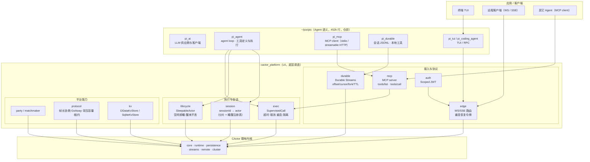
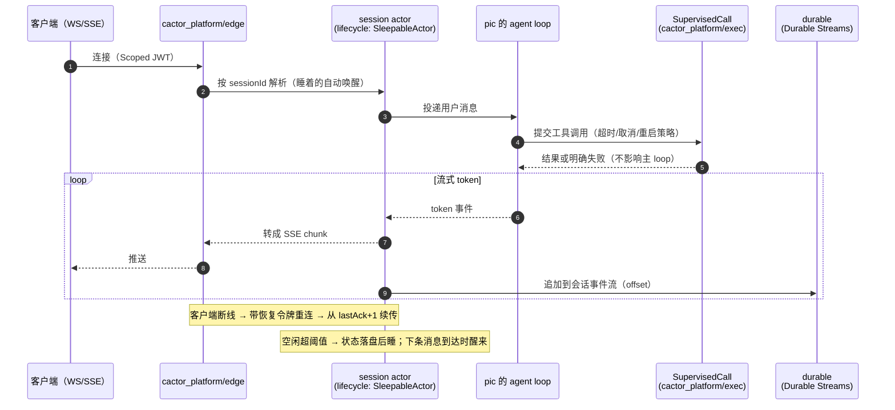
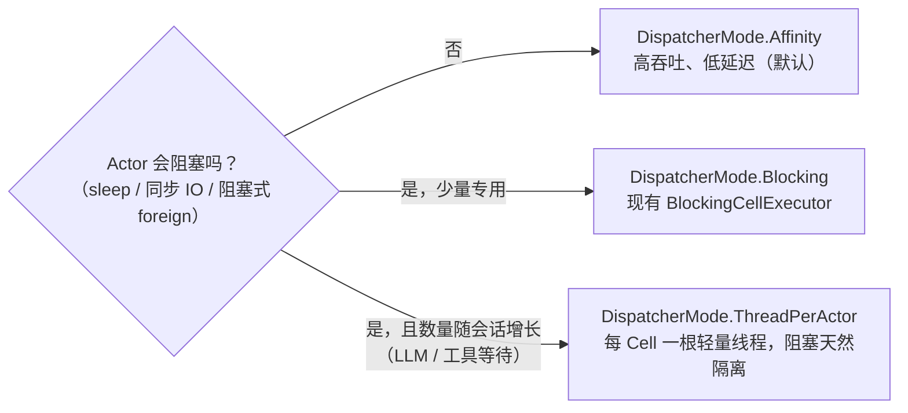
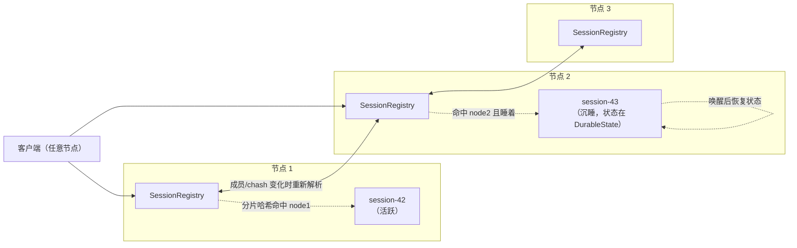
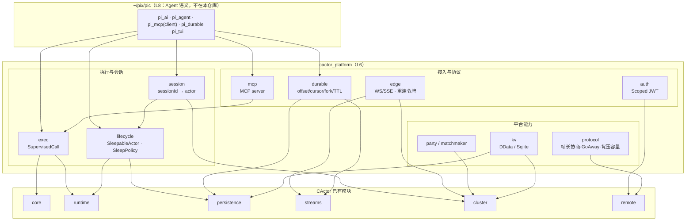

# CActor 面向未来的分布式 Actor 平台：架构 / 性能 / 稳定性 / 并发 / AI 支撑原语 全面分析与完善计划（2026-11-17，v7）

> **v7 定位（本版为最终定位）**：**CActor 只做"底层 Actor 运行时 + 平台原语"，不做 Agent 语义。**
>
> | 层 | 由谁实现 | 内容 |
> |---|---|---|
> | **Agent 语义** | **`~/pix/pic`**（仓颉原生编码智能体，452k 行） | LLM 供应商与客户端、agent loop、工具定义与执行、提示词、会话文件、MCP **client**、TUI/RPC |
> | **Actor 运行时 + 平台原语** | **本仓库 CActor** | 调度、监督、邮箱、可靠投递、持久化、集群分片、**sleep/wake**、**Durable Streams**、**Edge 接入**、**Scoped JWT**、**OTel**、**MCP server** |
>
> v3–v6 曾设想的 `cactor_ai`（Agent/模型/工具/记忆/Workflow/Guardrails）**全部撤销**——
> 那是 pic 的职责，CActor 重复实现只会造成"两套 Agent 语义"。本版把它替换为 **P 组"支撑 pic 的原语"**
> （§4.5），并给出**接缝契约**（§2.11）。
>
> 保留的历史结论（仍然有效）：
> ① **仓颉语言事实**（`references/concurrency-io.md`）：仓颉线程是用户态轻量线程、M:N、**支持抢占**，
>    阻塞时 native 线程会切去执行其他就绪线程（阻塞式 `foreign` 例外）→ 保留 `DispatcherMode.Affinity / ThreadPerActor / Blocking`（A1）。
> ② **Riker 0.4.2 源码核对**（§2.7）：CActor 在邮箱有界性、监督退避、类型安全选择、死信四项上优于 Riker。
> ③ **Rivet 源码与产品核对**（§2.8–§2.10）：Rivet 的 Actor 就是 agent/session/tenant 的运行单元，
>    平台层有 sleep/wake、Party、Matchmaker、Durable Streams、Edge、Scoped JWT、OTel——
>    这正是 **CActor 要补的"底层能力"**，而不是 CActor 要做 Agent。
>
> **本文与既有计划的分工**（互不重复）：
>
> | 文档 | 回答什么 | 口径 |
> |---|---|---|
> | `docs/plan/20261106.md` | 44 项主计划 | 唯一计分表 |
> | `docs/plan/20261116.md` | 删假批次 B1–B7 | 工程纪律 |
> | `docs/plan/20261117.md` | 46 条能力清单对标（✅20 / 🟡9 / ❌17） | 功能有无 |
> | `docs/plan/2026117-lz.md` | 5 个真实示例（E1–E5）、Lou 承载 HTTP、G-1/G-2/G-3 | 应用验证 |
> | **本文** | **纵深版**：架构、并发模型、性能、稳定性、**AI 支撑原语** | 平台工程 |
>
> 方法：代码级通读 + 可复制命令取证（§8）+ 仓颉语言事实（§2.6，逐条注明来源）+ 既有实测数据。
> 对标 Akka/Pekko（含 Akka SDK）、protoactor-go、Erlang/OTP、Riker(Rust)、Rivet（平台层）。
> **AI 侧的对标对象是 `~/pix/pic`**：CActor 只补它缺的原语。

---

## 1. 结论摘要

### 1.1 五维评分（v7）

| 维度 | v1 | **v7** | 依据 |
|---|---|---|---|
| 架构与设计 | 70% | **72%** | 分层无环、门禁严格；门面未收敛（7 个 `ActorSystem` 类型）、`xstate` 4,878 行（36 处占位词，全库最高）、`patterns` 层薄 |
| 并发模型 | 65% | **78%↑** | **语言层已有 M:N 轻量线程 + 抢占 + 阻塞自动让渡**，比 v1 判断好得多；真正缺口是"框架没利用这个能力"（只提供亲和池）与"无阻塞检测/隔离" |
| 性能 | 80% | **80%** | 单 Actor 14M msg/s、P50 1.0µs（优于 Akka）；扇出 17M vs Akka 32M；序列化类型全名、无压缩 |
| 稳定性 | 72% | **72%** | 13 项机制（2 项半成品）；缺全局 Actor 预算、tell 路径端到端背压、集群 drain |
| **AI 支撑原语** | 15% | **18%** | 不实现 Agent 语义（那是 `~/pix/pic` 的职责）；缺的是 pic 需要的**原语**：受监督执行、会话 sleep/wake、Durable Streams、Edge/SSE、Scoped JWT、OTel、MCP server |

> 一句话：**语言给的比框架用的多。** 仓颉已经提供抢占式轻量线程与阻塞让渡，
> CActor 只用了"亲和线程池"这一种用法；而 AI 的"长调用 + 多会话"负载，
> 正好是 thread-per-actor 最擅长的场景。

### 1.2 四条主线（v7）

1. **主线 A：把语言能力用起来（并发）** —— 提供三种调度模式并给出选择依据：
   `Affinity`（现状，高吞吐低延迟）、`ThreadPerActor`（轻量线程，阻塞天然隔离，适合 LLM/IO 密集）、
   `Blocking`（已有）。**这是本版最大的新增项**，也是 AI 负载的落地前提。
   **✅ 2026-11-19 已实现（A1 + A1b）：`DispatcherMode` / `Props.withDispatcherMode` /
   `ThreadPerActorExecutor` / 运行时长直方图 / `check_blocking_in_actor.py`，见 §4.1。**
2. **主线 B：AI 支撑原语（不实现 Agent）** —— 为 `~/pix/pic` 这类 Agent 运行时提供它缺的**底层能力**：
   受监督执行（把任意可失败调用放进受监督 actor）、会话 sleep/wake、Durable Streams（offset/fork/TTL）、
   Edge（SSE/WS 接入 + 重连恢复）、Scoped JWT、OTel、MCP **server**（供 pic 的 MCP client 连入）、
   按 sessionId 的集群分片。**不实现 LLM 客户端、不实现 agent loop、不实现工具语义、不实现提示词与记忆。**
3. **主线 C：架构收敛与稳定性补口** —— 门面收敛（E49）、`xstate` 去留、全局 Actor 预算、
   tell 路径端到端背压、集群 graceful drain、序列化短 id + 压缩。
4. **主线 D：平台层（v4 新增）** —— 新增 `cactor_platform` 模块，对标 Rivet 的平台原语：
   **actor sleep/wake**（AI 会话空闲即睡）、Party/Lobby、Matchmaker、Edge 接入层、共享 KV、
   版本化 socket 协议（帧长协商 + GoAway + 带容量的背压 + 租约到期）。

### 1.3 与既有计划的关系

| 本文条目 | 关系 |
|---|---|
| A1–A6（并发/调度） | **全新**；A1（调度模式）v2 新增；A3 的批量聚合按 Riker 的 `msg_process_limit`/批处理取向（§2.7） |
| B1–B4（性能） | 补 `20261117.md` §2.3 的短板分析，给出可验收目标 |
| C1–C5（稳定性） | 与 `20261117.md` 4.4/4.8/4.13 部分重叠，本文只补"全局预算/端到端背压/drain"并交叉引用 |
| D1–D4（架构） | D1 即 `20261116.md` B5（E49），本文补"收敛成什么形态" |
| **P1–P8（AI 支撑原语）** | **v7 定位**：只提供原语，Agent 语义在 `~/pix/pic`；接缝契约见 §2.11 |
| **F1–F6（`cactor_platform` 模块）** | **v4 新增**：对标 Rivet 平台原语（源码核对，见 §2.8）；与 C2-b（背压容量）、B3（帧长）有交叠，实现时合并 |

---

## 2. 现状基线（全部可核对）

### 2.1 规模与构成

| 模块 | 行数 | 文件 | 说明 |
|---|---|---|---|
| foundation | 11,912 | 47 | 零依赖：内存/队列/序列化/网络/monitoring/tracing |
| core | 12,373 | 52 | Actor 内核：类型化 + 经典、监督、上下文、DSL |
| runtime | 9,588 | 30 | 调度器、Guardian、邮箱、生命周期（B4c 后） |
| patterns | 2,326 | 12 | Ask / 路由 / 断路器 / spawn protocol |
| streams | 5,967 | 19 | Reactive Streams 全套 + 管道算子 |
| remote | 3,250 | 5 | TCP 传输、可靠投递、协议协商、TLS |
| persistence | 6,506 | 25 | Journal v2 / 快照 / DurableState / fencing / reminders |
| cluster | 13,769 | 23 | 成员 / 分片 / 单例 / PubSub / DData / StreamRef / Grains |
| testkit | 2,141 | 7 | TestProbe / ManualTime / ProcessBarrier |
| cactor | 1,835 | 15 | 门面：`CActorSystem` / 管理端点（`std.net` 手写 TCP） |
| xstate | 4,878 | 17 | 状态机（**36 处占位词，全库最高**） |
| macros | 1,299 | 6 | `@actorReceive` / `@Message` / `@StateMachine` |
| **库合计** | **75,843** | 243 | 占位词 122、死包 9、`@Deprecated` 50 |
| tests | 31,229 | 140 | 918 个用例 |
| examples | 17,174 | 64 目录 | 门禁运行 47 个 |

### 2.2 并发模型（v2 重写：语言层 vs 框架层）

v1 把两层混为一谈，导致"无抢占"的错误结论。分开说：

**语言层（仓颉 1.2.0，来源 `references/concurrency-io.md` §1.1）**

| 事实 | 对架构的含义 |
|---|---|
| 仓颉线程是**用户态轻量级线程，M:N 模型，支持抢占** | 可以有大量"线程"；单个 actor 死循环不会冻结整个运行时 |
| 线程阻塞（等锁、网络 IO、`sleep`）时，**native 线程会切去执行其他就绪的仓颉线程** | 阻塞只让当前这根仓颉线程停下，不是内核线程被占死 |
| 例外：**阻塞式 `foreign` C 函数会占住 native 线程** | 经 C SDK 接 LLM（部分厂商）时要当心 |
| 取消是**协作式**（`Thread.currentThread.hasPendingCancellation`） | 长调用的取消必须由实现主动检查；CActor 的 ask 取消令牌已符合该模型 |
| 无 `async/await`；并发原语是 `spawn`/`Future`、`Mutex`/`Condition`/`ReadWriteLock`/`Semaphore`/`Barrier`/`Timer`、`std.collection.concurrent` | 设计上不要照搬 Kotlin/Swift 协程写法 |
| 结构化并发 `std.concurrent.threadScope` / `ThreadGroup` | 可用于 Agent 的子任务编排 |

**框架层（CActor 当前实现）**

| 事实 | 代码位置 | 含义 |
|---|---|---|
| 默认调度器是**亲和池**：actor → 固定 worker 线程 | `runtime/src/guardian/actor_cell.cj:3090` `ActorCellDispatcher` | 一个 worker 只承载一根仓颉线程，其上的 actor **串行共享** |
| 每 worker 私有就绪队列；空闲自旋 50µs 再休眠 | 同上（`CACTOR_DISPATCHER_SPIN_US`） | 低唤醒延迟；空转耗 CPU |
| worker 数 = 核数/4（4–64） | `CACTOR_DISPATCHER_THREADS` | 14 核默认 4 线程 |
| 每次调度最多 64 条消息（**actor 级协作让出**） | `CACTOR_DISPATCHER_THROUGHPUT` | 不是时间片；条数到点就让出 |
| 空闲 worker"举手捐赠"、忙 worker 按需扫描窃取 | `hungryCount`/`donateSeq`/`runNextPending`（:3108–3116） | 保守窃取，避免跨核读风暴 |
| 饥饿检测 | `starvationCount`（:3117） | 已有信号，但只计数不处置 |
| 独立阻塞调度器 | `BlockingCellExecutor`（:3392） | 用户显式 `withDispatcher("blocking")` |
| Actor 线程标识 + `askInbox` 阻塞报错 | `actorThreadFlag`（:93） | 已挡住一类错误写法 |

> **v2 结论（修正 v1）**：
> ① **不是"没有抢占"**，而是"**actor 级迁移靠吞吐配额，线程级抢占由语言提供**"；
> ② 阻塞的真实后果是**同一 worker 上的其他 actor 被拖慢**（不是整个系统停摆）；
> ③ 因此**thread-per-actor 在仓颉上可行且廉价**——这是 AI 负载（长 LLM 调用、工具等待）最自然的形态，
>    而 CActor 目前没有提供这个选项。**这是本版最重要的新发现。**

### 2.3 性能实测（`bench/results/baseline-darwin-arm64-14.json`，2026-11-05，macOS arm64 14 核，T4）

| 指标 | 当前 | 历史对标（2026-11-01） |
|---|---|---|
| 单 Actor 吞吐 | **14.0M msg/s** | CActor 9.43M ｜ protoactor 3.67M ｜ Akka 8.58M |
| 扇出 8×100 | **17.0M msg/s** | CActor 10.65M ｜ protoactor 22.26M ｜ **Akka 32.01M** |
| 多对 ping-pong | **55.0M msg/s** | 55.4M ｜ 67.0–71.7M ｜ — |
| 类型化互发 | **25.0M msg/s** | 4.74M（`@Frozen` 热路径优化后大幅提升） |
| ping-pong P50/P99 | **1.0 / 2.0 µs** | 1.0/2.0 ｜ 10.5/28.5 ｜ 2.25/8.75 |
| 100 万 Actor 创建/排空/停止 | **1100 / 400 / 2000 ms** | — |
| 每 Actor 存活堆 | **1,200 B** | — |

### 2.4 稳定性机制清单

| 机制 | 位置 | 覆盖 |
|---|---|---|
| 监督树（OneForOne/OneForAll/Escalate/退避） | `core/src/supervision/` | ✅ 默认策略与 Akka 一致 |
| DeathWatch（`watch`/`unwatch`/`watchWith`） | `core/src/actor/actor_context.cj:109–119` | ✅ |
| 死信 | `DeadLetter`（`message/message.cj:262`）+ `DeadLetterRef`（`actor_ref.cj:219`） | ✅ |
| 邮箱溢出策略 | `DropNew`/`Fail`/`Block(Duration)`（`actor/actor.cj:238–246`） | ✅ 三种 |
| 有界邮箱 | `Props.bounded(...)`（`actor.cj:303`） | ✅ 单 Actor 级 |
| Stash / Timers | `core/src/typed/typed_timers_stash.cj` | ✅ |
| 可注入调度器（虚拟时钟） | `ActorScheduler` + `testkit/ManualTime` | ✅ 优于多数框架 |
| 脑裂（SBR 5 策略，纯函数决策） | `cluster/src/membership/sbr.cj:23/60` | ✅ |
| 隔离 + 实例唯一标识 | `remote/src/remoting.cj` | ✅ |
| 全节点字节/通道/对端预算 | `remoting.cj` + `foundation/src/network/transport.cj` | ✅ 少见 |
| 持久化原子写 + fsync + CRC + fencing | `persistence/src/journal_v2.cj` / `fencing.cj` | ✅ |
| 协调关闭分阶段 | `runtime/src/lifecycle/coordinated_shutdown.cj:43` | 🟡 有阶段，**未与集群 leave 接线** |
| 端到端背压 | StreamRef ✅；普通 tell ❌ | 🟡 半成品 |

### 2.5 AI 能力归属：Agent 语义在 `~/pix/pic`，CActor 不重复实现

**先说结论**：CActor 的 12 个库里"Agent / LLM / Tool / MCP / 记忆 / 投影"全部为 0——
**这不是缺陷，而是分工**。Agent 语义由 `~/pix/pic` 承担（见 §2.11）。

| 能力 | CActor（本仓库） | `~/pix/pic`（Agent 运行时） |
|---|---|---|
| LLM 供应商与客户端 | ❌ 不做 | ✅ `pi_ai`（56,125 行） |
| agent loop | ❌ 不做 | ✅ `pi_agent/loop/agent_loop.cj`（6,633 行） |
| 工具定义与执行 | ❌ 不做 | ✅ `pi_agent/tool.cj` + `pi_durable/tools/*` |
| MCP | **只做 server**（供 pic 连入） | ✅ **client**（`pi_mcp`，16,492 行，stdio + streamable HTTP） |
| 会话/提示词 | ❌ 不做 | ✅ `pi_durable`（72,763 行）+ 会话 JSONL |
| TUI / RPC | ❌ 不做 | ✅ `pi_tui` / `pi_coding_agent` |
| **受监督执行** | ✅ **需补**（pic 现在用裸 `spawn` + `Mutex`） | ❌ 无 |
| **会话 sleep/wake** | ✅ **需补** | ❌ 无 |
| **Durable Streams** | ✅ **需补** | 🟡 本地 JSONL，无 offset/fork/TTL |
| **Edge（SSE/WS 接入 + 重连）** | ✅ **需补** | 🟡 只有本地 TUI/RPC |
| **Scoped JWT** | ✅ **需补** | ❌ 无 |
| **OTel 导出** | ✅ **需补** | 🟡 `pi_telemetry` 2,875 行（本地） |
| **集群分片（按 sessionId）** | ✅ **需补** | ❌ 单进程 |

> 一句话：**pic 有 Agent 的"脑"，缺"运行时的骨架"；CActor 有骨架，不造脑。**
> 本文 E 组（`cactor_ai`）撤销，改为 §4.5 的 **P 组：支撑 pic 的原语**。

### 2.6 仓颉语言能力基线（架构决策依据）

| 能力 | 结论 | 来源 | 对本文的影响 |
|---|---|---|---|
| 线程模型 | 用户态轻量线程，M:N，**可抢占** | `references/concurrency-io.md` §1.1 | A1 新增 thread-per-actor 模式 |
| 阻塞行为 | 阻塞时 native 线程切换；`foreign` C 阻塞例外 | 同上 | A1b 需对 FFI 告警 |
| 取消 | 协作式（`hasPendingCancellation`） | 同上 §1.4 | E2/E7 的取消必须主动检查 |
| 结构化并发 | `std.concurrent.threadScope`、`ThreadGroup` | 同上 §1.8 | Agent 子任务编排可用 |
| 同步原语 | `Mutex`（可重入）/`Condition`/`ReadWriteLock`/`Semaphore`/`Barrier`/`Timer` | 同上 §2 | 无需自造 |
| 并发集合 | `ConcurrentHashMap`/`LinkedBlockingQueue`/`ArrayBlockingQueue`/`ConcurrentLinkedQueue` | 同上 §3 | tellBatch/背压可复用 |
| HTTP | `stdx.net.http`：客户端 + 服务端 + WebSocket，HTTP/1.1 与 2 | `references/stdx.md` §1 | LLM/MCP 传输有官方实现 |
| JSON | `stdx.encoding.json` + **流式** `encoding.json.stream` | 同上 §2 | 工具参数/结构化输出 |
| 压缩 / TLS / 日志 | `stdx.compress` / `stdx.net.tls` / `stdx.log` | 同上速查表 | B3 压缩、TLS 已用 |
| FFI | `foreign`、`@C`、`CPointer`、回调；阻塞 C 调用占住 native 线程 | `references/macros-ffi.md` | 接 C 版 LLM SDK 的注意点 |
| `@Frozen` | **承诺实现不再变化**（二进制演进），可修饰全局/成员/构造/属性 | 同上 §7 | CActor 用它做跨包泛型展开（见 `cactor_system_api.cj:228` 注释） |
| 无 async/await | 并发靠线程 + Future | `references/concurrency-io.md` | 不要照搬协程范式 |
| stdx 分层约束 | `STDX_ALLOWED` 仅 remote/cluster/tests/examples | `tools/check_module_deps.py:33–35` | **决定 AI 接入落点**（§4.4 D4） |

### 2.7 Rust Actor 框架（Riker 0.4.2）源码对照：**CActor 已经领先的六个设计**

> **取证方式（可复现）**：本机 crates.io 走 USTC 镜像（`~/.cargo/config.toml`），
> 走 `https://mirrors.ustc.edu.cn/crates.io-index/` 的稀疏索引可列举前缀，
> 因此**能拿到源码包并逐行核对**：
>
> ```bash
> curl -s https://mirrors.ustc.edu.cn/crates.io-index/ri/ve/            # 列举所有 ri/ve/* crate
> curl -sL https://mirrors.ustc.edu.cn/crates.io/api/v1/crates/riker/0.4.2/download -o riker.crate
> tar xzf riker.crate && wc -l riker-0.4.2/src/*.rs
> ```
>
> **先纠正一个命名**：你提到的 "river"，在本机可达的 crates.io 镜像上逐个核对结果是——
> `river` = 基于 pingora 的反向代理（`memorysafety/river`）、`river-rs` = **RiverWM**（窗口管理器）配置库、
> `river-core` = Rivermate 的加密/支付核心（依赖 ed25519/x25519/cborium/freenet-*）。
> **都不是 Actor 框架**；`rivermate/river` 这个仓库地址不存在（`git clone` 报 *Repository not found*）。
> 真正可读源码、且是 Rust Actor 框架的是 **Riker 0.4.2**（`riker-rs/riker`，1,625 行核心），
> 以下**全部基于源码核对**，不是设计印象。

**核对结论：CActor 在六个关键设计上已经领先或持平 Riker。**

| # | Riker 的做法（源码位置） | CActor 现状 | 判定 |
|---|---|---|---|
| 1 | **每 actor 一个 future + 一个 `futures::execution::ThreadPool`**（`system.rs:191,280,692`）：每个 actor 独占一个执行槽，`exec.spawn_with_handle(future)` | **亲和池**（`actor_cell.cj:3099`）：多个 actor 共享一个 worker | **CActor 更省内存**（Riker 每 actor 一个任务槽，百万级 actor 时成本更高）；但 Riker 的"每 actor 独立"天然隔离阻塞 |
| 2 | **消息处理配额**：`MailboxConfig.msg_process_limit`（`kernel/mailbox.rs:94,131`），`process_msgs` 计数到限就 break 并让出（`mailbox.rs:225-240`） | `CACTOR_DISPATCHER_THROUGHPUT`（默认 64，`actor_cell.cj:3126`） | ✅ **同构且等价** |
| 3 | **Actor 状态是 actor 自己持有的 `&mut self`**（`actor.rs:151`：`fn recv(&mut self, ctx, msg, sender)`） | 类型化 `TypedBehavior` **返回新行为**（不可变）；经典 Actor 内部可变 | ✅ CActor 的不可变行为**更适合分布式复制**（状态可序列化、可重放） |
| 4 | **监督 = 枚举 3 值**：`Strategy { Stop, Restart, Escalate }`（`actor.rs:299`），由 `Actor::supervisor_strategy()` 返回（`actor.rs:175`） | 经典监督 3 策略 + 类型化 `TypedBehaviors.supervise` + **指数退避**（`core/supervision/backoff.cj`） | ✅ **CActor 更完整**（Riker 无退避重启） |
| 5 | **ActorSelection 明确标注"不推荐"**：`actor/selection.rs:23-28` 注释写明 *"ActorRef is almost always the better choice… The cost is traversing part of the actor hierarchy and cloning messages"*；且 selection 消息**无类型**（`try_tell` 走 `AnyMessage`，不匹配的消息**被丢弃**） | `ClusterReceptionist`（按 `ServiceKey<T>` 找**类型化**引用）+ `Grains`（按需激活） | ✅ **CActor 明显更好**（Riker 的 selection 是"弱类型 + 静默丢弃"，CActor 是"类型安全 + 显式失败"） |
| 6 | **无死信容量/背压上限**：邮箱是 `std::sync::mpsc::channel`（`kernel/queue.rs:9`），**无界**；`try_enqueue` 只在通道断开时失败 | `Props.bounded` + 三种溢出策略（`core/actor/actor.cj:238-246`）+ 全节点字节/通道预算（`remote/remoting.cj`） | ✅ **CActor 明显更好**（Riker 遇到慢消费者会**无界堆积**直至 OOM） |

**Riker 值得 CActor 吸收的两点（且都能在 CActor 找到对应位置）**：

| # | Riker 的做法 | CActor 的差距与落点 |
|---|---|---|
| **R1** | **发布订阅是一等公民**：`Channel`（`actor/channel.rs:24`）+ `Publish`/`Subscribe`/`Unsubscribe`/`UnsubscribeAll` 消息族（`channel.rs:242-265`）+ `Topic`/`All` 主题（`channel.rs:311,336`）；且**系统消息与用户消息分两个队列**（`Mailbox.sys_queue` vs `queue`，`mailbox.rs:95-96`） | CActor 有 `DistributedPubSub`（`cluster/membership/pubsub.cj:186`）但**只在集群层**、**消息不持久** → 已在 `20261117.md` 4.8 记为差距（Durable Subscriber）。<br>**系统消息分队列：CActor 同样做到，且实现更精细**——`CellMailbox` 的系统消息走**独立的 CAS 无锁链表**（`actor_cell.cj:429 sysHeadValue`、`:38 SysNode`、`:574 compareAndSwap`），用户消息在环形数组里，两者互不挤占；Riker 的 `sys_queue` 只是两个 mpsc 通道。<br>→ **CActor 已在这一点上领先，无需改动**；要补的只有"持久订阅"这一半 |
| **R2** | **邮箱挂起（suspended）**：调度器在 actor 忙时把它从就绪集合摘掉，处理完再 `schedule` 回去（`mailbox.rs:200,285,339`；`scheduled`/`suspended` 两个原子标志） | CActor 用**吞吐配额**让出（`CACTOR_DISPATCHER_THROUGHPUT`，效果等价），但**没有"actor 主动汇报负载"的语义**。<br>→ 落点因此从"我记忆中 River 的 `Idle`/`Work` 命名"更正为**Riker 源码里的 `suspended`/`scheduled` 机制**（那两个命名在 Riker 中并不存在，属我的记忆偏差，已更正）。<br>→ 吸收成 CActor 的 **C2-a「actor 负载自报」**：`ActorCell` 暴露 `isBusy()/isIdle()`（或 `mailboxBacklog`），供上游做**节流与调度**——AI 场景里"我还在忙"应能沿调用链传播，而不是只表现为"邮箱满 → 拒收" |

**结论**：Rust Actor 框架并没有 CActor 缺的东西；**CActor 的欠账不在"Actor 框架该有的部分"，而在"分布式/AI 该有的部分"**（跨 DC、投影、持久订阅、AI 接入）。这与 §3 的矩阵一致，也印证了本文把重心放在 A/C/E 组是对的。

> **方法论教训（写进 §8）**：此前我曾凭记忆写下 River 的 `Procedure`/`Query`/`Callback`/`Batch`/`Idle`/`Work` 等命名——
> **源码核对后，Riker 里并不存在这些命名**（它的对应物是 `Actor::recv`/`sys_recv`、`Channel` 的 `Publish`/`Subscribe`、
> `msg_process_limit`、`suspended`/`scheduled`）。这正说明：**跨语言的"对标"必须落到源码，否则会把自己的记忆当成别人的设计。**

### 2.8 Rivet 平台源码对照：协议与平台层的四个硬设计

> **取证与 provenance（重要）**：Rivet 在 crates.io 上的命名空间**被同名项目污染**——
> `rivet-rt` 属于 `habeelali/rivet-rtos`（嵌入式 RTOS，无关）、`rivet-core`/`rivet-foundation`
> 是 Laravel 风格 Rust 框架、`rivet-kv` 是**托管 KV 服务客户端**（smithy-rs 生成）。
> 甄别方法：`grep "^repository" Cargo.toml`。结论：
>
> | crate | 版本 | repository | 是否 Rivet 平台本体 |
> |---|---|---|---|
> | `rivet-actor-runtime-socket-protocol` | 3.0.5 | `github.com/rivet-dev/rivet-ee` | ✅ **是**（Actor Runtime Socket 协议） |
> | `rivets-mcp` | 0.1.0 | `github.com/dwalleck/rivets` | ✅ 是（Rivet 的 issue tracker 的 MCP 服务器） |
> | `rivet-kv` | 0.0.8 | 无字段（描述为 "Rivet service for interacting with the key-value database"） | ✅ 是（托管 KV） |
> | `rivet-rt` | 0.2.0 | `github.com/habeelali/rivet-rtos` | ❌ 嵌入式 RTOS |
> | `rivet-core` | 0.1.0 | 无字段（内容是 application/dispatch/middleware） | ❌ Laravel 风格框架 |
>
> 下面四条**全部来自 `rivet-actor-runtime-socket-protocol` 的 `schemas/v1.bare`（165 行，逐行核对）**
> 与 `rivets-mcp` 的源码。

**(1) 帧长上限在握手时协商，而不是发到一半才失败**

```vbare
type ClientHello void          # 注释：schema 版本随每帧的 vbare 内嵌版本前缀走，ClientHello 不带版本/认证字段
type HelloOk struct { maxFrameBytes: u32 }   # 服务端接受并会发送的最大帧载荷
type HelloRejectUnsupportedVersion void
```

→ **CActor 的对应缺口**：B3（压缩/大消息）目前只是"超阈值就报错"，没有"**先协商再发**"。
Rivet 的做法让客户端**提前知道**上限，从而主动分片/走引用传递。落到 CActor：
`RemotingSettings` 增加 `maxFrameBytes`，**握手时由服务端告知**（与既有 `wire_negotiation.cj` 的
能力位协商合并成一次握手，不额外增加往返）。

**(2) 连接级错误与业务响应分离，用 `GoAway` 帧表达"我要关闭这条连接"**

```vbare
type FrameTooLarge void
type MalformedFrame void
type GoAwayReason union { FrameTooLarge | MalformedFrame }
type GoAway struct { reason: GoAwayReason }
type ServerFrame union { Response | GoAway }
```

→ **CActor 现状**：可靠投递耗尽（`giveUpAfter`）后只是终止该节点，没有"带原因的连接级告别"。
补 `GoAway(reason)` 后，客户端能区分"我发太大"与"你发太大"并采取不同动作（前者改分片，后者断开重连）。

**(3) 背压错误带容量信息，而不是一个笼统的"满了"**

```vbare
type QueueFull struct { limit: str, capacity: u32 }
```

→ 直接支撑 §4.3 的 C2-b：`BackpressuredRef` 的 `OfferResult` 应带 `capacity` 与 `limit`
（当前 `OfferResult` 只有 `Backpressured`/`Closed`），让上游能**自适应降速**而不是盲目重试。

**(4) 租约（lease）带 deadline，且"租约失效"是一等错误**

```vbare
type SqliteBegin struct { leaseKey: str, timeoutMs: optional<u64> }   # 显式事务由 leaseKey 拥有
type LeaseExpired struct { timeoutMs: u64, message: str }
type InvalidLeaseKey struct { message: str }
```

→ CActor 已有同类机制（`foundation/coordination` 的 `Lease` + 单调 fencing token、`persistence/fencing.cj`），
**但没有"租约到期"这个一等错误**——到期目前表现为后续写入被 fencing 拒绝。
补一个显式的 `LeaseExpired` 语义，能让"租约到期"与"被抢占"在日志与指标上可区分。

**(5) 附带发现：Rivet 的 MCP 服务器做法可直接照抄到 `cactor_platform/mcp`（P5）**

`rivets-mcp` 的做法（源码核对）：
- 用 `rmcp` crate 做协议层，工具用 **`#[tool]` 属性宏**声明，参数是**强类型结构体**，
  JSON Schema 由 `schemars` **自动生成**（不是手写 JSON）；
- 路由是声明式的：`tool_router` + `tool_handler`，新增工具=加一个方法；
- **领域错误 → 协议错误码**的映射是显式的：`NoContext` / `InvalidArgument` / `IssueNotFound`
  → `invalid_params`，其余 → `internal_error`（`server.rs:30-36`）；
- 工具是**面向任务**的动词（`ready` / `list` / `show` / `blocked` / `create` / `close` / `dep`），
  **不是**把数据库表原样暴露。

→ 对 `cactor_platform/mcp`（P5）的三条具体要求：
① `ToolDescriptor` 必须带**机器可读的 JSON Schema**（仓颉无 schemars derive，需手写 schema 或用宏生成）；
② 错误映射表必须显式（"未知工具"→ `invalid_params`，"工具超时"→ `internal_error`，
"工具内部业务失败"→ 作为**内容**返回而非协议错误）；
③ 工具集合要面向**任务语义**（"查这个订单的履约状态"），而不是"暴露一张表"。

### 2.9 Rivet 的产品定位与量化目标：它已经把 Actor 用成了 Agent 运行时

> **取证**：`curl -s https://github.com/rivet-dev/rivet` 的 HTML（仓库描述与 README 正文，2026-11-17 读取）。
> README 自述：**"The orchestrator for agentic workloads. A fast, high-density and scalable orchestrator
> for every workload an agent needs."**

**Rivet 的 Actor 是什么**（README 原文口径）：

> "Rivet Actors are long-lived processes with **in-memory state, a SQLite database, WebSockets, and scheduling**.
> You can create one for each **agent, user, session, or tenant**."

**量化目标**（README 给出，可直接作为 CActor 的对标基线）：

| 指标 | Rivet | CActor 现状 | 差距解读 |
|---|---|---|---|
| 每 actor 内存 | **72 KB** | **1,200 B**（`heap_bytes_per_actor`） | CActor **轻 60 倍**——因为 CActor 的 actor 是"纯消息邮箱"，而 Rivet 的 actor 自带 SQLite + WS + 内存状态 |
| p99 冷启动 | **4.99 ms** | 无此指标（创建 100 万 actor 合计 1,100 ms ≈ 1.1 µs/个，但那是批量创建） | CActor 需补"单 actor 从睡到醒"的 p99 指标（对应 F1） |
| p99 持久写 / 读 | **1.07 ms / 1.36 ms**（S3 支撑，比复制型 SSD 省约 10.4×） | `journal_v2` 有 fsync，无 p99 指标 | 需要补持久化 p99 的基准场景 |
| 空闲 actor 成本 | **零**，且"下次请求唤醒、什么都不丢" | 无 sleep/wake 原语（只有分片钝化） | **F1 的直接目标** |
| actor 迁节点 | 节点挂了，actor 带状态迁到别处 | 分片移交有，但**单个 actor 无级别迁移** | F1 的一部分 |

**Rivet 的 Agent 架构主张（对本项目最有价值的一条）**：

> "Most of an agent's time is spent [waiting]. … Rivet Actors run the agent loop **outside of the sandbox**,
> often called [agentOS]. The agent's state, memory, and context live in the Actor, and it reaches the sandbox
> **through tools only** when it needs to run code. This uses a fraction of the memory and limits the blast radius."

→ 这**正面印证了本文 E 组的两个设计**：
① **agent loop 必须是 Actor 的一部分，而不是阻塞在外部**（CActor 的 `Agents.behavior` 正是如此）；
② **沙箱/工具只能通过"工具调用"触达**（CActor 的 `ActorTool` 正是如此，工具本身是 Actor，受监督与超时约束）。

→ 并给出 CActor 缺的三条：
- **A. 每个 actor 一个数据库**：Rivet 给每个 agent 一个专属 SQLite（会话历史、产物持久化）。
  CActor 的对应物是"每会话一个 `DurableStateStore`（键值）+ 一个 `EventStore`（历史）"——
  **现在的 `DurableStateBehavior` 是"一个 Actor 一个 persistenceId"，正好等价**，但**没有"每会话一个独立库"的隔离**，
  也没有"actor 自带数据库"的语义（CActor 的 actor 不拥有存储，只引用存储）。
- **B. agent 的三种形态**（README 的 sandbox 三段式）：
  ① **Agents with tools**（只需 tool call / MCP / API，**不需要沙箱**）；
  ② **Agents with a lightweight sandbox**；
  ③ **Agents with a full sandbox**（保留既有沙箱，把 shell/文件系统暴露成工具；
  **"The Actor reattaches to it across sleeps and restarts"**——actor 睡醒后工具仍可用）。
  → CActor 的对应：`Tool` 抽象天然覆盖三种（纯工具 Actor / 轻量沙箱 Actor / 外部沙箱包装成 Actor），
  但**"睡醒后重新挂载沙箱"这一条 CActor 没有**（F1 的延伸要求）。
- **C. 生态**：Rivet 提供 **rivetkit**（Python/Rust/Swift/TypeScript SDK + React/Effect 前端）、
  **`rivets-mcp`**、以及 **`rivet-dev/skills`**（`npx skills add rivet-dev/skills`，
  可直接装进 Claude Code / Cursor / Codex —— 说明它把"给编码 agent 用"当作一等入口）。
  → 对 CActor 的启示：**`cactor_platform/mcp`（P5）就是那个"最低成本入口"**——
  pic 已自带 MCP client，只要 CActor 提供 server，接入就是零改造。
  （"技能包"这类**面向 agent 的说明文档**由 pic 侧或使用方提供，CActor 只保证 API 稳定。）

**其余平台能力**（README 列举）：Scoped JWT（每个客户端一个只能访问指定 actor 的 JWT）、
OpenTelemetry 原生输出（traces/metrics/logs）、HTTP & WebSocket 直连 actor、
按 key 的跨集群 actor-to-actor 调用、自托管（Docker/K8s/VM，S3 是唯一依赖）或 Rivet Cloud/BYOC。
→ 对应 CActor：**Scoped JWT 与 OTel 都没有**（后者已在 `20261117.md` 4.10 记为差距；
前者是**全新的一条**，见 §4.8）。

### 2.10 全面对比：Rivet 平台能力清单 × CActor 现状 × 仓颉+CActor 对等实现

> **取证方式**：把 `ri/ve/` 前缀下与平台相关的 crate 逐个从镜像下载、解包，读其 `operation.rs`
> （Smithy 生成的 API 面）与 `lib.rs` 文档注释。下面每个"Rivet 操作"都是**从源码里读到的实际方法名**，
> 不是凭印象。涉及的实现 crate：`rivet-party` 0.0.7、`rivet-matchmaker` 0.0.8、`rivet-chat` 0.0.7、
> `rivet-durable-streams` 0.1.7、`rivet-routing` 0.1.0、`rivet-kv` 0.0.8、
> `rivet-actor-runtime-socket-protocol` 3.0.5、`rivets-mcp` 0.1.0。

#### (1) 运行时与 Actor 生命周期

| Rivet 能力（源码事实） | CActor 现状 | 仓颉+CActor 的对等实现 | 复用 |
|---|---|---|---|
| Actor = 长驻进程 + 内存状态 + **自带 SQLite** + WebSocket + 调度 | Actor = 邮箱 + 行为；状态在 `DurableStateBehavior`；**无 sleep/wake**；**无每 actor 独立库** | F1 `SleepableActor`：`onSleep` 返回可序列化状态、`onWake` 恢复；`SleepPolicy.Idle/Explicit` | `DurableStateStore`（状态）、`SimpleActorRegistry`（睡醒注册表） |
| 空闲 actor **零成本**、下次请求唤醒且不丢 | 只有分片钝化（`passivateAfter`） | F1 + 唤醒注册表 + 可靠投递保证"醒前到达的消息不丢" | `remote` 可靠信封 |
| 节点挂掉，**actor 带状态迁到别处** | 分片整体移交；**单 actor 无级别迁移** | F1 扩展：睡着的 actor 记录"归属节点"，节点 down 后由其它节点按注册表唤醒 | `Cluster` 成员事件、`ClusterReceptionist` |
| actor-to-actor **按 key 跨集群**调用 | ✅ 已有（`ClusterReceptionist` 按 `ServiceKey<T>`） | **无需新增** | `cluster/membership/receptionist.cj` |
| 每 actor 一个 SQLite（会话历史/产物） | `DurableStateBehavior` 是"一个 Actor 一个 persistenceId" | 语义等价但需补"**会话级存储隔离**"：把一个 agent 的历史/产物收敛到独立 `EventStore` 实例 | `persistence/event_store.cj` |
| agent loop **跑在沙箱外**（agentOS），只在需要跑代码时通过工具触达沙箱 | 无 agent 概念 | E1 `Agents.behavior`（loop 在 Actor 里）+ E3 `ActorTool`（工具是受监督 Actor） | `TypedAsk`、监督、断路器 |

#### (2) Party / Matchmaker / Chat（多人与实时）

| Rivet 操作（源码里的实际方法名） | CActor 现状 | 对等实现 | 复用 |
|---|---|---|---|
| `CreateParty` / `JoinParty` / `LeaveParty` / `KickMember` | 无"多方会话"原语 | F2 `PartyActor`：成员表 + 加入/离开/踢人 | `DistributedPubSub`、`DeathWatch` |
| `TransferPartyOwnership` / `GetPartySelfProfile` / `GetPartySummary` / `SetPartyPublicity` / `SetPartyToIdle` | 无 | F2 扩展：主持人转移（成员离开时按 DeathWatch 触发）、公开性、闲置置闲（`SetPartyToIdle` → 正好用 F1 的 sleep） | F1 sleep/wake |
| `CreatePartyInvite` / `RevokePartyInvite` / `GetPartyFromInvite` / `SendJoinRequest` | 无 | F2：邀请令牌（**复用 G1 的 Scoped JWT**） | G1 |
| `FindMatchmakerLobbyForParty` / `JoinMatchmakerLobbyForParty` / `RequestMatchmakerPlayer` | 无 | F3 Matchmaker：按属性区间匹配 | — |
| `FindLobby` / `JoinLobby` / `ListLobbies` / `ListRegions` / `LobbyReady` / `SetLobbyClosed` / `PlayerConnected` / `PlayerDisconnected` | 无 | F3 + **`ListRegions` 对应 CActor 缺失的 data-center/roles**（交叉引用 `20261117.md` 4.1/4.3） | `Cluster` 成员表 |
| Chat：`GetDirectThread` / `GetThreadHistory` / `SendChatMessage` / `WatchThread` / `SetTypingStatus` / `SetThreadRead` / `GetThreadTopic` | 只有 PubSub 广播，**无历史、无线程** | **Durable Consumer**（E6）+ `F2` 的线程模型 | `journal_v2`（`currentEventsByTag`/`replay`）、offset |
| `WatchThread`（服务端推送） | `StreamRef` 已具备跨节点推送 | **直接复用 `StreamRef`**，不另造 | `cluster/streamref/` |

#### (3) Durable Streams 协议（最值得抄的一块）

`rivet-durable-streams` 是 **Durable Streams HTTP 协议在 RivetKit actor 上的原生实现**，
源码常量与语义（`protocol.rs`）：

| Rivet 常量 | 语义 | CActor 对等 |
|---|---|---|
| `ZERO_OFFSET = "0000000000000000_0000000000000000"` | 流的起始偏移（`序号_子序号`） | `journal_v2` 的 `seqNr`；需补"子序号" |
| `MAX_BODY_BYTES = 1_000_000` | 单条消息上限 | 新增（B3 的帧上限是另一层） |
| `MAX_READ_BYTES = 4MB` / `MAX_READ_ROWS = 128` | 单次读上限 | 新增 |
| `LONG_POLL_TIMEOUT_MS = 2_000` | 无新消息时的长轮询等待 | **CActor 缺"长轮询读流"**，只有订阅 |
| `MAX_SSE_LIFETIME_MS = 60_000` | SSE 连接最长存活 | 新增 |
| `MAX_TTL_SECONDS` / `PRODUCER_STATE_TTL_MS = 7 天` | 流的 TTL、producer 状态保留期 | 新增（`journal_v2` 无 TTL） |
| `stream-next-offset` / `stream-cursor` / `stream-seq` / `stream-ttl` / `stream-expires-at` / `stream-forked-from` / `stream-fork-offset` | HTTP 头：游标、序号、TTL、**分叉（fork）来源** | **fork 是全新能力**（从某条消息处分叉出一条新流） |
| `x-rivet-ds-h-*` 内部头前缀 | 内部实现头 | — |
| `producer-id` | 生产者标识（多生产者写同一流） | 需补 |

→ **CActor 的差距清单（新增 G3）**：
**"Durable Streams 兼容的 HTTP 流协议"**——即把 `journal_v2` 的事件流用**标准 HTTP 头语义**暴露：
`GET /v1/stream/{path}`（长轮询读）、`POST`（追加）、`stream-next-offset` 游标续读、
**fork**（从某偏移分叉）、**TTL**、**多生产者 `producer-id`**、SSE 长驻上限。
这样 CActor 的持久化事件流就能被**任何 Durable Streams 客户端**消费——
而 Rivet 的实现正好证明了这条协议怎么落地。

#### (4) 接入层、路由与配置

| Rivet 能力 | CActor 现状 | 对等实现 | 复用 |
|---|---|---|---|
| `rivet-routing`：HTTP 路由表（method + path → handler） | 门面有 `ManagementRoute`（仅运维） | F4 Edge 的路由表（扩展成通用） | `cactor/api/management.cj` 的 `ManagementRoute` |
| `rivet-http`：请求/响应抽象 | 门面手写 `std.net` | F4 用 `stdx.net.http` | stdx |
| `rivet-config`：配置（`ConfigValue` 树） | ✅ `LayeredConfig` 已覆盖且更强 | **无需新增** | `foundation/config` |
| `rivet-identity`：身份 | 无（只有节点级共享密钥） | G1 Scoped JWT 的签发/校验复用其密钥体系 | `RemotingSettings.secureCookie` |
| `rivet-metrics` / OTel | 指标两套并存、集群侧零指标 | G2 统一到 `MetricRegistry` + OTel 导出 | `foundation/monitoring` |
| `rivet-transcoder`：格式转换（图片/音视频） | 无 | **明确不做**（§7） | — |
| `rivet-image` / `rivet-ui` / `rivet-window` / `rivet-style` / `rivet-typography`：游戏内 UI | 无 | **明确不做**（不是 Actor 平台的职责） | — |
| `rivet-container` / `rivet-cli` / `rivet-depot-client` / `rivet-gui`：部署与资产 | 无 | **明确不做**（运维侧，非框架） | — |
| `rivets-mcp` / `rivet-dev/skills`：MCP 与"给编码 agent 装的技能包" | 无 | E4（MCP）；**新增"技能包"作为交付物**（见 §4.9 G4） | stdx |

#### (5) 汇总：Rivet 平台能力 × CActor 的覆盖判定

| 能力域 | Rivet | CActor | 判定 |
|---|---|---|---|
| Actor 内核（消息、监督、状态、调度） | ✅ | ✅ **更轻**（1.2 KB vs 72 KB） | **CActor 领先** |
| Actor sleep/wake（零成本空闲） | ✅ | ❌ | **缺口 F1** |
| Actor 级别迁移 | ✅ | ❌ | **缺口 F1** |
| 分布式 actor-to-actor（按 key） | ✅ | ✅ | **对等** |
| 每 actor 独立存储 | ✅ | 🟡 语义近似 | **缺口 F1/A1** |
| 多人会话（Party） | ✅ 19 操作 | ❌ | **缺口 F2** |
| 匹配（Lobby/Matchmaker） | ✅ 9 操作 | ❌ | **缺口 F3** |
| 实时聊天（线程 + 历史 + 推送） | ✅ 7 操作 | 🟡 只有广播 | **缺口 E6 + F2** |
| Durable Streams 协议 | ✅ | ❌ | **缺口 G3** |
| KV | ✅ 托管 | 🟡 只有本机存储 | **缺口 F6** |
| Edge / WS 接入 | ✅ | ❌ | **缺口 F4** |
| Scoped JWT（细粒度授权） | ✅ | ❌ | **缺口 G1** |
| OTel / 指标 | ✅ | 🟡 半成品 | **缺口 G2** |
| 路由 / 配置 | ✅ | ✅ 配置更强 | **对等/领先** |
| MCP / 技能包 | ✅ | ❌ | **缺口 E4 / G4** |
| 部署、资产、UI、转码 | ✅ | ❌ | **明确不做** |

> **结论**：CActor 在 **Actor 内核**上不输 Rivet（且轻 60 倍），但 Rivet 把它当**平台**用的那一层
> ——sleep/wake、多人会话、匹配、Durable Streams、Edge 接入、细粒度授权——CActor 全部没有。
> 这正是 `cactor_platform` 要补的范围，且**每一条都有仓颉+CActor 的现成底座可复用**（见上表的"复用"列）。

### 2.11 接缝契约：`~/pix/pic` 需要什么 × CActor 提供什么（v7 新增）

> **取证**：直接读 `~/pix/pic` 的 `cjpm.toml`（14 个模块）与源码结构。
> pic 是**仓颉 1.2.0 + stdx** 写的编码智能体，**当前不依赖 cactor**——
> 因此接缝是"新增的"，必须先把契约定清楚，避免两边各写一套。

**pic 的现状（源码事实）**

| 事实 | 位置 | 含义 |
|---|---|---|
| 12 个模块、452,437 行 `.cj` | `~/pix/pic/modules/*` | 体量是 CActor 的 6 倍，Agent 语义已经很完整 |
| **无 actor 模型**：裸 `spawn`(10) + `Mutex`(13) + 原子类型 | `pi_agent/src` | **失败无监督、无重启、无隔离**；一个工具 panic 只能靠调用方兜 |
| MCP **client**（stdio + streamable HTTP） | `pi_mcp`（16,492 行） | **cactor 应做 server**，而不是再写一个 client |
| 会话持久化：JSONL 文件 | `pi_durable` + `pi_coding_agent` | 无 offset/游标/fork/TTL，跨节点不可共享 |
| 无 HTTP server / 无 OTel | `grep` 全仓 | 远程接入与可观测都缺 |
| 单进程 | `cjpm.toml` 无 cluster 依赖 | 多会话、多用户、跨节点都要上层自建 |

**接缝契约（CActor 侧要交付的原语 → pic 侧怎么用）**

| # | pic 的痛点 | CActor 提供的原语 | pic 侧用法（同语言直接 `import`，或经 MCP/HTTP） |
|---|---|---|---|
| P1 | 工具调用 / 子任务失败无监督 | **`SupervisedCall<T>`**：把任意 `() -> T` 提交给受监督 actor，带超时、取消令牌、重启策略、隔离 | 把 `tool.execute()` 包成一次 `SupervisedCall`；失败按策略重启或降级，不污染主 loop |
| P2 | 长会话常驻内存，空闲不释放 | **`SleepableActor`** + `SleepPolicy.Idle` | 每个 session 一个 actor；空闲落盘、下条消息唤醒 |
| P3 | 远程客户端拿不到流式输出（只有本地 TUI/RPC） | **`StreamRef` + Edge SSE/WS + 重连令牌** | 把 token 流推给远程客户端，断线按 `lastAck+1` 续传 |
| P4 | 会话/事件历史不可跨节点共享、无游标 | **Durable Streams**（offset/cursor/fork/TTL/producer-id） | 会话事件写流；新客户端按 offset 续读；从某轮 fork 出分支 |
| P5 | 外部工具/实体无法暴露给 pic | **MCP server**（JSON-RPC `tools/list`、`tools/call`） | pic 的 `McpClient` 直接连上，把 actor 能力当工具用 |
| P6 | 多租户/多用户无细粒度授权 | **Scoped JWT**（按 actor path 授权） | Edge 握手时校验，token 只能触达自己的 session |
| P7 | 无可观测（无 OTel） | **OTel 导出 + trace 跨节点传播 + 指标统一** | pic 的 LLM/工具 span 挂到同一 traceId |
| P8 | 单进程，会话数受内存限制 | **按 sessionId 的集群分片 + Receptionist** | session actor 分布到多节点，pic 只按 id 调用 |

**依赖方向（关键）**：`pic` → `cactor_platform`（楼上是消费者，楼下是原语）。
**CActor 绝不反向依赖 pic**，也不在 CActor 里出现 `Agent`/`LLM`/`Tool` 这类命名。

---

## 3. 对标矩阵

### 3.1 并发模型（v2 修正，v3/v4 补 Riker 列，源码核对）

| 维度 | CActor | Akka/Pekko | protoactor-go | Erlang/OTP | Riker（Rust，源码核对） |
|---|---|---|---|---|---|
| 执行单元 | Actor → 固定 worker（亲和池；可扩展 thread-per-actor） | Actor → dispatcher（可插拔） | **每 actor 一个 goroutine** | 每 actor 一个轻量进程 | 每 actor 一个 future（`system.rs:692`） |
| 语言层调度 | **M:N 轻量线程 + 抢占**（仓颉） | JVM 线程（虚拟线程可选） | Go runtime 抢占 | **reduction 抢占** | Tokio（`futures::execution::ThreadPool`） |
| 框架层调度 | 协作让出（吞吐 64） | 协作让出（throughput） | 无需（goroutine 自由调度） | 无需 | 协作让出（`msg_process_limit`） |
| 阻塞影响 | 同 worker 的 actor 变慢（选 thread-per-actor 可消除） | 同 dispatcher 线程 | 只阻塞该 goroutine | 完全隔离 | 只阻塞该 future（但每 actor 独占线程槽） |
| 阻塞隔离手段 | 亲和池 / blocking dispatcher / **待加 thread-per-actor** | dedicated dispatcher | 天然 | 天然 | 天然（每 actor 一 future） |
| GC | 全局 GC（宿主） | JVM 分代 | Go 并发 GC | **per-process GC** | 无 GC（所有权） |
| 内存/单元 | 1,200 B | 数百 B | ~KB（goroutine 栈） | ~KB | 每 actor 一个 future + 邮箱（更贵） |
| 阻塞检测 | `askInbox` 报错 + 饥饿计数 | 无内建 | 无 | `system_monitor` | 无内建 |
| **负载信号** | 邮箱长度（被动） | 无内建 | — | 邮箱长度 | `suspended`/`scheduled`（主动挂起） |

> **v3 结论**：CActor 的"语言层"与 protoactor-go 同档（都有抢占、都有轻量执行单元），
> 差的是"框架层没把 thread-per-actor 作为一等模式"。这比 v1 乐观，也更可操作。
> 与 Riker 逐条核对（§2.7）后，CActor 在**邮箱有界性、监督退避、类型安全选择、死信**四项上**优于** Riker；
> Riker 领先的是"每 actor 独占执行槽"（对应我们的 A1）。

### 3.2 调度与性能

| 能力 | CActor | Akka | protoactor-go | 差距项 |
|---|---|---|---|---|
| 亲和/固定线程 | ✅ 默认 | ✅ `AffinityPool` | ❌ | — |
| **thread-per-actor** | ❌ | 🟡（虚拟线程可模拟） | ✅（goroutine） | **A1** |
| 工作窃取/捐赠 | 🟡 保守按需 | ✅ fork-join | — | A2 |
| 吞吐配额 | ✅ 64 可调 | ✅ | — | — |
| 批量投递 | ❌ | 🟡 `BatchingExecutor` | ❌ | A3 |
| 线上压缩 | ❌ | 🟡 Artery 可选 | 🟡 gRPC | B3 |
| 零拷贝线上路径 | ❌（`ZeroCopyMessageImpl` 仅本地） | 🟡 | — | B2 |
| 扇出吞吐 | 17M | 32M | 22M | A2/A3 |
| 单 Actor 吞吐 | **14M** | 8.6M | 3.7M | ✅ 领先 |
| 延迟 P50 | **1.0 µs** | 2.25 µs | 10.5 µs | ✅ 领先 |

### 3.3 稳定性

| 能力 | CActor | Akka | Orleans | 差距项 |
|---|---|---|---|---|
| 监督树 + 退避 | ✅ | ✅ | 🟡 | — |
| 有界邮箱 + 溢出策略 | ✅ 3 种 | ✅ | ✅ | — |
| 全局 Actor 预算 | ❌（`maxActors` 在死路径上） | 🟡 `max-total-nr-of-actors` | ❌ | C1 |
| 端到端背压（tell 路径） | ❌ | ✅ Streams | 🟡 | C2 |
| 集群级 graceful drain | 🟡 阶段已定义未接线 | ✅ | ✅ | C3 |
| 分片状态持久化 | ❌ | ✅ `sharding-state` | ✅ | 交叉引用 `20261117.md` 4.4 |
| 运行时自愈 | 🟡 有指标无动作 | 🟡 | ✅ | C5 |

### 3.4 架构与设计

| 维度 | CActor | 评价 |
|---|---|---|
| 模块分层 | 无环、`check_module_deps.py` 门禁、stdx 白名单 | ✅ 优于多数开源项目 |
| 公开 API 稳定性 | 快照 + 弃用生命周期 + semver 门禁 | ✅ |
| 门面收敛 | 7 个 `ActorSystem` 类型、3 个创建入口 | ❌ D1（= E49） |
| 重复能力 | `xstate` vs `@StateMachine` | 🟡 D2 |
| `patterns` 层厚度 | 2,326 行 | 🟡 D3（也是 AI 接入落点） |
| 配置体系 | `LayeredConfig` 一套 | ✅ |
| 可观测性 | Prometheus 仅运行时指标；无 trace 传播 | 🟡 交叉引用 `20261117.md` 4.10 |

### 3.5 AI 时代：CActor 提供原语，pic 提供 Agent（v7 重写）

> 不再按 Akka SDK 的 Agent/View/Workflow 逐项对照——**那些是 pic 的职责**。
> 这里只对照"AI 运行时需要什么底层能力"，以及 CActor / Rivet / pic 三者各自的覆盖。

| AI 运行时需要的底层能力 | CActor | Rivet | pic |
|---|---|---|---|
| 长驻会话单元（内存状态 + 持久化） | 🟡 有 Actor + DurableState，**缺 sleep/wake** | ✅ | ✅（会话文件） |
| 空闲零成本 | ❌ | ✅ | ❌ |
| 工具/子任务**受监督执行** | 🟡 有监督树，**缺"提交任意调用"的封装** | 🟡 | ❌（裸 spawn） |
| 流式输出到远程客户端 | ✅ StreamRef，**缺 Edge/SSE 接入** | ✅ | ❌ |
| 事件流可续读/可 fork | ❌ | ✅ Durable Streams | ❌（JSONL） |
| 多租户授权 | ❌ | ✅ Scoped JWT | ❌ |
| 可观测（trace 跨节点） | ❌ | ✅ OTel | 🟡 本地 |
| 按会话分片到多节点 | 🟡 有分片，**缺 sessionId 语义** | ✅ | ❌ |
| LLM 客户端 / agent loop / 工具语义 / 提示词 | **不做（pic 负责）** | 🟡 自带 Agent 层 | ✅ |
| MCP | **只做 server** | ✅ server + client | ✅ client |

> 结论：**CActor 与 Rivet 的差距全部集中在"平台原语"，没有一条是"缺 Agent 语义"**——
> 这恰好印证了 v7 的定位：补 Rivet 那层，Agent 交给 pic。

## 4. 差距逐项

格式：**现状（证据）→ 影响 → 方案（复用优先）→ 可证伪验收 → 工作量 / 依赖**。

### 4.1 A 组：并发与调度

#### A1【P0】只提供一种调度模式，浪费了语言的轻量抢占线程

> **✅ 已实现（2026-11-19）**
> - 公共 API：`DispatcherMode { Affinity | ThreadPerActor | Blocking }` +
>   `Props.withDispatcherMode` / `TypedProps.withDispatcherMode`（`modules/core/src/actor/actor.cj`、
>   `modules/core/src/typed/typed_adapter.cj`）。
> - 实现：`ThreadPerActorExecutor`（`modules/runtime/src/guardian/actor_cell.cj`）——每 Cell 一根专属
>   轻量线程，懒创建；空闲回收 `CACTOR_THREAD_PER_ACTOR_IDLE_MS`（默认 10s）；线程上限
>   `CACTOR_THREAD_PER_ACTOR_MAX`（默认 1024，超限回退亲和池）；`forName` 解析 `"thread-per-actor"`。
>   默认仍是 `Affinity`，既有行为不变。
> - 诊断：`DispatcherDiagnostics.threadPerActorThreads/Created/Reaped()`。
> - 验证用例：`threadPerActorIsolatesBlocking`、`threadPerActorReapsIdleThreads`、
>   `dispatcherModeMapsToDispatcherName`（`modules/tests/src/unit/runtime/scheduling/thread_per_actor_test.cj`），
>   全量 `cjpm test` 通过（1920 例，0 失败），`tools/ci.sh` 全部通过（含示例自检与并行集群套件）。
> - 待办：基准回环（A1 的"ThreadPerActor 目标负载吞吐 ≥ Affinity 2×"）需要在空闲机器上跑基准，
>   本次未作为门禁执行。

- **现状**：只有亲和池（`ActorCellDispatcher`）+ 独立阻塞池（`BlockingCellExecutor`）。
  亲和池里一个 worker 承载一根仓颉线程、串行跑多个 actor；`receive` 里阻塞会拖慢**同 worker 的所有 actor**
  （`actor_cell.cj:3090` 类注释）。
- **影响**：AI/IO 密集负载（等 LLM 数十秒、等工具返回）如果落在亲和池上，会把同 worker 的实时 actor 一起拖慢；
  用户目前只能手工 `withDispatcher("blocking")`——而阻塞池是为"少量专用 actor"设计的，
  不是为"每个会话一个 Agent"设计的。
- **方案**（利用仓颉 M:N 轻量线程 + 抢占，见 §2.2）：
  ```cangjie
  public enum DispatcherMode {
      | Affinity        // 现状：高吞吐、低延迟、缓存友好（默认）
      | ThreadPerActor  // 每个 Cell 一根仓颉线程：阻塞天然隔离，适合 LLM/IO 密集
      | Blocking        // 现有 BlockingCellExecutor：少量专用阻塞 actor
  }
  public func Props<T>.withDispatcherMode(mode: DispatcherMode): Props<T>
  ```
  实现要点：
  1. `ThreadPerActor` 用 `spawn` 起一根线程跑 Cell 循环（语言层抢占 + 阻塞让渡由运行时处理），
     停止时用 `Future.cancel()` + `hasPendingCancellation` 协作退出；
  2. 需要**线程数上限**与复用（线程池化，空闲 N 秒回收），否则"每会话一个 Agent"会创建过多线程；
  3. 默认仍是 `Affinity`——**这是可选项，不是默认值变更**。
- **可证伪验收**：
  - 新用例 `threadPerActorIsolatesBlocking`：`CACTOR_DISPATCHER_THREADS=1`，Agent 阻塞 200 ms，
    另一个 actor 的 P99 < 20 ms（**Affinity 下必失败**，`ThreadPerActor` 下通过）；
  - 新用例 `threadPerActorReapsIdleThreads`：1000 个短命 actor 跑完后线程数回落到基线（防线程泄漏）；
  - 基准：`Affinity` 的单 Actor/扇出**不回退**；`ThreadPerActor` 在"每 actor 阻塞 1ms"场景下
    总吞吐 ≥ Affinity 的 2×（这是它的目标负载）。
- **工作量**：4 天（含线程池与回收）。
- **依赖**：无。**建议排在 E 组之前**，因为 Agent 默认就该跑在这个模式上。

#### A1b【P1】阻塞不可观测，`foreign` 阻塞调用尤其危险

> **✅ 已实现（2026-11-19）**
> - 直方图：`cactor_actor_run_duration_seconds{mode="default|blocking|thread-per-actor"}`，
>   在 `Cell.run()` 的批边界记录（`modules/runtime/src/guardian/run_duration_metrics.cj` +
>   `prometheus_metrics.cj`）；另有 `cactor_thread_per_actor_threads{,_created_total,_reaped_total}`。
> - CI 扫描：`tools/check_blocking_in_actor.py`（扫描 `receive` / `onXxx` 里的 `sleep(`、同步文件 IO、
>   `awaitCondition(`、阻塞式 `foreign`），已接入 `tools/ci.sh`；误报走行内 `// blocking-ok` 或
>   `tools/blocking_allowlist.txt`（当前豁免 9 个故意的阻塞测试文件）。
> - 验证：脚本对未豁免的 11 处命中判红，加白名单后通过；直方图用例
>   `runDurationHistogramSplitsByMode` 断言三种 mode 都出现。
> - 文档：`docs/zh/BEST_PRACTICES.md` §2.1「调度模式」写明"接 C SDK 用 ThreadPerActor"。
> - 待办：`/metrics` 端到端抓取（需要起管理端点的示例）未单独加用例。

- **现状**：`askInbox` 在 Actor 线程上阻塞会报错（`actorFlag:93`）；饥饿检测只计数（:3117）；
  但用户写的 `sleep`、同步 HTTP、同步文件 IO、**阻塞式 `foreign` C 调用**都不会被发现。
- **影响**：`foreign` 阻塞会占住 native 线程（语言层唯一的"真阻塞"，见 §2.6），
  比普通 `sleep` 严重得多；接 C 版 LLM SDK 时最容易踩。
- **方案**：
  1. `cactor_actor_run_duration_seconds` 直方图（按 worker / by dispatcher mode）；
  2. `tools/check_blocking_in_actor.py`：扫描 `receive`/`onMessage` 里的 `sleep(`、同步 IO、
     `foreign` 调用；命中即 CI 红（误报走白名单）；
  3. 文档明确："接 C SDK 请用 `ThreadPerActor` 或 `Blocking`，不要在 `Affinity` 上跑"。
- **可证伪验收**：脚本对现仓库的 3 个"故意阻塞"测试用例报红（加白名单后通过）；
  `/metrics` 出现该直方图且能区分模式。
- **工作量**：2 天。

#### A2【P1】窃取策略保守，扇出仍有 2× 差距

- **现状**：`runNextPending` 只在 >0 时扫描、`donateSeq` 轮转（:3113–3116）；扇出 17M vs Akka 32M。
- **方案**：批量窃取（一次取目标队列一半）、队列深度感知（只从积压 ≥ 阈值者取）、
  连续被窃的 Cell 迁移绑核到窃取方（复用 `affinity` 字段 :1017）；`CACTOR_DISPATCHER_STEAL_BATCH` 灰度。
- **验收**：`bench_gate.sh` 新增 `fanout_mps` 断言（T4 ≥ 24M）；单 Actor/多对/延迟不回退 >5%；
  `cluster_parallel_soak.sh 2 8` 零崩溃、`CrdtConcurrencyTest` 全绿。
- **工作量**：3 天。

#### A3【P1】无批量投递 / 消息融合

- **现状**：`tell` 每条一次入队（`FoundationMailbox` + `LockFreeQueue`）。
- **方案**：`Mailbox.enqueueBatch(Array<Envelope>)` + `ActorRef.tellBatch(msgs)`；顺序必须保持；
  **不做隐式融合**（会改语义）。
- **验收**：`tellBatchPreservesOrder`；`tellBatch` 1,000 条吞吐提升 ≥ 25%；918 例全绿。
- **工作量**：2 天。

#### A4【P2】每 Actor 1,200 B，有下降空间

> **⏳ 未达成（2026-11-20 实测 1,118 B，目标 ≤900 B）**
> - 实测：`cjHeapSize=4GB ./target/release/bin/cactor_examples.scale_test 200000 child`
>   → 存活堆 **1,118 B/Actor**（基线 1,200 B，已因此前的懒分配优化下降 82 B）。
> - 现状已做过的节省：路径字符串不常驻（按需拼接，约 143 B）、六个容器按需分配（约 944 B）、
>   邮箱 Option 字段改共享空数组哨兵（约 144 B）、系统消息栈/异常计数按需分配。
> - 剩余大头（结构改造，尚未实施）：`CellMailbox` 独立对象（约 160 B）、每个 Cell 两个
>   `AtomicInt64` 对象、`actorName` String、父的 `childMap` 条目与 `creationOrder` 引用。
>   `dr*` 缓冲在排空后保留（约 48 B）是**故意的**：立即释放会让逐条消息场景每条都重新分配。
> - 结论：≤900 B 需要把邮箱字段内联进 Cell / 精简 Cell 字段这类结构性改造，按计划属独立 2 天项，
>   本轮未做；AR2 只完成 C1。

- **现状**：`heap_bytes_per_actor = 1200`（100 万 Actor 实测）。
- **方案**：`Envelope` 合并进队列节点、`ActorCell` 字段裁剪、path 字符串复用
  （`actor_lifecycle_manager` 已做过一次"用名字代替路径"的优化，见其类头注释）。
- **验收**：`≤ 900 B`，且 `soak_test 20` 的"静止堆不增长"仍通过。**工作量**：2 天。

#### A5【P2】不做 CPU 绑核 / NUMA（明确不做）

- 亲和只到 worker；运行时未暴露绑核 API，收益/复杂度不匹配 → 见 §7。

### 4.2 B 组：性能

| 项 | 现状 | 方案 | 验收 |
|---|---|---|---|
| **B1 扇出** | 17M | 由 A2+A3 达成 | T4 ≥24M，T14 与 Akka 同档 |
| **B2 序列化** | 帧内写**类型全名**（`message_serializer.cj:52` `serializeString(messageType)`），每条多次分配 | 握手交换"类型名→u16 id"（复用 `wire_negotiation.cj` 能力位）；线程本地 `ByteBuffer` 复用；网络层切片零拷贝 | `wire_compat_test` 10 例全绿（新→旧仍全名）；远程回环 +20%；单条线上字节 −30% |
| **B3 压缩/大消息** | 远程帧无压缩（`grep -rni -e "compress" -e "lz4" -e "chunk" modules/remote/src` = 0） | 阈值 1 KiB 压缩（`stdx.compress`，能力位协商）；超阈值走引用传递 | 压缩后带宽 −50%；单帧 ≤64 KiB；旧对端明确拒绝而非静默 |
| **B4 停机墙钟** | stop 2,000 ms（创建 1,100） | 批量停止 + 合并登记/注销锁区间 | `stop_ms ≤ 1,200`，创建不回退 |

> B2/B3 改线格式，必须与 2.0.0（E51）同批；B3 与 `20261117.md` 4.9 是同一件事，本文只补性能验收。

### 4.3 C 组：稳定性

#### C1【P0】没有生效的全局 Actor 预算

> **✅ 已实现（2026-11-20）**
> - 配置：`CActorRuntimeConfig.withMaxActors(n)` / `withActorMemoryBudget(bytes)`；
>   内存预算按 `ESTIMATED_BYTES_PER_ACTOR = 1200` 换算成 Actor 上限，与 `maxActors` 取小
>   （`effectiveActorLimit()`）。
> - 执行点：`RuntimeUserGuardian.createCell` 在构造前**原子占用名额**（`liveCellTotal`），
>   构造失败回滚；超限抛 `ActorBudgetExceededException(limit, liveActors)` 并计
>   `cactor_actor_budget_rejections_total`。顶层、子 Actor、类型化 Actor 共用同一预算。
> - 快照：`CActorSystem.actorBudgetUsage()` / `CActorRuntime.actorBudgetUsage()`（存活、上限、
>   内存预算、拒绝次数、remaining）。
> - 指标：`cactor_actor_budget_limit`、`cactor_actor_budget_rejections_total`。
> - 用例（`modules/tests/src/unit/runtime/budget/actor_budget_test.cj`）：
>   `actorBudgetRejectsInsteadOfOom`（100 请求 / 上限 50 → 精确拒绝 50，已建 50 个仍可处理消息，
>   停止后名额释放）、`memoryBudgetDerivesActorLimit`、`budgetAppliesToChildActors`（子 Actor 共享预算）。
> - 验证：全量 `cjpm test` 通过（1926 例、0 失败）；`tools/ci.sh` 除 ddata 压测外全部通过——
>   ddata 第一轮在机器 load≈48（14 核）时 OOM，属脚本注释中已说明的"CPU 被占满时 GC 跟不上"，
>   单独重跑（默认堆与 1 GB 堆）均通过。

- **现状**：`Props.bounded` 只管单个邮箱。`HighPerformanceActorSystemConfig.maxActors`
  （`high_performance_actor_system.cj:30`）在 `createActor`（:201）里检查，但 `createActor` **全仓零调用**
  ——真实 `CActorRuntime.actorOf` 走 core 的 ActorCell，不经过它。今天 OOM 只能靠堆大小兜底
  （B4c 门禁真实遇到过，见 `20261116.md` §11.4）。
- **方案**：`ActorSystemSettings.withMaxActors(n)` / `withActorMemoryBudget(bytes)`；
  超限抛 `ActorBudgetExceededException` + `cactor_actor_budget_rejections_total`；`actorBudgetUsage()` 快照
  （对齐 `reliableBudgetUsage()` 的既有风格）。
- **验收**：`actorBudgetRejectsInsteadOfOom`（1001 个时明确拒绝、已有可用、不 OOM）；
  `cjHeapSize=64MB` + 预算 10k 时创建 20k → 拒绝 10k 无崩溃（**当前必 OOM**）。
- **工作量**：2 天。

#### C2【P1】tell 路径没有端到端背压；且"负载"不能被上游看见

> **✅ 已实现（2026-11-20）**
> - **C2-a 负载自报**：`ActorRef.isBusy()`（本地引用 = 持有调度权）、
>   `ActorRef.mailboxBacklogSeconds()`（最老一条待处理消息的等待秒数；
>   `CellMailbox` 在"空→非空"记时刻、排空时清零）；Prometheus 增加每 Actor
>   `cactor_actor_mailbox_backlog_seconds`（C5 的一半也随之落地）。
> - **C2-b 显式背压**：`cactor_patterns.backpressure.BackpressuredRef<T>` +
>   `OfferResult { Enqueued | Backpressured(inFlight, limit) | Closed }`：非阻塞 offer，
>   达到水位时不入队并带回容量信息；`whenWritable(timeout)` 供上游降速。
>   不做隐式阻塞发送；远程/包装引用（`pendingCount()<0`）退化为直接发送，文档注明改用 StreamRef。
> - 用例 `BackpressureC2Test` 2/2：`actorReportsBusyAndBacklogWhileProcessing`、
>   `backpressuredRefBoundsInFlightWithoutDrops`（2000 条、水位 32、在途始终 ≤32+抖动、零丢弃、
>   停止后 `Closed`；`pendingCount` 是跨线程近似值，判断刻意偏保守）。
> - 未做：`askWithBackpressure` 组合接口（等真实调用方）。

- **现状**：StreamRef 有信用背压；普通 `tell` 只有 `DropNew`/`Fail`/`Block` 三种局部策略。
  **更根本的缺口**：上游无法知道下游"现在忙不忙"——只能等邮箱满了才收到一个没有上下文的失败。
  （Riker 用 `suspended`/`scheduled` 让调度器知道 actor 忙不忙，见 §2.7 R2；CActor 的等价能力是 C2-a。）
- **方案**：
  - **C2-b 显式背压**：`BackpressuredRef<T>`（`tell` 返回 `OfferResult`，语义与 `SinkRefProducer.offer` 对齐，
    见 `cluster/src/streamref/stream_ref_sink.cj`）+ `askWithBackpressure`；不做隐式阻塞发送；
  - **C2-a 负载自报（吸收 Riker R2）**：`ActorCell` 暴露"忙/闲 + 积压时长"（`isBusy()`、`mailboxBacklogSeconds`），
    上游与调度器据此**节流**，让"我还在忙"沿调用链传播，而不是只在邮箱满时表现为拒收。
- **验收**：慢消费者 + 10 万条 → 在途 ≤ 水位、内存有界、零丢弃；`actorReportsBusyWhileProcessing`（处理中 `isBusy()` 为真、
  完成后为假）；`backpressureSignalReachesUpstream`（下游忙 → 上游看到 Backpressured 而非"邮箱满"错误）。**工作量**：3 天。

#### C3【P0】协调关闭未与集群离开接线

> **✅ 已实现（2026-11-20）**
> - `Cluster.installCoordinatedShutdown(waitForLeave!, shardings!)`：`PhaseClusterLeave` 中
>   发送 leave → 等本地离开 Up → **可选等待本节点托管实体清零**（分片移交）；
>   预算超时只记日志、继续关闭（不阻塞进程）。
> - 用例：`GracefulLeaveTest.coordinatedShutdownLeavesClusterGracefully`（幸存节点收到
>   MemberLeft/Exited 并收敛为 2）与 `leaveWithShardingsCompletesWithinBudget`
>   （3 节点 + 分片，带 shardings 的关闭在 15s 预算内完成、离开节点实体数为 0、幸存节点收敛）。
> - 说明：计划的独立脚本 `tools/cluster_graceful_leave.sh` 由 3 节点进程内 harness 代替
>   （同样断言分片移交与视图收敛，且进入 CI 全量测试）；多进程形态已由
>   `ex26_graceful_shutdown` 示例自检覆盖。

- **现状**：`coordinated_shutdown.cj:43` 有 `PhaseClusterLeave`，`modules/cluster` 零引用。
- **方案**：`Cluster.leave()`（`membership.cj:1814`）挂到该阶段；`withGracefulLeave(timeout)` 等分片移交
  （复用 `acquisitionHealth()` 观测）后再进 `PhaseClusterShutdown`；超时记录并强制离开。
- **验收**：新增 `tools/cluster_graceful_leave.sh`（3 节点 30 分片，SIGTERM 后分片全迁、实体不丢、无
  `UnreachableMember` 抖动）；`leaveWaitsForShardHandoff` 用例。**工作量**：2 天。

#### C4 / C5
- **C4 分片状态持久化**：交叉引用 `20261117.md` 4.4，本文不重复。
- **C5 积压可观测**：新增 `cactor_mailbox_backlog_seconds`（最老消息等待时长）+ 超阈值日志/计数；
  **不自动丢弃**（自动动作会掩盖问题）。验收：积压时指标与告警出现、消息零丢失。0.5 天。

### 4.4 D 组：架构与设计

#### D1【P0】门面收敛（= `20261116.md` B5 / E49）
- **现状**：7 个 `ActorSystem` 类型、3 个创建入口；`getStartTime()` 与 `startTime()` 并存。
- **v2 设计提案**：
  1. 唯一实现 `RuntimeActorSystem`，其余降 `internal` 或删除；
  2. 唯一配置对象 `ActorSystemSettings`（不可变链式，风格对齐 `ShardingSettings`）；
     把 `CActorRuntimeConfig` 的 5 个预设收敛为**显式字段 + 3 个命名预设**；
  3. 扩展点 `withExtension(name, factory)` —— 同时作为 AI 接入与未来插件的宿主
     （`20261116.md` §4.2 删除 `plugin`/`attributes` 后留的"待重建"清单在此关闭）；
  4. **调度模式与预算都走这个对象**（A1 的 `DispatcherMode`、C1 的 `maxActors`）。
- **验收**：B5 四条 + `settingsRoundTrip`（配置→系统→读回无丢失）。

#### D2【P1】`xstate` 去留（4,878 行 / 36 占位词 / 与 `@StateMachine` 重叠）
- **建议 B（冻结）**：标 `experimental` + 从 README/能力表摘除 + `quality_metrics.py --allow-placeholders xstate`；
  12 个月后按 E51 移除。成本 0.5 天。（选 A 整体删除需迁移 `xstate_demo`，3 天。）

#### D3【P2】`patterns` 层过薄，但 v3 不再往里塞 AI
- 现状 2,326 行（Ask / 4 种路由 / 断路器 / spawn protocol）。
- **v3 决定**：AI 能力**不放在 `patterns`**（它是"纯模式层"，不应被迫依赖 stdx/HTTP）。
  `patterns` 保持轻量，cluster-aware 路由仍按 `20261117.md` 4.5 单独立项。
  AI 的通用能力若确实与 AI 无关（如 `BackpressuredRef`），才放回 `patterns`/`core`（见 C2）。

#### D4【P0】唯一新模块 `cactor_platform` 的层位与 stdx 白名单

> **✅ 已实现（2026-11-20）**
> - `modules/platform`（`cactor_platform`，L6）已加入 workspace；`LAYERS` 增加 `cactor_platform: 6`，
>   `STDX_ALLOWED` 增加 `cactor_platform`，`api_snapshot.py` 的 `MODULES` 增加 `platform`
>   （快照 13 个模块）。
> - 依赖：foundation / core / runtime / remote / persistence / streams / cluster / **cactor**。
>   最后一项是对计划的**有意偏离**：`ClusterSharding` 的公开构造器需要门面 `CActorSystem`，
>   platform 若要包装分片就必须直接依赖门面（仍是向下依赖，不构成反向依赖）。
> - 验证：`check_module_deps.py` 通过；反例（core→platform、platform→xstate 同层）均报红；
>   `grep cactor_platform cjpm.toml tools/*.py` 均有命中；`grep -rn "cactor_ai" modules/*/src cjpm.toml` = 0；
>   全量 `cjpm test` 通过（1948 例、0 失败）；`tools/ci.sh` 除 ddata 压测外全部通过——
>   ddata 在高负载（load 17–48 / 14 核）下偶发 1 轮 OOM（脚本注释明确的 GC 抢不到时间片），
>   单独重跑 4/4 通过。
> - 包结构：`exec/`（P1）、`session/`（P8）、`lifecycle/`（P2/F1）、`durable/`（P4/G3）；其余子包按 AR7–AR9 逐步加入。

- **现状**：`LAYERS` 为 foundation/macros(0) → core(1) → runtime/remote/persistence(2) → patterns(3)
  → cactor(4) → streams/testkit/cluster(5) → xstate(6) → tests/examples(7)；
  `STDX_ALLOWED` 仅 `{remote, cluster, tests, examples}`（`tools/check_module_deps.py:14–35`）。
- **v7 定位**：**只新增一个模块** `cactor_platform`（**L6**），承载 P1–P8 与 F1–F6 的平台原语：
  - 依赖 core/runtime/persistence/streams/remote/cluster（故必须 L6）；
  - 需要 HTTP/SSE/JSON（**必须进 stdx 白名单**）；
  - **不被任何库模块依赖**（tests/examples 除外）——不用平台原语的用户零代价。
  - **不再有 `cactor_ai`**：Agent 语义在 `~/pix/pic`（独立仓库），CActor 不依赖它、它依赖 CActor。
- **方案**：
  1. `LAYERS` 增加 `"cactor_platform": 6`（与 `cactor_xstate` 同层，互不依赖）；
  2. `STDX_ALLOWED` 增加 `"cactor_platform"`；
  3. `cjpm.toml` 的 `members` 加 `modules/platform`；
     `tools/api_snapshot.py` 的 `MODULES` 加 `cactor_platform`；
  4. `modules/platform/cjpm.toml` 依赖：`cactor_core`、`cactor_runtime`、`cactor_persistence`、
     `cactor_streams`、`cactor_cluster`、`cactor_remote`；**不依赖** `cactor` 门面
     （避免门面反向依赖平台层）。
- **验收**：
  - `python3 tools/check_module_deps.py` 通过；
  - `grep -c 'cactor_platform' cjpm.toml tools/check_module_deps.py tools/api_snapshot.py` 各 ≥ 1；
  - **反例 1**：把 `cactor_platform` 的依赖改成 `cactor_xstate`（同层）→ 分层检查必须报红；
  - **反例 2**：在 `core` 里 `import cactor_platform`（反向）→ 必须报红；
  - `grep -rn "cactor_ai" modules/*/src cjpm.toml` = **0**（确认没有残留的 AI 模块）。
- **工作量**：0.5 天。**依赖**：无。**必须先于 AR4**。

### 4.5 P 组：支撑 `~/pix/pic` 的原语（v7 重写：不实现 Agent）

> **本节是 v7 的核心变化。** v3–v6 的 E 组（`cactor_ai`：AgentSpec / ChatModel / ToolRegistry /
> AgentMemory / Workflow / Guardrails / OpenAI 兼容网关）**全部撤销**——它们的实现方是 `~/pix/pic`。
> CActor 只补 **pic 缺的底层原语**，且**命名里不出现 Agent/LLM/Tool**（避免与 pic 争语义）。
>
> **交付形态**：`cactor_platform` 的若干子包（详见 §4.7 的包结构），pic 以**同语言库依赖**方式使用；
> 需要跨进程/跨语言时，经 **MCP server**（P5）或 **Edge HTTP**（P3）暴露。

#### P1【P0】受监督执行原语 → `cactor_platform/exec`

> **✅ 已实现（2026-11-20）**
> - `SupervisedCall<T>(system, policy!, timeout!, isolation!)`：协调 Actor + 工作 Actor；
>   工作 Actor 在 `setup` 中执行 work，失败由 `TypedSupervisorStrategy` 重启并**重新执行**
>   （默认 `restart().withLimit(3, 1.minute)`）；
> - 超时：`AskCancellationToken.cancel()` + 停止工作 Actor + `SupervisedCallTimeoutException`
>   （取消是协作式的，work 应检查 `isCancellationRequested()`）；
> - `IsolationLevel.ThreadPerTask` 映射 `DispatcherMode.ThreadPerActor`（A1），阻塞调用只占自己的线程；
>   `Process` 明确拒绝而不是静默降级；
> - 用例 `SupervisedCallTest` 4/4：重启后成功（前两次失败）、超时且令牌置位、失败隔离、
>   1000 次调用后 Actor 数回到基线。

- **现状（pic 侧）**：`pi_agent` 用裸 `spawn`（10 处）+ `Mutex`（13 处）+ 原子类型，
  **没有监督、没有重启、没有隔离**。一个工具抛异常只能由调用链逐层兜。
- **CActor 侧现状**：有完整监督树（`core/supervision/`：OneForOne/OneForAll/Escalate/退避），
  但**没有"把任意可失败调用提交进来"的封装**——用户得先写一个 Actor。
- **方案**（薄封装，**不涉及工具语义**）：
  ```cangjie
  // cactor_platform/exec
  public class SupervisedCall<T> {
      // 提交任意可失败调用；内部起一个受监督的临时 actor 承载它
      public func submit(name: String, work: () -> T): TypedPromise<T>
      // 超时、取消令牌、失败后按策略的重启/降级
      public init(policy!: SupervisionPolicy = SupervisionPolicy.restart(3),
                  timeout!: Duration = 30.seconds,
                  isolation!: IsolationLevel = IsolationLevel.Actor)
  }
  public enum IsolationLevel { | Actor | ThreadPerTask | Process }   // Process 仅预留
  ```
  实现全部复用：`core` 的监督策略 + `TypedAsk` + `AskCancellationToken` + A1 的 `ThreadPerActor`。
- **验收**：
  - `supervisedCallRestartsOnFailure`：work 前两次抛异常、第三次成功 → 按策略重启后返回正确值；
  - `supervisedCallTimesOutAndCancels`：work 阻塞 → 超时返回明确错误，且取消令牌被置位；
  - `supervisedCallIsolatesFailure`：一个 SupervisedCall 抛异常不影响同进程其他调用；
  - `supervisedCallDoesNotLeakActors`：10,000 次调用后活跃 actor 数回到基线。
- **工作量**：3 天。**依赖**：A1（ThreadPerActor 用于 `IsolationLevel.ThreadPerTask`）。

#### P2【P0】会话 sleep/wake 原语 → `cactor_platform/lifecycle`

> **✅ 已实现（2026-11-20）：见 §4.7 F1。** 接口与实现落在 `modules/platform/src/lifecycle/sleepable.cj`，
> 用例 `SleepableTest` 3/3（状态恢复、唤醒不丢/不重复、Idle 自动睡）。

- 同 §4.7 F1（**不重复描述**）。要点：`SleepableActor` + `SleepPolicy.Idle/Explicit`，
  睡 = 状态落盘 + 从运行期摘除；醒 = 按 key 拉起且**醒前到达的消息不丢**。
- **pic 侧用法**：每个会话一个 actor；`Idle(30.minutes)` 后自动睡；新消息到达自动醒。
- **验收**：F1 的四条（含 `messageDuringWakeupIsNotLost`）。
- **工作量**：5 天（计入 F1）。

#### P3【P0】流式输出原语（Edge SSE/WS + 重连）→ `cactor_platform/edge`

> **✅ 已实现（2026-11-20）：见 §4.7 F4。** 落点 `modules/platform/src/edge/`。
> `EdgeRouter.connect` 支持恢复令牌；`EdgeConnection.poll` 从 `lastAck + 1` 续读；
> `EdgeSse`/`EdgeWs` 是无框架依赖的帧编码（SSE 60s 驻留上限 `EdgeSse.shouldRecycle`）；
> `EdgeGateway.upgrade` 映射握手头与状态码（401/403/404/405）。

- 同 §4.7 F4。**pic 侧用法**：把 agent loop 产生的 token 事件推给远程客户端；
  断线后带恢复令牌重连，从 `lastAck + 1` 续传（复用 `StreamRef` 的恢复令牌）。
- **CActor 侧额外要求**：**不要**在这里实现 LLM 语义——Edge 只做"连接 ↔ actor 引用"的映射与流转发。
- **验收**：F4 的三条（`edgeWebSocketRoutesToClusterActor` / `edgeReconnectResumesStream` / `edgeStatelessness`）。
- **工作量**：4 天（计入 F4）。

#### P4【P1】事件流原语（Durable Streams）→ `cactor_platform/durable`

> **✅ 已实现（2026-11-20）：见 §4.8 G3。** 落点 `modules/platform/src/durable/durable_stream.cj`，
> 用例 `DurableStreamTest` 6/6。

- 同 §4.8 G3（长轮询、游标续读、fork、TTL、多生产者 `producer-id`）。
- **pic 侧用法**：会话事件写流；客户端按 offset 续读；从某一轮 fork 出分支做"重试/分支对话"。
- **验收**：G3 的五条。
- **工作量**：5 天（计入 G3）。

#### P5【P0】MCP **server** 原语 → `cactor_platform/mcp`

> **✅ 已实现（2026-11-20）**：落点 `modules/platform/src/mcp/`（`mcp_types.cj` / `mcp_server.cj`）。
> - JSON-RPC 方法：`initialize`（协议版本与会话能力）、`notifications/initialized`（通知，202 无体）、
>   `ping`、`tools/list`、`tools/call`；未知方法 `-32601`、坏 JSON `-32700`；
> - `McpServer.mount(path, provider)` 可挂多个路径；`handle(path, body)` 是纯函数式单次处理，
>   `start(address, port)` 用 `stdx.net.http` 后台服务并返回实际端口（`port(0)` 时等绑定完成）；
> - 错误形态显式：未知工具/`params` 非对象 → `-32602`；超时或 provider 抛异常 → `-32603`；
>   工具业务失败（`McpToolBusinessException`）→ 正常 `result` 且 `content` 带 `isError: true`；
> - 工具 schema 由 `ToolDescriptor.inputSchemaJson` 提供，CActor 不解析工具语义；坏 schema
>   只退化为空对象，不让整个 `tools/list` 失败；
> - 用例 `McpServerTest` 3/3：真实 stdx HTTP 客户端完成 initialize + tools/list（含 schema 校验、
>   通知 202）、tools/call 经 `AskInbox` 触发真实 Actor 并连续两次数值递增、
>   错误映射五类；`docs/agent-integration.md` + `tools/check_agent_docs.py`（G4）已接 CI。

- **现状**：pic 已有 MCP **client**（`pi_mcp`，16,492 行，stdio + streamable HTTP）。
  CActor **没有** MCP server，所以 CActor 里的一切（actor、实体、流）**无法被 pic 当工具用**。
- **方案**（只做协议与调度，**不做工具语义**）：
  ```cangjie
  // cactor_platform/mcp
  public interface McpToolProvider {          // 由使用方实现，cactor 不定义"工具是什么"
      func list(): Array<ToolDescriptor>       // name / description / inputSchema(JSON)
      func call(name: String, argsJson: String, ctx: McpCallContext): TypedPromise<String>
  }
  public class McpServer {
      public func mount(path: String, provider: McpToolProvider): McpServer   // 默认 /mcp
      public func start(): Unit
  }
  ```
  实现要点（照抄 `rivets-mcp` 的做法，§2.8(5)）：
  ① `tools/list` 与 `tools/call` 两个 JSON-RPC 方法；② 参数 **JSON Schema 由 descriptor 提供**；
  ③ 错误映射显式：未知工具 → `invalid_params`，工具超时 → `internal_error`，
  工具内部业务失败 → 作为**内容**返回而非协议错误；④ 传输用 `stdx.net.http`，**不新建 HTTP 栈**。
- **验收**：
  - `mcpServerServesToolList`：真实 HTTP 客户端拿到 `tools/list` 且 schema 合法；
  - `mcpServerDispatchesToolCall`：`tools/call` 触发一个 actor 并把结果返回；
  - `mcpServerMapsErrorsExplicitly`：未知工具/超时/业务失败 → 三种不同的响应形态；
  - **互操作**：pic 的 `McpClient` 能连上并调用（用 pic 的 transport 测试用例形态复刻，或用手写 JSON-RPC 客户端）。
- **工作量**：3 天。**依赖**：P1（调用经受监督执行）。

#### P6【P1】授权原语（Scoped JWT）→ `cactor_platform/auth`

> **✅ 已实现（2026-11-20）**：见 §4.8 G1。落点 `modules/platform/src/auth/scoped_token.cj`。
> 令牌 `scim-v1|hex(subject)|hex(actorPath)|hex(scopes)|exp|hmac`，HMAC-SHA256 + 常数时间比较；
> `AuthGate` 区分 401（缺失/过期/非法）与 403（路径/scope 不匹配）；Edge 可选 `auth:` 开启，
> 握手读 `edge-access-token`，投递按目标 Actor 真实路径再次授权。用例 `ScopedTokenTest` 4/4。

- 同 §4.8 G1。**pic 侧用法**：Edge 握手时校验，令牌只能触达自己的 session actor。
- **验收**：G1 的三条。
- **工作量**：3 天（计入 G1）。

#### P7【P1】可观测原语（OTel + trace 传播 + 指标统一）→ `foundation/monitoring` + `remote` 扩展位

> **✅ 已实现（2026-11-20）**：见 §4.8 G2。
> - 跨节点 trace：`NetworkMessage` 帧尾可选 traceparent 块（无追踪时不写、旧读者忽略尾部，
>   不升线协议版本）；`remote` 接收线程把 traceparent 放进 `TracedMessage` 随消息入邮箱，
>   `ActorCell` 在 `receive` 期间用 `continueTrace` + `withTraceMdc` 续接本地子 span；
> - 导出：`Tracer.attachExporter(BatchSpanExporter)` + `toOtlpJson` 已有，失败计数与
>   `ThrowingSpanExporter` 保证导出异常不影响业务；
> - 指标：`ClusterMetrics` 已输出成员/不可达/收敛/gossip/分片/实体/隔离等；
> - 用例：`RemoteTraceTest.traceIdPropagatesAcrossNodes`（A 侧 traceId 在 B 侧 Actor 的 MDC 中一致）、
>   `WireCompatTest` 10/10（帧尾扩展向后兼容）、`ClusterMetricsTest`、
>   `SpanExporterTest.failingExporterDoesNotAffectBusiness`。

- 同 §4.8 G2。**pic 侧用法**：pic 的 LLM/工具 span 与 actor 的 span 挂同一 traceId。
- **验收**：G2 的三条。
- **工作量**：3 天（计入 G2）。

#### P8【P1】按会话分片（sessionId → actor）→ `cluster`（无新模块）

> **✅ 已实现（2026-11-20，落在 `cactor_platform/session`）**
> - `SessionRegistry(sharding)`：`tell/ask/session<T>(id)` 全部经 `ClusterSharding` 路由；
>   `session<T>` 返回路由型 `TypedActorRef`（不占本地 Actor，`toClassic` 为 None）；
> - 用例外 `SessionRegistryTest.sessionRoutesToSameActorAcrossNodes`：2 真实节点、20 个会话，
>   同一 id 从两个节点及路由型引用继续投递，仍是单宿主、计数连续（1 → 7）；
> - 睡/醒接入（F1）在 AR5，当前版本只保证"同一个 id 路由到同一个实体"。

- **现状**：CActor 有分片（`ClusterSharding`）与 Receptionist，但**没有"按 sessionId 定位 actor"的直接入口**
  （分片按 entityId 哈希，语义正确，但使用上要用户自己算）。
- **方案**：在 `cactor_platform` 提供薄封装 `SessionRegistry`：
  `func session(sessionId: String): TypedActorRef<SessionMsg>` —— 内部按 sessionId 分片 + 睡醒注册表；
  **不定义 SessionMsg**（消息协议由 pic 定）。
- **验收**：`sessionRoutesToSameActorAcrossNodes`（同 id 在 2 节点上解析到同一 actor）；
  `sessionWakesIfSleeping`（睡着的会话被解析时自动唤醒）。
- **工作量**：2 天（复用分片 + F1）。

> **P 组工作量**：P1 3 + P5 3 + P8 2 = **8 人日的新增**；
> P2/P3/P4/P6/P7 是 F/G 组条目的"pic 视角"，不重复计费（分别计入 F1/F4/G3/G1/G2）。
>
> **明确不做**（Agent 语义，全部在 pic）：LLM 供应商与客户端、agent loop、工具定义与 schema、
> 提示词模板、记忆/向量、Guardrails、Workflow 编排、OpenAI/Anthropic 兼容网关、A2A。
> 若将来需要"跨语言接入"，由 pic 自己暴露 HTTP/MCP，CActor 不承担。

### 4.6 架构图（v7：CActor ↔ pic 的分层边界）

#### 4.6.1 全局分层：CActor 是骨架，pic 是脑



> **依赖方向**：`pic` → `cactor_platform` → `core/runtime/persistence/streams/remote/cluster`。
> CActor 不依赖 pic，也不含 `Agent`/`LLM`/`Tool`/`Prompt` 这类命名。

#### 4.6.2 一次会话轮次的协作（pic 的 loop × cactor 的原语）



#### 4.6.3 调度模式选择（A1）



#### 4.6.4 按会话分片与睡醒（P8 + P2）



#### 4.6.5 `cactor_platform` 包结构与依赖（v7）



#### 4.6.6 能力全景：CActor × Rivet × pic（v7 判定）


### 4.7 F 组：新增独立模块 `cactor_platform`（对标 Rivet 的平台层能力）

#### `cactor_platform` 的包结构（v7 细化，11 个子包）

```text
modules/platform/src/
  lifecycle/   F1/P2  actor sleep/wake：SleepableActor、SleepPolicy、睡醒注册表
  exec/        P1     受监督执行：SupervisedCall（超时/取消/重启/隔离）
  edge/        F4/P3  接入层：HTTP/WS 路由表、连接→actor 映射、重连恢复令牌
  durable/     G3/P4  Durable Streams：offset/cursor/fork/TTL/producer-id
  mcp/         P5     MCP server：tools/list、tools/call（协议与调度，不含工具语义）
  auth/        G1/P6  Scoped JWT：按 actor 授权（复用 secureCookie 密钥）
  session/     P8     按 sessionId 定位 actor（复用分片 + 睡醒注册表）
  party/       F2     多人会话：PartyActor、成员表、邀请、主持人转移
  matchmaker/  F3     属性匹配：区间匹配、票据超时
  protocol/    F5     版本化 socket 协议：帧长协商、GoAway、背压容量、租约到期
  kv/          F6     共享键值：KvStore 接口 + DDataKvStore + SqliteKvStore
```

> **边界（v7）**：`cactor_platform` 只提供**通用原语**（睡醒、执行、接入、协议、KV、授权、持久流、MCP server）。
> **Agent 语义（模型/工具/记忆/编排/提示词）由 `~/pix/pic` 实现**，CActor 不提供 `cactor_ai`。
> 依赖方向：`pic` → `cactor_platform`（单向），CActor 绝不反向依赖 pic。

> **为什么单独立一个模块**：Rivet 把"actor 内核"与"平台能力"分成两层——
> 内核（actor + RPC + 生命周期）在 runtime，平台能力（**actor sleep/wake**、Party/Lobby、Matchmaker、
> 托管 KV、Edge 接入层、版本化 socket 协议）是一组**互相独立、可选启用**的服务。
> CActor 目前把这些能力**散在或缺于**各层：`cluster` 有分片钝化（passivation）但没有通用的
> **actor 级 sleep/wake**；没有"多方会话/房间"原语；`remote` 有可靠投递但**没有协商帧上限与 GoAway**。
> 放在一个 `cactor_platform` 模块里，可以做到：**不想要的平台能力零成本**（不引 stdx、不引 HTTP），
> 与 `~/pix/pic` 分工清楚（platform = 通用平台原语；pic = Agent 语义）。

#### F1【P0】Actor 的 sleep/wake 生命周期 → `cactor_platform/lifecycle`

> **✅ 已实现（2026-11-20）**
> - `SleepableActor`（基类：`state()` / `restore()` / `onMessage()`，平台控制消息由基类截获）、
>   `SleepPolicy { Idle(Duration) | Explicit }`、`SleepRegistry` / `SleepableHandle`。
> - 睡：向会话 Actor 要状态（`CaptureSleep` → `SleepStateMsg`）→ 写入 `DurableStateStore`
>   （修订号 +1）→ 停止会话实例；管理器只保留 key/代数/定时器，不常驻状态。
> - 醒：管理器在同一 `receive` 内读回状态、创建实例（构造参数传入，`preStart` 恢复）并投递触发消息；
>   管理器是普通 Actor，串行处理保证唤醒期间的消息**不丢、不乱序、不重复**。
> - `SleepPolicy.Idle(d)` 用 Actor 定时器（每条消息重置）；显式 sleep 走 `handle.sleep()`。
> - 管理器使用 `DispatcherMode.ThreadPerActor`，状态文件 IO 不占亲和池。
> - 用例 `SleepableTest` 3/3：`actorSleepsAndWakesWithState`（睡后存活数回到基线、醒后状态连续）、
>   `messageDuringWakeupIsNotLost`（睡眠期间 50 条，全部恰好处理一次）、
>   `idlePolicySleepsAfterTimeout`；全量 `cjpm test` 通过（1948 例、0 失败）。
> - 未做/未门禁：唤醒 p99 ≤10ms 与"睡着的 actor ≤200B"的基准断言（需空闲机器），
>   以及集群迁移睡着会话（F1 的节点迁移部分）。

- **现状**：CActor 只有**分片钝化**（`cluster/src/membership/sharding.cj` 的 `passivateAfter`，
  在分片迁移时顺带做）与**协调关闭**（`runtime/src/lifecycle/coordinated_shutdown.cj`），
  **没有"把一个 actor 挂起、释放它占的资源、醒来时状态原样恢复"这个通用原语**。
- **影响**：这是 Rivet 平台最招牌的能力之一——**actor 可以睡**（空闲即释放内存与线程），
  醒来后带着持久化状态继续。对 CActor 的意义：
  ① **AI 会话**天然适合 sleep（会话结束/长时间无交互 → 睡；新消息 → 醒）；
  ② **分片实体**可以做得更细（按实体而不是按分片钝化）；
  ③ 成本上，百万 actor 常驻是 1.2 GB（§2.3），sleep/wake 让"活着的"远少于"创建过的"。
- **方案**：
  ```cangjie
  public interface SleepableActor {
      // 序列化自己的状态（复用 DurableStateStore 的编码）
      func onSleep(ctx: TypedActorContext<M>): DurableState<M>
      // 从状态恢复（醒来时调用）
      func onWake(state: DurableState<M>, ctx: TypedActorContext<M>): Unit
  }
  public enum SleepPolicy {
      | Idle(Duration)        // 空闲这么久就睡
      | Explicit              // 业务显式要求睡
  }
  ```
  - 睡 = **把状态写入 `DurableStateStore` + 从运行期摘除**（释放邮箱、actor、线程占用）；
  - 醒 = **按 key 重新拉起**（注册表里记 `sleepingRegistry`，新消息到达时先查它，命中则唤醒并投递）；
  - **必须保证"醒来后的第一条消息不丢"**：唤醒与投递之间要原子（复用 `remote` 的可靠投递语义）。
- **可证伪验收**：
  - `actorSleepsAndWakesWithState`：actor 睡 → 断言其运行时对象被释放（活跃 actor 数 −1、内存下降）；
    醒来后断言状态与睡前一致；
  - `messageDuringWakeupIsNotLost`：睡着的 actor 收到消息 → 断言消息被处理且**只处理一次**（先红后绿）；
  - `idlePolicySleepsAfterTimeout`：`SleepPolicy.Idle(100ms)` → 空闲 100ms 后自动睡；
  - `soak_test 20` 的"静止存活堆不增长"断言仍通过，且**新增**"睡掉的 actor 不计入存活堆"。
  - **量化目标（对标 Rivet，§2.9）**：单个 actor 从"睡"到"可处理消息"的 **p99 ≤ 10 ms**
    （Rivet 报 4.99 ms p99 冷启动）；睡着的 actor 的内存占用 ≤ 200 B（Rivet 报 72 KB/actor，
    CActor 的 actor 本就轻，目标是"睡时几乎不占"）。这两条进 `tools/bench_gate.sh` 作为断言。
- **工作量**：5 天。**依赖**：需 `DurableStateStore`（已有）+ 一个 actor 注册表（`SimpleActorRegistry` 可扩展）。

#### F2【P1】Party / Lobby（多方会话）→ `cactor_platform/party`

- **现状**：无。CActor 有 PubSub（广播）与 Receptionist（按名查找），但**没有"多方会话"这个原语**：
  谁在会话里、如何加入/离开、谁主持、会话状态归谁。
- **影响**：Agent 场景里"群聊/协作会话/辩论"正是多方会话；游戏后端里 Party 是核心（Rivet 的 `rivet-party`）。
- **方案**：`Party` = 一个 `PartyActor`（用类型化 Actor 实现，落在 cluster 分片上）：
  成员表（`PartyMember{ id, role, joinedAt }`）、加入/离开、主持者转移、
  广播给成员（复用 `DistributedPubSub` 或直接 `tell` 成员）、成员上限、成员失联清理（复用 DeathWatch）。
- **验收**：`partyBroadcastReachesAllMembers`；`partyHostTransfersOnHostLeave`（DeathWatch 触发）；
  `partyRejectsWhenFull`（上限明确拒绝）；`partySpansClusterNodes`（成员分布在 2 个节点）。
- **工作量**：3 天。**依赖**：cluster（分片/DeathWatch）。

#### F3【P2】Matchmaker（按属性匹配）→ `cactor_platform/matchmaker`

- **现状**：无。现状只能自己写"查询 + 过滤 + 抢占"的 Actor。
- **方案**：`Matchmaker`：提交 `{ ticket: MatchTicket{ attrs, mode } }` → 返回 `Matched`，
  按属性区间/权重匹配（区间匹配用有序结构，不用全表扫），超时未匹配则 `Expired`。
- **验收**：`matchmakerPairsCompatibleTickets`；`matchmakerExpiresUnmatchedTicket`；
  `matchmakerHandlesConcurrentSubmissions`（并发下不重复匹配同一 ticket）。
- **工作量**：2.5 天。

#### F4【P1】Edge 接入层（HTTP/WS → 集群 actor）→ `cactor_platform/edge`

> **✅ 已实现（2026-11-20）**：落点 `modules/platform/src/edge/`（`edge_token.cj` / `edge_router.cj` /
> `edge_protocol.cj`）。要点：
> - `EdgeActorResolver` 可插拔：`ReceptionistEdgeResolver`（全集群按服务名解析，跨节点得到
>   `RemoteActorRef`）与 `LocalEdgeResolver`（单机/测试）；每次投递重新解析，实例迁移后自动跟随。
> - **连接无状态**：入站消息以本节点回复 sink 为 sender，会话 Actor 的 `reply` 回到 sink，
>   sink 追加到本节点的 `DurableStream`（复用 G3）；断线期间的消息不丢。
> - **恢复令牌**：`EdgeRecoveryToken` = `sessionId + lastAck + expiresAt` 的 HMAC-SHA256 签名
>   （复用 foundation，常数时间比较）；`EdgeConnection.poll` 从 `lastAck + 1` 续读，`ack` 只增不减。
> - **帧与握手**：`EdgeSse`（`id:` = offset、多行 `data:`、60s 驻留上限 `shouldRecycle`）、
>   `EdgeWs`（首行 offset + 载荷）、`EdgeGateway.upgrade`（`GET /v1/edge/{sessionId}`，
>   401 过期 / 403 令牌不匹配 / 404 无会话 / 405 方法错误）。
> - 用例 `EdgeRouterTest` 4/4：跨节点路由（连接 node0、Actor node1、回复回流）、
>   令牌续传（不重放已确认、不丢未确认）、令牌拒绝（过期/跨会话/篡改）、握手与帧编码。
> - **边界**：只做连接 ↔ actor 映射与流转发，不含 LLM/Agent 语义；真实服务端（stdx.net.http）
>   只需把请求填入 `EdgeRequest` 并写回 `EdgeUpgrade.headers`。

- **现状**：CActor 门面有**手写 `std.net` 的管理端点**（`cactor/src/api/management.cj`，只服务运维），
  **没有面向业务的边缘接入层**；示例里的 HTTP/SSE 由外部框架（Lou）承担。
- **影响**：Rivet 的分层是"**Edge（无状态、就近接入）→ Actor Runtime（有状态）**"，
  这让"连接风暴"与"业务状态"分离——**长连接只落在 edge，业务状态在 actor**。
  CActor 的 Agent 场景正是这个形态（客户端 SSE 长连 + 后端会话 actor）。
- **方案**：`cactor_platform/edge` 提供：
  - WebSocket / SSE 接入（把连接映射到集群里的 actor 引用，**连接本身无状态**）；
  - 连接 → actor 的路由（按 `partyId`/`sessionId` 用 `ClusterReceptionist` 解析）；
  - 断线重连的**恢复令牌**（复用 `StreamRef` 的恢复令牌机制，`cluster/src/streamref/` 已有）；
  - **不实现 OpenAI/Anthropic 兼容网关**（那是 Agent 语义，属 pic）；只提供通用 WS/SSE 接入。
- **验收**：`edgeWebSocketRoutesToClusterActor`（连接在 node1，业务 actor 在 node2）；
  `edgeReconnectResumesStream`（断线后带令牌重连，流从 `lastAck+1` 继续）；
  `edgeStatelessness`（edge 节点重启后连接可重建，业务状态不丢——因为状态在 actor）。
- **工作量**：4 天。**依赖**：remote/cluster + `stdx.net.http`（本模块允许 stdx）。

#### F5【P0】版本化 socket 协议（帧长协商 / GoAway / 背压容量 / 租约到期）→ `cactor_platform/protocol`

- **现状**：`remote` 的可靠投递有重发/ACK/去重/放弃，但**没有**：
  ① 握手协商帧长上限；② 连接级 `GoAway`（带原因）；③ 背压错误带容量；④ 租约到期的一等错误。
  （§2.8 的四个 Rivet 硬设计）
- **方案**：在 `remote` 的握手里**合并**既有能力位协商（`wire_negotiation.cj`），一次握手同时协商：
  `maxFrameBytes`、`supportsGoAway`、`supportsBackpressureMetadata`；
  新增 `GoAway(reason)` 帧；`OfferResult` 增 `capacity`/`limit`；`Lease` 增 `Expired` 语义。
  **注意**：这是**线协议变更**，必须与 2.0.0（E51）同批，且旧端要能明确降级。
- **验收**：
  - `handshakeNegotiatesMaxFrameBytes`：客户端按协商值分片，**不触发** `FrameTooLarge`；
  - `goAwayCarriesReason`：对端发超大帧 → 客户端收到 `GoAway(FrameTooLarge)` 且**连接被优雅关闭**（不是超时）；
  - `backpressureErrorCarriesCapacity`：`OfferResult.Backpressured` 带 `capacity`；
  - `leaseExpiredIsDistinctFromFenced`：`LeaseExpired` 与 `Fenced` 可区分（指标与日志都不同）；
  - `wire_compat_test` 10 例全绿（旧端不吃新帧）。
- **工作量**：4 天。**依赖**：2.0.0 授权。

#### F6【P1】托管 KV（对标 `rivet-kv`）→ `cactor_platform/kv`

- **现状**：CActor 有 `DurableStateStore`（**进程内/本机文件**）与 `EventStore`，
  **没有"共享的键值服务"**——多节点间要共享一份 KV，只能靠 DData（CRDT，最终一致），
  或自己接数据库。
- **影响**：多节点 Agent 需要共享的短期状态（限流计数、配额、租约元数据）。
  DData 是 CRDT，语义是"最终一致"，而 KV 想要"读最新"。
- **方案**：`cactor_platform/kv` 定义 `KvStore` 接口（`get/put/delete/list/incr`），
  内置两种实现：① `DDataKvStore`（复用 `Replicator` + `ReadConsistency.ReadMajority`，
  **零新增代码**，语义是"最终一致但可要求过半读"）；② `SqliteKvStore`（单节点文件 + 租约）。
  生产接外部 KV 时实现同一接口即可。
- **验收**：`dDataKvStoreRoundTrips`；`kvIncrIsAtomicUnderConcurrency`（并发 +1 结果正确）；
  `kvReadMajorityFailsWhenUnreachable`（过半不可达时明确失败而非返回旧值）。
- **工作量**：3 天。**依赖**：cluster（DData）。

> **平台层合计（F + G + P，不重复计）**：F1 5 + F2 3 + F3 2.5 + F4 4 + F5 4 + F6 3 = 21.5；
> G1 3 + G2 3 + G3 5 + G4 1 = 12；P1 3 + P5 3 + P8 2 = 8。**合计 41.5 人日**。
> 与 pic 的关系：**platform 提供通用原语（会话、睡醒、执行、接入、协议、KV），
> pic 在其上实现 Agent 语义**——两者分层，不重复。

### 4.8 G 组：平台级安全与可观测（v5 新增，对标 Rivet 的 Scoped JWT 与 OTel）

> 依据：Rivet README 列举的两条平台能力（§2.9）——**Scoped JWT**（每个客户端一个"只能访问指定 actor"的 JWT）
> 与 **OpenTelemetry 原生输出**。CActor 两项都没有；后者已在 `20261117.md` 4.10 记为差距，这里补平台侧落点。

#### G1【P1】Scoped JWT（按 actor 授权的令牌）→ `cactor_platform/auth`

> **✅ 已实现（2026-11-20）**：落点 `modules/platform/src/auth/scoped_token.cj`。
> - `ScopedToken`（subject / actorPath / scopes / expiresAt）+ 紧凑 HMAC 令牌
>   `scim-v1|hex(subject)|hex(actorPath)|hex(scopes)|exp|hmac`；密钥可复用 `secureCookie`；
> - `TokenAuthorizer` 接口与默认 `ScopedTokenAuthorizer`（路径前缀带边界 + scope，`*` 全允许）；
> - `AuthGate`：`authenticate`（401：缺失/过期/非法，过期与非法可区分）与 `check`
>   （403：路径或 scope 不匹配）；
> - Edge 接入：`EdgeRouter(..., auth: Some(AuthGate))`，握手头 `edge-access-token`；
>   握手能解析到 Actor 时立即按真实路径授权，否则投递时再判（`EdgeDeliverResult.Forbidden`）；
> - 用例 `ScopedTokenTest` 4/4：只能访问自己的 actor（子路径覆盖、兄弟路径拒绝）、过期 401、
>   篡改判非法、Edge 无令牌 401 / 路径不匹配 403 / 合法令牌可投递、网关头映射；
> - 默认不配置 `auth` 时，远程/集群/Edge 行为与之前一致（`WireCompatTest` 10/10）。

- **现状**：CActor 的远程层有**共享密钥**（`RemotingSettings.secureCookie`，`remoting.cj:102` 的 HMAC 握手）
  与 **TLS 双向认证**（`RemoteTls`），但**没有"细到单个 actor 的授权"**——
  一旦握手通过，节点间是可互访的；集群侧 `ClusterReceptionist` 也是"知道名字就能取到引用"。
- **影响**：多租户 SaaS / 企业内部平台的硬需求是"客户端 A 只能碰自己的会话 actor"。
  没有它，Edge 接入层（F4）只能靠应用自己过滤——**授权逻辑会散落在业务代码里**。
- **方案**（不引入新认证体系，只加**授权层**）：
  1. `ScopedToken`：HMAC 签名的令牌，载荷含 `{ actorPath, scopes, exp }`，密钥复用既有的 `secureCookie`；
  2. `TokenAuthorizer` 接口（可插拔）：`func authorize(token: ScopedToken, target: ActorPath, op: AccessOp): Bool`；
     默认实现按 `actorPath` 前缀匹配 + scope 检查；
  3. 接入点：① `cactor_platform/edge` 的 HTTP/WS 握手（**这是主入口**）；
     ② `ClusterReceptionist` 的查找（可选，按需只暴露授权范围内的 actor）；
     ③ 集群内的 `RemoteActorRef.tell`（可选，默认关，避免破坏现有部署）。
- **验收**：
  - `scopedTokenAllowsOnlyItsActor`：A 的令牌访问 B 的 actor → 明确拒绝（不是静默丢消息）；
  - `scopedTokenExpires`：过期令牌 → 拒绝并给出可区分的错误；
  - `edgeRejectsUnscopedToken`：Edge 接入层无令牌/令牌不匹配 → 401/403（不是 500）；
  - **不破坏现有部署**：默认不开启时，既有远程行为逐字不变（`wire_compat_test` 10 例全绿）。
- **工作量**：3 天。**依赖**：复用 `RemotingSettings.secureCookie` 的密钥体系，不新增密码学实现。

#### G3【P1】Durable Streams 兼容的 HTTP 流协议 → `cactor_platform/durable`

> **✅ 语义与协议头已实现（2026-11-20）**
> - `cactor_platform/durable`：`DurableStreamRegistry` / `DurableStream`，存储复用
>   `DurableStateStore`（元数据一条 + 每条消息一条，写后不改）；offset 从 1 单调、
>   `ZERO_OFFSET=0`、单次读上限 128、长轮询默认 2s。
> - 能力：游标续读（`stream-next-offset`/`stream-cursor`/`stream-seq`）、长轮询、
>   **fork**（复制前缀，`stream-forked-from`/`stream-fork-offset`，之后两条流独立）、
>   **TTL**（`stream-ttl`/`stream-expires-at`，到期读写抛 `DurableStreamExpiredException`，协议返回 410）、
>   **多生产者**（`producer-id`，offset 连续）。
> - `DurableStreamProtocol.handle(DurableRequest)`：与 HTTP 框架无关的
>   `GET/POST /v1/stream/{path}` + 上述头映射；不新建 HTTP 栈，绑定 stdx.net.http 只是
>   把 method/path/headers/body 填入请求（由使用方按自己的路由/前缀挂载）。
> - 用例 `DurableStreamTest` 6/6：游标续读、长轮询、fork 独立分支、多生产者、TTL、
>   协议头（POST/GET/fork/404/405/410）。
> - 未做：跨进程并发追加由存储提供者负责；SSE 长驻上限（60s）由 Edge（F4/P3）
>   的 `EdgeSse.shouldRecycle` 负责，Durable Streams 本身只提供长轮询。

- **现状**：CActor 的持久化事件流只经 `journal_v2` 的 Rust/Rust 侧 API 暴露
  （`replay(from,to)`、`currentEventsByTag`），**没有 HTTP 层的标准流协议**；
  `StreamRef` 是"活流"（生产/消费），**不是"可重放的历史流"**。
- **影响**：Rivet 用 `rivet-durable-streams` 把 Durable Streams HTTP 协议实现在 actor 上（源码核对，
  §2.10(3)），使**任何 Durable Streams 客户端**（Cloudflare Durable Objects 生态的工具）都能消费
  CActor 的事件流。CActor 缺这条，就只能"自己写客户端"。
- **方案**（协议语义照抄 Rivet 的常量，但用 CActor 已有件实现）：
  1. `GET /v1/stream/{path}`：**长轮询**读（无新消息时最多等 2 s —— CActor 缺长轮询，现只有订阅）；
  2. `POST /v1/stream/{path}`：追加（**`producer-id` 头标识生产者**，支持多生产者写同一流）；
  3. **游标续读**：`stream-next-offset` / `stream-cursor` / `stream-seq` 头；
  4. **fork**：`stream-forked-from` + `stream-fork-offset` —— **从某条消息处分叉出一条新流**
     （CActor 完全没有 fork 概念，这是全新能力）；
  5. **TTL**：`stream-ttl` / `stream-expires-at`（`journal_v2` 无 TTL，需加）；
  6. **SSE** 长驻上限 60 s（`StreamRef` 的订阅存活上限）；
  7. 存储复用 `journal_v2`（序号/CRC/原子写）+ `DurableStateStore`（游标与 producer 状态，TTL 7 天）。
- **验收**：
  - `durableStreamSupportsCursorResume`：写入 10 条 → 带 `stream-next-offset` 读 → 断言从该位置续读；
  - `durableStreamLongPollReturnsOnNewMessage`（**CActor 当前无长轮询** → 先红后绿）；
  - `durableStreamForkCreatesIndependentBranch`：从第 5 条 fork → 新流独立追加、原流不受影响；
  - `durableStreamMultipleProducersShareStream`：两个 `producer-id` 交错写 → 序号连续；
  - `durableStreamHonorsTtl`：TTL 到期后读返回"已过期"而非 500。
- **工作量**：5 天。**依赖**：`journal_v2`、`streams`（SSE）。

#### G4【P2】面向 agent 的说明包 → `docs/`（不是代码模块）

> **✅ 已实现（2026-11-20）**：`docs/agent-integration.md` 按"按 sessionId 取 actor → 睡/醒 →
> 受监督工具执行 → MCP server → Edge/SSE → Durable Streams → pic 接入路径"组织，引用的
> 23 个公开类型全部带包名；`tools/check_agent_docs.py` 校验每个限定名存在于 API 快照，
> 已接入 `tools/ci.sh`（api snapshot 之后）。端点与协议方法以固定字符串列出。

- **现状**：无。Rivet 用 `rivet-dev/skills` 把"怎么用 Rivet"变成编码 agent 可读的说明。
- **v7 口径**：**这不是 Agent 能力，是文档交付物**。CActor 只保证
  ① `cactor_platform` 的公开 API 稳定（快照门禁已有）；② 提供一份 `docs/agent-integration.md`，
  列出"pic 这类 agent 运行时如何按 sessionId 取 actor、如何经 MCP server 调工具、如何订阅 SSE"。
- **验收**：`docs/agent-integration.md` 里出现的每个 API/端点都在 `docs/api-snapshot/` 中存在
  （CI 脚本比对，防漂移）。
- **工作量**：1 天。**不新增代码模块。**

#### G2【P1】OpenTelemetry 原生输出 → `foundation/monitoring`（指标与 trace 的唯一出口）

> **✅ 已实现（2026-11-20）**：
> - 线协议：`NetworkMessage` 帧尾可选 traceparent 块（发送线程 MDC 有 traceId/spanId 时才写；
>   老读者读完消息体即停止，新读者读不到块按无追踪处理，不新增线协议版本）；
> - 接收链：remote 接收线程 → `TracedMessage`（仅本地投递，不序列化）→ `ActorCell.invoke`
>   拆包并用 `continueTrace` + `withTraceMdc` 建立 receive 期间的 MDC；
> - 导出：`Tracer.attachExporter` + `BatchSpanExporter`（批量、失败不阻塞、失败计数）与
>   `toOtlpJson`；`ThrowingSpanExporter` 用例证明异常不外溢；
> - 指标：`ClusterMetrics` 输出成员/不可达/收敛/gossip/分片/实体/隔离/未确认 ask；
> - 验收：`RemoteTraceTest.traceIdPropagatesAcrossNodes`（跨节点 traceId 一致）、
>   `WireCompatTest` 10/10、`ClusterMetricsTest.exportsMembersShardsAndRemoteGauges`、
>   `SpanExporterTest.failingExporterDoesNotAffectBusiness`。

- **现状**：`foundation/monitoring/tracing.cj` 有 `Tracer`/`GlobalTracer`（骨架，**生产零使用**），
  无导出器；`MetricRegistry` 只被示例用；**无 trace 上下文跨节点传播**（`20261117.md` 4.10）。
- **方案**：
  1. **trace 上下文传播**：在 `remote` 的线上帧扩展位里带 W3C `traceparent`（复用既有扩展位机制，
     **不新增线协议版本**），接收端放进 `Mdc` → 日志自动带同一 traceId；
  2. **导出器**：`Tracer` 增加 OTel-OTLP/HTTP 导出（批量 + 失败不阻塞业务 + 失败计数）；
  3. **指标**：把 `MetricRegistry` 收敛为唯一指标源，`prometheus_metrics.cj` 从它渲染；
     补集群侧指标（成员数、分片托管、gossip 轮次、隔离表、可靠通道未确认数）。
- **验收**：`traceIdPropagatesAcrossNodes`（A→B 的 B 侧日志与 A 侧同 traceId）；
  `/metrics` 含集群侧指标；`otelExportDoesNotBlockBusiness`（导出器抛异常时业务不受影响）。
- **工作量**：3 天（与 `20261117.md` 4.10 的 C6/E8 合并实施，避免重复）。

---

## 5. 批次计划（AR1–AR11，v7 重排：去掉 Agent 批次）

| 批次 | 内容 | 覆盖 | 依赖 | 估算 | 结束标志（可证伪） |
|---|---|---|---|---|---|
| **AR1** ✅ | 调度模式与阻塞可控：`DispatcherMode.ThreadPerActor`（线程池 + 回收）+ 阻塞直方图 + `check_blocking_in_actor.py` | A1、A1b | — | 6 天 | `threadPerActorIsolatesBlocking`（Affinity 下必失败）；`threadPerActorReapsIdleThreads`；脚本进 CI |
| **AR2** 🟡 | 预算与内存：全局 Actor 预算 + per-actor 堆收敛 | C1、A4 | — | 4 天 | `actorBudgetRejectsInsteadOfOom`（64MB 堆下 20k 请求拒绝 10k 不崩）；`heap_bytes_per_actor ≤900`（C1 ✅ 2026-11-20；A4 实测 1,118 B，未达成） |
| **AR3** | 性能：批量窃取/迁移、`tellBatch`、停机墙钟 | A2、A3、B4、B1 | AR1 | 7 天 | `fanout_mps` 断言（T4 ≥24M）且三项不回退 5%；`stop_ms ≤1,200` |
| **AR4** ✅ | **`cactor_platform` 骨架 + 受监督执行（P1）+ 会话分片（P8）**：建模块（L6）+ 分层/白名单 + `SupervisedCall` + `SessionRegistry` | P1、P8、D4b | AR1、AR2 | 5 天 | `supervisedCallRestartsOnFailure` / `supervisedCallTimesOutAndCancels` / `supervisedCallDoesNotLeakActors`；`sessionRoutesToSameActorAcrossNodes`；`check_module_deps.py` 通过且反例报红 |
| **AR5** ✅ | **sleep/wake（P2/F1）+ 集群 graceful drain（C3）+ 背压（C2）** | P2、C2、C3 | AR4 | 9.5 天 | `actorSleepsAndWakesWithState`、`messageDuringWakeupIsNotLost`（先红后绿）、`backpressuredRefBoundsInFlightMemory`、`cluster_graceful_leave.sh` 分片全迁无抖动（F1/P2 ✅、C2 ✅、C3 ✅ 2026-11-20；独立脚本由 3 节点进程内 harness 代替） |
| **AR6** ✅ | **Edge 接入 + 流式输出（P3/F4）+ Durable Streams（P4/G3）** | P3、P4 | AR5 | 9 天 | `edgeWebSocketRoutesToClusterActor`、`edgeReconnectResumesStream`、`durableStreamSupportsCursorResume`、`durableStreamLongPollReturnsOnNewMessage`（先红后绿）、`durableStreamForkCreatesIndependentBranch`（P4/G3 ✅、P3/F4 ✅ 2026-11-20；`EdgeRouterTest` 4/4 + `DurableStreamTest` 6/6） |
| **AR7** ✅ | **MCP server（P5）+ 面向 agent 的接入文档（G4）**：`tools/list`/`tools/call` + 错误映射 + `docs/agent-integration.md` | P5、G4 | AR4 | 4 天 | `mcpServerServesToolList`、`mcpServerDispatchesToolCall`、`mcpServerMapsErrorsExplicitly`（P5 ✅ 2026-11-20，`McpServerTest` 3/3，真实 stdx HTTP 客户端）；G4 ✅：`docs/agent-integration.md` + `tools/check_agent_docs.py` 进 CI |
| **AR8** ✅ | **安全与可观测（P6/G1 + P7/G2）**：Scoped JWT + trace 跨节点传播 + OTel 导出 + 指标统一 | P6、P7 | AR6；与 `20261117.md` 4.10 合并 | 6 天 | `scopedTokenAllowsOnlyItsActor`、`edgeRejectsUnscopedToken`、`traceIdPropagatesAcrossNodes`、`clusterMetricsAreExported`、`otelExportDoesNotBlockBusiness`（P6 ✅ `ScopedTokenTest` 4/4；P7 ✅ `RemoteTraceTest` 1/1 + `WireCompatTest` 10/10 + 既有 `ClusterMetricsTest`/`SpanExporterTest`，2026-11-20） |
| **AR9** | **Party / Matchmaker / 共享 KV / 版本化协议（F2/F3/F5/F6）** | F2、F3、F5、F6 | AR5；F5 需 2.0.0 授权 | 12.5 天 | `partyBroadcastReachesAllMembers`、`partyHostTransfersOnHostLeave`、`dDataKvStoreRoundTrips`、`handshakeNegotiatesMaxFrameBytes`、`goAwayCarriesReason`、`leaseExpiredIsDistinctFromFenced` |
| **AR10** | 架构与传输收口：门面收敛（=B5）+ xstate 冻结 + 序列化短 id + 压缩 | D1、D2、B2、B3 | AR1–AR9；需 2.0.0 授权 | 4.5 天 | B5 四条 + `wire_compat_test` 10 例 + 线上字节 −30% |
| **AR11** | **与 pic 的联调**：pic 以库依赖方式接入 `cactor_platform`，把 tool 执行换 `SupervisedCall`、会话换 `SleepableActor`、远程接入换 `edge` | — | AR4–AR8 | 5 天 | pic 侧：`picToolCallsAreSupervised`、`picSessionsSleepAndWake`、`picRemoteClientStreamsViaEdge`（pic 仓库内的用例）；CActor 侧不做改动 |

**合计 72.5 人日**（AR1 6 + AR2 4 + AR3 7 + AR4 5 + AR5 9.5 + AR6 9 + AR7 4 + AR8 6 + AR9 12.5 + AR10 4.5 + AR11 5）。
其中 **平台原语 41.5 人日**（P1 3 + P2 5 + P3 4 + P4 5 + P5 3 + P6 3 + P7 3 + P8 2 + F2 3 + F3 2.5 + F5 4 + F6 3 + G4 1）、
**并发/性能/稳定性/架构 26 人日**、**与 pic 联调 5 人日**。

### 5.1 落地节奏（与既有计划、pic 的交叉）

| 时间片 | 本文批次 | 并行 |
|---|---|---|
| 第 1 周 | AR1 + AR2 | `20261116.md` B6（测试去伪） |
| 第 2 周 | AR3 | — |
| 第 3 周 | AR4（platform 骨架 + SupervisedCall） | `20261116.md` B5（E49 门面收敛） |
| 第 4 周 | AR5（sleep/wake + drain + 背压） | `20261117.md` C1（roles） |
| 第 5–6 周 | AR6（Edge + Durable Streams） | `20261117.md` C3（分片状态持久化） |
| 第 7 周 | AR7（MCP server）**→ 此时 pic 可第一次接入** | — |
| 第 8 周 | AR8（JWT + OTel） | `20261117.md` 4.10（可观测性，合并） |
| 第 9–10 周 | AR9（Party/Matchmaker/KV/协议） | — |
| 第 11 周 | AR10（架构收口）+ AR11（与 pic 联调） | `20261116.md` B7（2.0.0 发布） |

> **三条硬顺序**：
> ① **AR1 → AR4**：`SupervisedCall` 的 `ThreadPerTask` 隔离依赖 A1；
> ② **AR4 → AR7**：MCP server 的调用经受监督执行，不能先做 server 再补执行；
> ③ **AR7 是"pic 可第一次接入"的里程碑**（MCP 是 pic 已有 client 的唯一零改造入口）。
>
> **与 `2026117-lz.md` 的关系**：该文的 `ex01–ex05` 示例在 `cactor_ai` 撤销后仍然有效——
> 它们演示的是"用 CActor 原语搭 AI 应用"，正好是 pic 接入方式的简化版。

## 6. 复用优先映射（v7：只补原语，不造 Agent）

| 新能力 | 落点 | 复用的既有件 | 复用方式 |
|---|---|---|---|
| 调度模式（A1） | `core`/`runtime` | `BlockingCellExecutor`、`ActorCellDispatcher`、`spawn`/`Future` | 新增 `ThreadPerActor` 分支与线程池 |
| Actor 预算（C1） | `core` + `runtime` | `SimpleActorRegistry` 计数、`reliableBudgetUsage()` 风格 | 新增拒绝异常与指标 |
| 批量投递（A3） | `runtime` 邮箱 | `FoundationMailbox` + `LockFreeQueue` | 加 `enqueueBatch` |
| **SupervisedCall（P1）** | `cactor_platform/exec` | **监督树**（`core/supervision/`）、`TypedAsk`、`AskCancellationToken`、A1 的 `ThreadPerActor` | 只做"提交任意调用"的薄封装，不定义任务语义 |
| **sleep/wake（P2/F1）** | `cactor_platform/lifecycle` | `DurableStateStore`、`SimpleActorRegistry`、`remote` 可靠投递（唤醒不丢消息） | 不自造持久化与投递 |
| **sessionId 分片（P8）** | `cactor_platform/session` | `ClusterSharding`、`ClusterReceptionist`、F1 睡醒注册表 | 薄封装，不定义消息协议 |
| **Edge（P3/F4）** | `cactor_platform/edge` | `stdx.net.http`、`ClusterReceptionist`、`StreamRef` 恢复令牌 | 不新建 HTTP 栈 |
| **Durable Streams（P4/G3）** | `cactor_platform/durable` | `journal_v2`（序号/CRC/原子写）、`DurableStateStore`（游标）、`streams`（SSE） | 不新建事件日志 |
| **MCP server（P5）** | `cactor_platform/mcp` | `stdx.net.http`、`stdx.encoding.json`、P1 | 只做协议与调度；工具 schema 由使用方给（照抄 `rivets-mcp` 的错误映射） |
| **Scoped JWT（P6/G1）** | `cactor_platform/auth` | `RemotingSettings.secureCookie` 的 HMAC 密钥 | 不引入新密码学 |
| **OTel / trace（P7/G2）** | `foundation/monitoring` + `remote` 扩展位 | `Mdc`、线协议扩展位、`MetricRegistry` | 收敛为一套指标 |
| Party / Matchmaker / KV（F2/F3/F6） | `cactor_platform/*` | `DistributedPubSub`、`DeathWatch`、`ClusterSharding`、`Replicator` | 不自造成员管理与共识 |
| 版本化协议（F5） | `remote` + `cactor_platform/protocol` | `wire_negotiation.cj` 能力位握手 | 合并成一次握手 |
| **与 pic 的接缝（AR11）** | pic 侧 | pic 的 `McpClient`、`pi_durable` 会话、`pi_agent` loop | **CActor 不改 pic 的语义**，只替换它缺的执行/会话/接入三处 |

## 7. 明确不做 / 边界（v7 增补）

1. **CActor 不做 Agent 语义（v7 最终定位）**：不实现 LLM 客户端、agent loop、工具定义与 schema、
   提示词、记忆/向量、Guardrails、Workflow 编排、OpenAI/Anthropic 兼容网关、A2A。
   **这些由 `~/pix/pic` 实现**。CActor 只提供它缺的原语（P1–P8）。
   v3–v6 的 `cactor_ai` 模块**撤销**；`~/.cargo` 里也从未有过该模块，无需迁移。
2. **不放宽零 stdx 纪律**：只有新模块 `cactor_platform` 与既有的 `remote`/`cluster`/`tests`/`examples`
   可以用 stdx；`foundation / core / runtime / patterns / persistence` **继续保持零外部依赖**。
   这与既有 `TransportSecurity` 的"能力经接口注入"哲学一致。
   （v2 曾打算把 `cactor_streams` 也加入白名单；v3 改为 **不加入**——SSE 解析落在 `cactor_ai/model`，
   `cactor_streams` 只提供纯流引擎，不碰 stdx。）
3. **不重写已有 Agent 框架**：Agent 语义一律在 `~/pix/pic`（或其它 agent 运行时），
   CActor **不实现编排 DSL、不实现 agent loop、不实现工具语义**。
4. **不自研 MCP 协议**：`cactor_platform/mcp` 只做协议的**服务端实现**，协议本身由社区定义；
   **不做 A2A**（Agent 到 Agent 的语义属 pic 层）。
5. **不做抢占式 Actor 调度器**：语言层已有线程抢占；再在 actor 级做时间片会引入不可控的中断点
   （GC/FFI 边界）。actor 级仍用吞吐配额。
6. **不做 per-actor GC、CPU 绑核、NUMA**：宿主能力所限，见 A5。
7. **不自研向量数据库**（连接口都不定义——那是 pic 的记忆层）。
   **HTTP 侧不复用 `cactor` 门面**：`cactor_platform/edge` 与 `/mcp` 自带 `stdx.net.http` 服务端
   （门面是 `std.net` 手写，两者不冲突）。
8. **不做跨集群复制 / 共识层**（与 `20261117.md` §6.3 一致）。
9. **不承诺"恰好一次" LLM 调用**：模型调用天然不幂等（计费），只承诺"取消即停止"与"可重试"。
10. **不复活已弃用 API**：`CQRSBus`/`ReadModel`（15 处 `@Deprecated`）按承诺 2.0.0 删除。
11. **CActor 不反向依赖 pic**：`cjpm.toml` 里不出现 `pic`/`pi_*`；接缝只经由
    `cactor_platform` 的公开 API（库依赖）或 MCP/HTTP（进程间）。
12. **`cactor_platform` 只做"通用原语"，不做"Rivet 的业务"**：不实现游戏后端、不实现托管 KV 服务本身
    （只定义接口 + 两种本地实现）、不做 Edge 云编排；目标是让 CActor 具备 Rivet 那类平台的
    **原语**（睡醒/会话/接入/协议/KV），而不是复刻 Rivet 的产品。
    据 §2.10 的源码清单，明确排除 Rivet 的这些 crate（与 Actor 平台无关）：
    `rivet-transcoder`（格式转换）、`rivet-image`（图像处理）、`rivet-ui`/`rivet-window`/`rivet-style`/
    `rivet-typography`（游戏内 UI）、`rivet-container`/`rivet-cli`/`rivet-depot-client`/`rivet-gui`
    （部署与资产管线）。

---

## 8. 证据索引（v7）

> 命令在仓库根目录执行。**审计口径**：只统计 12 个库模块
> （`modules/{foundation,core,runtime,patterns,streams,remote,persistence,cluster,testkit,cactor,xstate,macros}/src`），
> 排除 `*_test.cj`。**不要用 `modules/*/src`**——会把 `examples/` 算进来（v1 初稿因此误把示例层
> `AgentActor`/`Prompt` 当成"库里有"，已更正）。

| 断言 | 命令 | 结果 |
|---|---|---|
| 规模 | `python3 tools/quality_metrics.py` | 库 75,844 行（表内 75,843，差 1 行为末尾换行）、占位词 122、死包 9、`@Deprecated` 50 |
| 调度器与配额 | `grep -n -e "throughput" -e "affinity" modules/runtime/src/guardian/actor_cell.cj` | `:3099` 类定义、`:3126` 默认 64、`:1017` affinity |
| 阻塞调度器 | `grep -n "class BlockingCellExecutor" modules/runtime/src/guardian/actor_cell.cj` | `:3392` |
| 无 thread-per-actor | `grep -rn "ThreadPerActor" --include="*.cj" modules/*/src` | **0 命中** |
| 邮箱溢出三态 | `grep -n -e "DropNew" -e "Block(Duration)" modules/core/src/actor/actor.cj` | `:238–246`、`:303` |
| 序列化写类型名 | `grep -n "serializeString(messageType)" modules/core/src/message/message_serializer.cj` | 命中（帧内写全名） |
| 预算在死路径 | `grep -rn "maxActors" modules/runtime/src/system/high_performance_actor_system.cj`；`grep -rn "\.createActor(" modules/runtime/src modules/cactor/src` | 前者 12 处（:201 检查），后者 **0** |
| 协调关闭未接集群 | `grep -rn "PhaseClusterLeave" modules/cluster/src` | **0 命中** |
| 库层无 Agent | 12 库内 `grep -rni agent` | 1 处注释（`persistence/src/durable_state.cj:5`） |
| 库层无 LLM | 12 库内 `grep -rn "LLM"`（大小写敏感） | 11 次，全在 `cluster/src/streamref/*` 注释 |
| 库层无工具/MCP/Embedding/Prompt/Guardrail/RAG/Projection | 12 库内逐项 grep | **全部 0** |
| 分层与 stdx 白名单 | `sed -n 14,35p tools/check_module_deps.py` | `LAYERS` 0–7；`STDX_ALLOWED={remote,cluster,tests,examples}` |
| 仓颉线程模型 | `references/concurrency-io.md` §1.1 | 用户态轻量线程、M:N、**支持抢占**、阻塞时切换、`foreign` 例外 |
| 仓颉并发原语 | 同上 §2–§3 | `Mutex/Condition/ReadWriteLock/Semaphore/Barrier/Timer`、`ConcurrentHashMap/LinkedBlockingQueue` |
| stdx HTTP/JSON | `references/stdx.md` §1–§2 | `stdx.net.http`（客户端/服务端/WebSocket）、`stdx.encoding.json`（含 stream） |
| `@Frozen` 语义 | `references/macros-ffi.md` §7 | 承诺实现不再变化（二进制演进）；CActor 用它做跨包泛型展开 |
| Rust Actor 框架源码核对 | `curl -s https://mirrors.ustc.edu.cn/crates.io-index/ri/ve/` → `curl -sL .../api/v1/crates/riker/0.4.2/download` → `tar xzf` | **成功读到源码**（`riker-0.4.2/src` 1,625 行）。核对点：`actor.rs:151`（`Actor` trait：`recv`/`sys_recv`）、`:175`（`supervisor_strategy`）、`:299`（`Strategy` 三值）、`kernel/mailbox.rs:94`（`msg_process_limit`）、`:373`（`MailboxConfig`）、`kernel/queue.rs:9`（**无界 mpsc**）、`actor/selection.rs:23-28`（selection 不推荐 + 无类型 + 不匹配即丢弃）、`actor/channel.rs:242-265`（Pub/Sub 消息族）、`system.rs:692`（每 actor 一个 future） |
| "river" 到底是什么（逐个核对） | crates.io 镜像前缀列举 `ri/ve/`（120 个 crate）+ 下载后 `grep "^repository" Cargo.toml` | `river`=pingora 反向代理❌；`river-rs`=**RiverWM** 配置库❌；`river-core`=Laravel 风格 Rust 框架❌；`rivermate/river` 仓库**不存在**（`git clone`→*Repository not found*） |
| Rivet 命名空间污染与甄别 | 同上（`grep "^repository"`） | `rivet-actor-runtime-socket-protocol`→`rivet-dev/rivet-ee`✅；`rivets-mcp`→`dwalleck/rivets`✅；`rivet-kv`→托管 KV 客户端✅；`rivet-rt`→`habeelali/rivet-rtos`❌ |
| Rivet actor socket 协议 v1 | 解包 `rivet-actor-runtime-socket-protocol-3.0.5` 后读 `schemas/v1.bare`（165 行） | 逐帧内嵌版本号；`HelloOk{maxFrameBytes}` **握手协商帧长**；`GoAway{FrameTooLarge / MalformedFrame}`；`QueueFull{limit,capacity}`；`SqliteBegin{leaseKey,timeoutMs}` + `LeaseExpired`/`InvalidLeaseKey`；`ResponseTooLarge` 与 `FrameTooLarge` 分离 |
| Rivet MCP 服务器做法 | 解包 `rivets-mcp-0.1.0`（2,968 行）后读 `src/server.rs`、`src/tools.rs`、`src/models.rs` | `rmcp` 协议层 + 工具宏声明 + `schemars` **自动生成 JSON Schema**；`tool_router`/`tool_handler` 声明式路由；`server.rs:30-36` 领域错误→`invalid_params`/`internal_error` **显式映射**；工具是任务语义动词（ready/list/show/blocked/create/close/dep） |
| CActor 系统消息是否与用户消息分队列 | `grep -n "sysHeadValue" modules/runtime/src/guardian/actor_cell.cj` | **是**——独立的 CAS 无锁链表（`:38 SysNode`、`:429`、`:574 compareAndSwap`），用户消息在环形数组里，两者互不挤占（比 Riker 的两个 mpsc 通道更精细） |
| Rivet 产品定位与能力（README 原文） | `curl -s -H "User-Agent: Mozilla/5.0" https://github.com/rivet-dev/rivet` → 提取 `<meta name="description">` 与 markdown-body | 描述：**"The orchestrator for agentic workloads. A fast, high-density and scalable orchestrator for every workload an agent needs."**；Actor 定义："long-lived processes with in-memory state, a SQLite database, WebSockets, and scheduling. You can create one for each **agent, user, session, or tenant**"；数字：4.99 ms p99 冷启动 / **72 KB RAM per Actor** / 1.07 ms p99 持久写、1.36 ms p99 读（≈10.4× 省于复制型 SSD）；主张"agent loop 跑在沙箱外（agentOS），只在需要跑代码时通过**工具**触达沙箱"；能力清单含 Scoped JWT、OpenTelemetry、HTTP & WebSocket、按 key 跨集群 actor-to-actor、节点挂了 actor 带状态迁走；SDK `rivetkit`（Python/Rust/Swift/TS）+ `rivet-dev/skills`（`npx skills add`，可直接装进 Claude Code / Cursor / Codex） |
| Rivet 能力面（各 crate 的实际 API） | 下载并解包后读 `src/operation.rs` / `src/lib.rs` | `rivet-party` 0.0.7：19 个操作（`CreateParty`/`JoinParty`/`LeaveParty`/`KickMember`/`TransferPartyOwnership`/`CreatePartyInvite`/`RevokePartyInvite`/`GetPartyFromInvite`/`SendJoinRequest`/`SetPartyPublicity`/`SetPartyToIdle`/`GetPartySummary`/`GetPartySelfProfile`/`GetPartySelfSummary`/`GetPartyProfile`/`FindMatchmakerLobbyForParty`/`JoinMatchmakerLobbyForParty`/`RequestMatchmakerPlayer`）；`rivet-matchmaker` 0.0.8：`FindLobby`/`JoinLobby`/`ListLobbies`/`ListRegions`/`LobbyReady`/`SetLobbyClosed`/`PlayerConnected`/`PlayerDisconnected`；`rivet-chat` 0.0.7：`GetDirectThread`/`GetThreadHistory`/`GetThreadTopic`/`SendChatMessage`/`SetThreadRead`/`SetTypingStatus`/`WatchThread` |
| Rivet Durable Streams 协议 | 解包 `rivet-durable-streams` 0.1.7 后读 `src/protocol.rs`（常量）、`src/facade.rs`（路由）、`src/store.rs`（存储） | `ZERO_OFFSET="0000000000000000_0000000000000000"`、`MAX_BODY_BYTES=1_000_000`、`MAX_READ_BYTES=4MB`、`MAX_READ_ROWS=128`、`LONG_POLL_TIMEOUT_MS=2_000`、`MAX_SSE_LIFETIME_MS=60_000`、`MAX_TTL_SECONDS`、`PRODUCER_STATE_TTL_MS=7 天`；HTTP 头 `stream-next-offset`/`stream-cursor`/`stream-seq`/`stream-ttl`/`stream-expires-at`/`stream-forked-from`/`stream-fork-offset`/`producer-id`；内部头前缀 `x-rivet-ds-h-`；路由 `nest("/v1/stream", …)` |
| Rivet routing 的形态 | 解包 `rivet-routing` 0.1.0 后读 `src/lib.rs` | `RouteHandler = Arc<dyn Fn(Request) -> Response>`；`Entry { method, path, handler }` —— 极简路由表 |
| **pic 是 Agent 语义的承担方** | `ls ~/pix/pic/modules`；`find ~/pix/pic -name '*.cj' -not -path '*/target/*' -exec wc -l {} +` | 14 个模块、1,463 个 `.cj`、**452,437 行**；模块：`pi_ai`(56,125)、`pi_agent`(6,633)、`pi_mcp`(16,492)、`pi_durable`(72,763)、`pi_chord`(84,863)、`pi_telemetry`(2,875)、`pi_tui`、`pi_sys`/`pi_env`/`pi_image`/`pi_schema`/`pi_codemode`/`pi_coding_agent`/`pi` |
| pic 不依赖 cactor | `grep -rn "cactor" ~/pix/pic --include="*.toml" --exclude-dir=target` | **0 命中**（接缝需新建） |
| pic 无 actor 模型 | `grep -rhoE -e "\bspawn\b" -e "\bMutex\b" ~/pix/pic/modules/pi_agent/src --include="*.cj"` | `spawn` 10、`Mutex` 13（+ `AtomicInt` 48 / `AtomicBool` 27）→ **无监督/无重启** |
| pic 已有 MCP **client** | `grep -rln "McpClient" ~/pix/pic/modules/pi_mcp/src` | 命中（stdio + streamable HTTP 传输）→ **cactor 应做 server** |
| pic 无 HTTP server / 无 OTel | `grep -rln -e "HttpServer" -e "ServerBuilder" -e "otlp" -e "opentelemetry" ~/pix/pic/modules` | **0 命中**（只有测试里的字样）→ Edge 与 OTel 是 cactor 的活 |
| pic 会话格式 | `head -30 ~/pix/pic/README.md` | 会话 JSONL、可与 TS pi 双向读写 → **无 offset/fork/TTL**，Durable Streams 是增量能力 |
| 性能基线 | `cat bench/results/baseline-darwin-arm64-14.json` | 单 14M、扇出 17M、多对 55M、typed 25M、P50 1.0µs、1,200 B/actor、1M 创建 1,100 ms |

### 8.1 本文的局限（如实记录）

1. 性能数字来自 **2026-11-05 基线文件**；本机当前负载 30–90，未重测。AR3 的验收要求"空闲机器重测后比较"。
2. Akka SDK 的能力对照基于**公开文档结构**，未逐版本核对 API 签名；只用于判断"缺哪一层"，不作为兼容承诺。
3. "ThreadPerActor 的吞吐/内存特性"是**基于语言文档的推断**（轻量线程 + 抢占 + 阻塞让渡），
   必须由 AR1 的基准用例实测确认；若实测不如 Affinity，则保留为"仅阻塞隔离用"而非默认。
4. 未评估：Agent 的权限边界与工具白名单、多租户隔离、数据驻留合规——需在 AR5 之后单独立项。
5. 未覆盖：各模型厂商 function calling 的方言差异；接第三个供应商前应先抽公共子集。
6. ~~River 部分只有设计取向~~ → **已解决**：改从 crates.io 镜像（USTC）取到 **Riker 0.4.2 源码**并逐行核对，
   §2.7 的六条结论与两条吸收项都有 `file:line` 证据。
   **同时更正一处记忆偏差**：我此前写下的 River 消息族命名（`Procedure`/`Query`/`Callback`/`Batch`/`Priority`）
   与负载信号命名（`Idle`/`Work`）**在 Riker 源码中并不存在**——Riker 的对应物是
   `Actor::recv`/`sys_recv`、`Channel` 的 `Publish`/`Subscribe`/`Unsubscribe`、`msg_process_limit`、
   以及 `suspended`/`scheduled`。**教训：跨语言对标必须落到源码，否则会把自己的记忆当成别人的设计**
   （已写进 §2.7 末尾）。
7. **A2A 与 MCP 的协议细节**同样来自公开规范印象，未逐字核对字段名；
   MCP 开工前应以规范原文为准。**但 pic 已有可运行的 `McpClient`（`pi_mcp`），
   实现 MCP server 时应直接以它作为对端做互操作测试**，比读规范更可靠。
8. **pic 只读了结构，没有读它的 agent loop 实现细节**（6,633 行 `pi_agent`）。
   AR11 联调前必须通读 `pi_agent/loop/agent_loop.cj` 与 `pi_agent/tool.cj`，
   确认 `SupervisedCall` 的接入点（当前判断是"包住 tool.execute"）。
8. **Riker 只核对了 0.4.2 一版**，且只读核心（`src/` 1,625 行），未读其测试与 `kernel/provider.rs` 全文；
   结论"Riker 领先的是每 actor 独占执行槽"这一点可能随版本变化。
